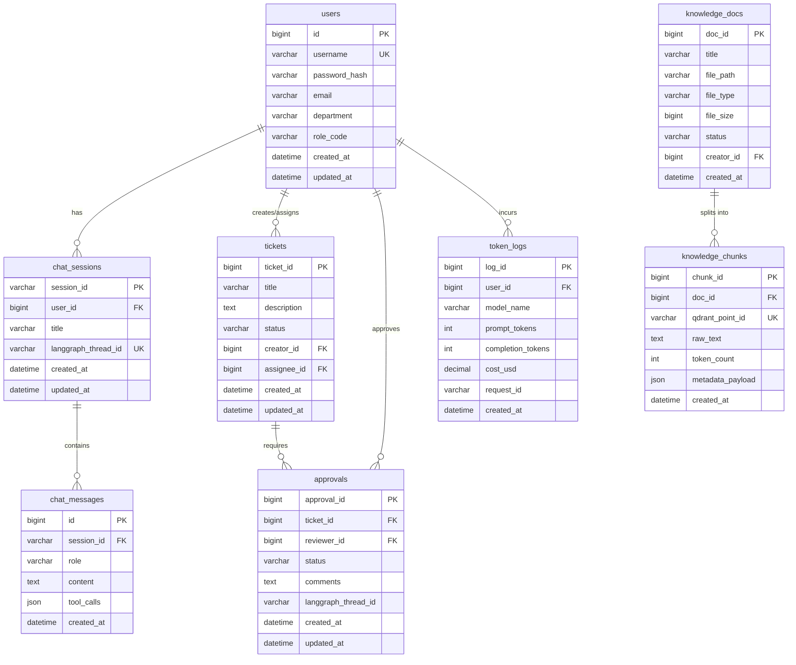

# Enterprise AI Digital Assistant - Database Schema Design
> 企业级 AI 数字员工平台数据库设计说明书 (V1.0)

---

## 1. 数据库总体设计

企业数字员工平台采用**关系型数据库 (MySQL 8.0)** 与**向量数据库 (Qdrant)** 双引擎架构。
- **MySQL** 负责核心业务实体（用户、工单、审批、文档元数据、审计日志、会话历史、ERP Mock 数据）的强一致性结构化存储，支持高并发 ACID 事务。
- **Qdrant** 负责海量文档分块 (Chunks) 的稠密向量（Embedding Vector）及负载数据 (Payload) 的高速相似度检索与过滤。

---

## 2. 关系型数据库 (MySQL) 设计

### 2.1 数据库物理实体关系图 (ER Diagram)



---

### 2.2 数据表结构清单

#### 2.2.1 用户表 (`users`)
存储系统用户身份、部门归属以及基于角色的访问权限（RBAC）。

| 字段名 | 数据类型 | 约束 | 默认值 | 说明 |
| :--- | :--- | :--- | :--- | :--- |
| `id` | `BIGINT` | PRIMARY KEY, AUTO_INCREMENT | - | 用户自增唯一标识 |
| `username` | `VARCHAR(64)` | UNIQUE, NOT NULL | - | 用户登录名 |
| `password_hash` | `VARCHAR(255)` | NOT NULL | - | 经过盐值加密的密码哈希 |
| `email` | `VARCHAR(128)` | UNIQUE, NULL | NULL | 电子邮箱，用于接受审批/通知 |
| `department` | `VARCHAR(64)` | NOT NULL | - | 所属部门（如 `R&D`, `Sales`, `HR`） |
| `role_code` | `VARCHAR(32)` | NOT NULL | 'EMPLOYEE' | 角色编码（如 `ADMIN`, `MANAGER`, `EMPLOYEE`） |
| `created_at` | `DATETIME` | NOT NULL | CURRENT_TIMESTAMP | 账号创建时间 |
| `updated_at` | `DATETIME` | NOT NULL | CURRENT_TIMESTAMP ON UPDATE | 账号更新时间 |

**SQL 定义：**
```sql
CREATE TABLE `users` (
    `id` BIGINT AUTO_INCREMENT COMMENT '用户自增唯一标识',
    `username` VARCHAR(64) NOT NULL COMMENT '用户登录名',
    `password_hash` VARCHAR(255) NOT NULL COMMENT '密码哈希',
    `email` VARCHAR(128) DEFAULT NULL COMMENT '邮箱',
    `department` VARCHAR(64) NOT NULL COMMENT '所属部门',
    `role_code` VARCHAR(32) NOT NULL DEFAULT 'EMPLOYEE' COMMENT '角色：ADMIN, MANAGER, EMPLOYEE',
    `created_at` DATETIME NOT NULL DEFAULT CURRENT_TIMESTAMP COMMENT '创建时间',
    `updated_at` DATETIME NOT NULL DEFAULT CURRENT_TIMESTAMP ON UPDATE CURRENT_TIMESTAMP COMMENT '修改时间',
    PRIMARY KEY (`id`),
    UNIQUE KEY `uk_username` (`username`),
    UNIQUE KEY `uk_email` (`email`),
    INDEX `idx_dept_role` (`department`, `role_code`)
) ENGINE=InnoDB DEFAULT CHARSET=utf8mb4 COLLATE=utf8mb4_unicode_ci COMMENT='系统用户表';
```

---

#### 2.2.2 会话表 (`chat_sessions`)
对应大模型对话交互的 Thread 实体，绑定 LangGraph 状态机检查点 ID。

| 字段名 | 数据类型 | 约束 | 默认值 | 说明 |
| :--- | :--- | :--- | :--- | :--- |
| `session_id` | `VARCHAR(64)` | PRIMARY KEY | - | 会话全局唯一 UUID |
| `user_id` | `BIGINT` | FOREIGN KEY | - | 关联用户 ID |
| `title` | `VARCHAR(128)` | NOT NULL | '新会话' | 会话默认标题 |
| `langgraph_thread_id` | `VARCHAR(128)` | UNIQUE, NOT NULL | - | 关联 LangGraph 的持久化 Thread ID |
| `created_at` | `DATETIME` | NOT NULL | CURRENT_TIMESTAMP | 创建时间 |
| `updated_at` | `DATETIME` | NOT NULL | CURRENT_TIMESTAMP | 活跃更新时间 |

**SQL 定义：**
```sql
CREATE TABLE `chat_sessions` (
    `session_id` VARCHAR(64) NOT NULL COMMENT '会话UUID',
    `user_id` BIGINT NOT NULL COMMENT '关联用户ID',
    `title` VARCHAR(128) NOT NULL DEFAULT '新会话' COMMENT '会话名称',
    `langgraph_thread_id` VARCHAR(128) NOT NULL COMMENT 'LangGraph Thread 关联主键',
    `created_at` DATETIME NOT NULL DEFAULT CURRENT_TIMESTAMP COMMENT '会话创建时间',
    `updated_at` DATETIME NOT NULL DEFAULT CURRENT_TIMESTAMP ON UPDATE CURRENT_TIMESTAMP COMMENT '最后修改时间',
    PRIMARY KEY (`session_id`),
    UNIQUE KEY `uk_thread_id` (`langgraph_thread_id`),
    CONSTRAINT `fk_sessions_user_id` FOREIGN KEY (`user_id`) REFERENCES `users` (`id`) ON DELETE CASCADE
) ENGINE=InnoDB DEFAULT CHARSET=utf8mb4 COLLATE=utf8mb4_unicode_ci COMMENT='会话主表';
```

---

#### 2.2.3 消息明细表 (`chat_messages`)
记录每轮对话的交互内容，以便进行流式渲染、历史追溯和微调数据导出。

| 字段名 | 数据类型 | 约束 | 默认值 | 说明 |
| :--- | :--- | :--- | :--- | :--- |
| `id` | `BIGINT` | PRIMARY KEY, AUTO_INCREMENT | - | 消息自增 ID |
| `session_id` | `VARCHAR(64)` | FOREIGN KEY | - | 会话外键 |
| `role` | `VARCHAR(16)` | NOT NULL | - | 角色类型: `system`, `user`, `assistant`, `tool` |
| `content` | `TEXT` | NULL | - | 消息纯文本内容 |
| `tool_calls` | `JSON` | NULL | - | 当角色为 assistant 时的工具调用 Payload 元组 |
| `created_at` | `DATETIME` | NOT NULL | CURRENT_TIMESTAMP | 写入时间 |

**SQL 定义：**
```sql
CREATE TABLE `chat_messages` (
    `id` BIGINT AUTO_INCREMENT COMMENT '消息自增ID',
    `session_id` VARCHAR(64) NOT NULL COMMENT '会话ID',
    `role` VARCHAR(16) NOT NULL COMMENT '消息角色：system, user, assistant, tool',
    `content` TEXT DEFAULT NULL COMMENT '消息文本',
    `tool_calls` JSON DEFAULT NULL COMMENT '工具调用明细(JSON)',
    `created_at` DATETIME NOT NULL DEFAULT CURRENT_TIMESTAMP COMMENT '产生时间',
    PRIMARY KEY (`id`),
    CONSTRAINT `fk_messages_session_id` FOREIGN KEY (`session_id`) REFERENCES `chat_sessions` (`session_id`) ON DELETE CASCADE
) ENGINE=InnoDB DEFAULT CHARSET=utf8mb4 COLLATE=utf8mb4_unicode_ci COMMENT='会话消息明细表';
```

---

#### 2.2.4 企业工单表 (`tickets`)
记录由 Agent 协助用户创建的待办事项。

| 字段名 | 数据类型 | 约束 | 默认值 | 说明 |
| :--- | :--- | :--- | :--- | :--- |
| `ticket_id` | `BIGINT` | PRIMARY KEY, AUTO_INCREMENT | - | 工单自增唯一主键 |
| `title` | `VARCHAR(128)` | NOT NULL | - | 工单标题 |
| `description` | `TEXT` | NOT NULL | - | 工单详细描述 |
| `status` | `VARCHAR(32)` | NOT NULL | 'PENDING' | 状态: `PENDING`, `APPROVED`, `PROCESSING`, `CLOSED` |
| `creator_id` | `BIGINT` | FOREIGN KEY | - | 创建者用户 ID |
| `assignee_id` | `BIGINT` | FOREIGN KEY, NULL | NULL | 被分配的审批人/处理人 ID |
| `created_at` | `DATETIME` | NOT NULL | CURRENT_TIMESTAMP | 创建时间 |
| `updated_at` | `DATETIME` | NOT NULL | CURRENT_TIMESTAMP | 修改时间 |

**SQL 定义：**
```sql
CREATE TABLE `tickets` (
    `ticket_id` BIGINT AUTO_INCREMENT COMMENT '工单ID',
    `title` VARCHAR(128) NOT NULL COMMENT '工单标题',
    `description` TEXT NOT NULL COMMENT '工单描述',
    `status` VARCHAR(32) NOT NULL DEFAULT 'PENDING' COMMENT 'PENDING, APPROVED, PROCESSING, CLOSED',
    `creator_id` BIGINT NOT NULL COMMENT '发起人ID',
    `assignee_id` BIGINT DEFAULT NULL COMMENT '负责人ID',
    `created_at` DATETIME NOT NULL DEFAULT CURRENT_TIMESTAMP COMMENT '创建时间',
    `updated_at` DATETIME NOT NULL DEFAULT CURRENT_TIMESTAMP ON UPDATE CURRENT_TIMESTAMP COMMENT '修改时间',
    PRIMARY KEY (`ticket_id`),
    INDEX `idx_ticket_status` (`status`),
    CONSTRAINT `fk_tickets_creator` FOREIGN KEY (`creator_id`) REFERENCES `users` (`id`),
    CONSTRAINT `fk_tickets_assignee` FOREIGN KEY (`assignee_id`) REFERENCES `users` (`id`)
) ENGINE=InnoDB DEFAULT CHARSET=utf8mb4 COLLATE=utf8mb4_unicode_ci COMMENT='企业业务工单表';
```

---

#### 2.2.5 审批表 (`approvals`)
针对关键敏感工具调用的中途拦截与审批流实体。

| 字段名 | 数据类型 | 约束 | 默认值 | 说明 |
| :--- | :--- | :--- | :--- | :--- |
| `approval_id` | `BIGINT` | PRIMARY KEY, AUTO_INCREMENT | - | 审批单 ID |
| `ticket_id` | `BIGINT` | FOREIGN KEY | - | 关联工单 ID |
| `reviewer_id` | `BIGINT` | FOREIGN KEY | - | 主管/审批人 ID |
| `status` | `VARCHAR(32)` | NOT NULL | 'PENDING' | 状态: `PENDING`, `APPROVED`, `REJECTED` |
| `comments` | `TEXT` | NULL | - | 审批评语 / 驳回理由 |
| `langgraph_thread_id` | `VARCHAR(128)` | NOT NULL | - | 当审批完成后唤醒状态机所需的 Thread ID |
| `created_at` | `DATETIME` | NOT NULL | CURRENT_TIMESTAMP | 创建时间 |
| `updated_at` | `DATETIME` | NOT NULL | CURRENT_TIMESTAMP | 审批处理时间 |

**SQL 定义：**
```sql
CREATE TABLE `approvals` (
    `approval_id` BIGINT AUTO_INCREMENT COMMENT '审批ID',
    `ticket_id` BIGINT NOT NULL COMMENT '关联工单ID',
    `reviewer_id` BIGINT NOT NULL COMMENT '主管/审核人ID',
    `status` VARCHAR(32) NOT NULL DEFAULT 'PENDING' COMMENT 'PENDING, APPROVED, REJECTED',
    `comments` TEXT DEFAULT NULL COMMENT '审核批注/驳回意见',
    `langgraph_thread_id` VARCHAR(128) NOT NULL COMMENT '中途唤醒对应的线程',
    `created_at` DATETIME NOT NULL DEFAULT CURRENT_TIMESTAMP COMMENT '发起时间',
    `updated_at` DATETIME NOT NULL DEFAULT CURRENT_TIMESTAMP ON UPDATE CURRENT_TIMESTAMP COMMENT '审批处理时间',
    PRIMARY KEY (`approval_id`),
    INDEX `idx_approval_status` (`status`),
    CONSTRAINT `fk_approvals_ticket` FOREIGN KEY (`ticket_id`) REFERENCES `tickets` (`ticket_id`) ON DELETE CASCADE,
    CONSTRAINT `fk_approvals_reviewer` FOREIGN KEY (`reviewer_id`) REFERENCES `users` (`id`)
) ENGINE=InnoDB DEFAULT CHARSET=utf8mb4 COLLATE=utf8mb4_unicode_ci COMMENT='审批决策流水表';
```

---

#### 2.2.6 知识库文档主表 (`knowledge_docs`)
记录用户上传到企业知识库中的原始文档元数据。

| 字段名 | 数据类型 | 约束 | 默认值 | 说明 |
| :--- | :--- | :--- | :--- | :--- |
| `doc_id` | `BIGINT` | PRIMARY KEY, AUTO_INCREMENT | - | 文档唯一标识 ID |
| `title` | `VARCHAR(255)` | NOT NULL | - | 文档标题（文件名） |
| `file_path` | `VARCHAR(512)` | NOT NULL | - | 文件在 S3/MinIO 中的存储相对路径 |
| `file_type` | `VARCHAR(32)` | NOT NULL | - | 后缀名（PDF, DOCX, XLSX, TXT 等） |
| `file_size` | `BIGINT` | NOT NULL | - | 文件字节大小 (Bytes) |
| `status` | `VARCHAR(32)` | NOT NULL | 'PARSING' | 状态: `PARSING`, `PARSED`, `FAILED` |
| `creator_id` | `BIGINT` | FOREIGN KEY | - | 上传人员 ID |
| `created_at` | `DATETIME` | NOT NULL | CURRENT_TIMESTAMP | 上传时间 |

**SQL 定义：**
```sql
CREATE TABLE `knowledge_docs` (
    `doc_id` BIGINT AUTO_INCREMENT COMMENT '文档唯一自增ID',
    `title` VARCHAR(255) NOT NULL COMMENT '文件名/标题',
    `file_path` VARCHAR(512) NOT NULL COMMENT '对象存储S3绝对路径',
    `file_type` VARCHAR(32) NOT NULL COMMENT '扩展名',
    `file_size` BIGINT NOT NULL COMMENT '文件字节大小',
    `status` VARCHAR(32) NOT NULL DEFAULT 'PARSING' COMMENT '解析中, 已解析, 失败',
    `creator_id` BIGINT NOT NULL COMMENT '创建者ID',
    `created_at` DATETIME NOT NULL DEFAULT CURRENT_TIMESTAMP COMMENT '上传时间',
    PRIMARY KEY (`doc_id`),
    CONSTRAINT `fk_docs_creator` FOREIGN KEY (`creator_id`) REFERENCES `users` (`id`)
) ENGINE=InnoDB DEFAULT CHARSET=utf8mb4 COLLATE=utf8mb4_unicode_ci COMMENT='知识库文档主表';
```

---

#### 2.2.7 文档分块关系表 (`knowledge_chunks`)
记录文档在切片（Chunking）并写入 Qdrant 后的对应关系，用以支持文档的增删改查。

| 字段名 | 数据类型 | 约束 | 默认值 | 说明 |
| :--- | :--- | :--- | :--- | :--- |
| `chunk_id` | `BIGINT` | PRIMARY KEY, AUTO_INCREMENT | - | 分块自增主键 |
| `doc_id` | `BIGINT` | FOREIGN KEY | - | 关联文档主键 |
| `qdrant_point_id` | `VARCHAR(64)` | UNIQUE, NOT NULL | - | 对应 Qdrant 中的 Point UUID |
| `raw_text` | `TEXT` | NOT NULL | - | 本分块的纯文本上下文 |
| `token_count` | `INT` | NOT NULL | - | 本分块的 Token 计数 |
| `metadata_payload` | `JSON` | NULL | - | 附属元数据（如章节、页码、OCR 信息） |
| `created_at` | `DATETIME` | NOT NULL | CURRENT_TIMESTAMP | 创建时间 |

**SQL 定义：**
```sql
CREATE TABLE `knowledge_chunks` (
    `chunk_id` BIGINT AUTO_INCREMENT COMMENT '分块ID',
    `doc_id` BIGINT NOT NULL COMMENT '文档ID',
    `qdrant_point_id` VARCHAR(64) NOT NULL COMMENT 'Qdrant端对应的Point ID',
    `raw_text` TEXT NOT NULL COMMENT '分块原文',
    `token_count` INT NOT NULL COMMENT 'Token数量',
    `metadata_payload` JSON DEFAULT NULL COMMENT 'Payload元数据备份',
    `created_at` DATETIME NOT NULL DEFAULT CURRENT_TIMESTAMP COMMENT '记录时间',
    PRIMARY KEY (`chunk_id`),
    UNIQUE KEY `uk_qdrant_point` (`qdrant_point_id`),
    CONSTRAINT `fk_chunks_doc_id` FOREIGN KEY (`doc_id`) REFERENCES `knowledge_docs` (`doc_id`) ON DELETE CASCADE
) ENGINE=InnoDB DEFAULT CHARSET=utf8mb4 COLLATE=utf8mb4_unicode_ci COMMENT='文档分块映射表';
```

---

#### 2.2.8 Token 用量审计表 (`token_logs`)
精确核算每次 API 请求带来的 Token 成本和金钱消耗。

| 字段名 | 数据类型 | 约束 | 默认值 | 说明 |
| :--- | :--- | :--- | :--- | :--- |
| `log_id` | `BIGINT` | PRIMARY KEY, AUTO_INCREMENT | - | 审计自增 ID |
| `user_id` | `BIGINT` | FOREIGN KEY | - | 触发问答的用户 ID |
| `model_name` | `VARCHAR(64)` | NOT NULL | - | 被调用的模型名称 |
| `prompt_tokens` | `INT` | NOT NULL | - | 输入 Token 数 |
| `completion_tokens` | `INT` | NOT NULL | - | 输出 Token 数 |
| `cost_usd` | `DECIMAL(10, 6)` | NOT NULL | - | 本次生成核算美元成本 |
| `request_id` | `VARCHAR(64)` | UNIQUE, NOT NULL | - | 模型返回的 API Request ID |
| `created_at` | `DATETIME` | NOT NULL | CURRENT_TIMESTAMP | 消费发生时间 |

**SQL 定义：**
```sql
CREATE TABLE `token_logs` (
    `log_id` BIGINT AUTO_INCREMENT COMMENT '用量自增ID',
    `user_id` BIGINT NOT NULL COMMENT '发生用户ID',
    `model_name` VARCHAR(64) NOT NULL COMMENT '调用模型',
    `prompt_tokens` INT NOT NULL COMMENT '输入Token',
    `completion_tokens` INT NOT NULL COMMENT '输出Token',
    `cost_usd` DECIMAL(10,6) NOT NULL COMMENT '核算成本(美元)',
    `request_id` VARCHAR(64) NOT NULL COMMENT 'API请求ID',
    `created_at` DATETIME NOT NULL DEFAULT CURRENT_TIMESTAMP COMMENT '记录时间',
    PRIMARY KEY (`log_id`),
    UNIQUE KEY `uk_request_id` (`request_id`),
    INDEX `idx_user_model_cost` (`user_id`, `model_name`, `cost_usd`),
    CONSTRAINT `fk_token_logs_user` FOREIGN KEY (`user_id`) REFERENCES `users` (`id`) ON DELETE CASCADE
) ENGINE=InnoDB DEFAULT CHARSET=utf8mb4 COLLATE=utf8mb4_unicode_ci COMMENT='Token用量审计表';
```

---

### 2.3 企业 ERP Mock 系统表设计
用以模拟真实的 ERP/HR 关系数据库，供 Function Calling 进行查询与变更。

#### 2.3.1 ERP 员工信息表 (`erp_employees`)
```sql
CREATE TABLE `erp_employees` (
    `emp_id` INT AUTO_INCREMENT COMMENT '员工工号',
    `name` VARCHAR(64) NOT NULL COMMENT '姓名',
    `email` VARCHAR(128) NOT NULL COMMENT '邮箱',
    `department` VARCHAR(64) NOT NULL COMMENT '部门',
    `position` VARCHAR(64) NOT NULL COMMENT '职位',
    `phone` VARCHAR(32) DEFAULT NULL COMMENT '电话',
    PRIMARY KEY (`emp_id`)
) ENGINE=InnoDB DEFAULT CHARSET=utf8mb4 COLLATE=utf8mb4_unicode_ci COMMENT='[MOCK] ERP 员工表';
```

#### 2.3.2 ERP 商品库存表 (`erp_inventory`)
```sql
CREATE TABLE `erp_inventory` (
    `item_code` VARCHAR(64) NOT NULL COMMENT '物料编码',
    `item_name` VARCHAR(128) NOT NULL COMMENT '物料名称',
    `quantity` INT NOT NULL DEFAULT 0 COMMENT '库存数量',
    `price` DECIMAL(10,2) NOT NULL COMMENT '单价',
    `location` VARCHAR(64) NOT NULL COMMENT '货架/仓库位置',
    PRIMARY KEY (`item_code`)
) ENGINE=InnoDB DEFAULT CHARSET=utf8mb4 COLLATE=utf8mb4_unicode_ci COMMENT='[MOCK] ERP 库存表';
```

#### 2.3.3 ERP 采购单表 (`erp_purchases`)
```sql
CREATE TABLE `erp_purchases` (
    `purchase_id` BIGINT AUTO_INCREMENT COMMENT '采购工单ID',
    `item_code` VARCHAR(64) NOT NULL COMMENT '采购物料编码',
    `quantity` INT NOT NULL COMMENT '数量',
    `total_price` DECIMAL(12,2) NOT NULL COMMENT '总金额',
    `applicant_id` BIGINT NOT NULL COMMENT '申请人工号',
    `status` VARCHAR(32) NOT NULL DEFAULT 'PENDING' COMMENT 'PENDING, APPROVED, REJECTED',
    `created_at` DATETIME NOT NULL DEFAULT CURRENT_TIMESTAMP,
    PRIMARY KEY (`purchase_id`)
) ENGINE=InnoDB DEFAULT CHARSET=utf8mb4 COLLATE=utf8mb4_unicode_ci COMMENT='[MOCK] ERP 采购订单表';
```

---

## 3. 向量数据库 (Qdrant) 设计

### 3.1 Qdrant 集合 (Collection) 结构
我们创建一个名为 `enterprise_knowledge` 的 Qdrant Collection：

- **向量维度 (Vector Dimension)**: 1024 维 (对应 BGE-M3 编码器输出)。
- **距离度量 (Distance Metric)**: Cosine (余弦相似度)。

### 3.2 Payload 元数据结构
为了支持基于多租户和部门权限的精细检索过滤，每一个写入 Qdrant 的 Point 都会携带以下 Payload：

```json
{
  "doc_id": 10287,
  "chunk_id": 98124,
  "department": "R&D",
  "category": "Security Policy",
  "security_level": "CONFIDENTIAL",
  "text": "本章节详细描述了企业核心代码资产的访问与备份规范。所有开发人员在提交代码至生产分支前，必须通过 SonarQube 安全扫描，并且获取至少两名高级工程师的 Review 同意。违者将依据安全条例进行处罚。",
  "created_at": "2026-07-21T15:50:00Z"
}
```

### 3.3 检索过滤索引 (Payload Indexing)
为提高海量检索效率，需在 Qdrant 中对过滤字段（Field）建立 Keyword / Integer 类型的 Payload Index：
- **`doc_id`**: 整数索引（用于文档级级联删除）。
- **`department`**: 关键字索引（用于跨部门数据隔离过滤）。
- **`security_level`**: 关键字索引（根据当前会话用户的密级鉴权，防止越权检索敏感知识）。
- **`category`**: 关键字索引（过滤知识库分类）。
