# Enterprise AI Digital Assistant - 前端现代化与 ChatGPT/Gemini 范式重构全景背书白皮书

> **项目名称**：企业级 AI 数字员工平台 - 现代化终端体验重塑与 Copilot 架构升级  
> **当前运行模式**：**FRONTEND MODERNIZATION MODE (前端工程演进与体验重构模式 · 规划就绪)**  
> **设计范式标准**：**ChatGPT / Gemini 极简沉浸式 Web 范式 + UI/UX Pro Max 企业级生产力标准**  
> **基准规范**：[docs/PROJECT_PROGRESS.md](file:///g:/LLM_Learning/product/docs/PROJECT_PROGRESS.md) · [docs/SPEC.MD](file:///g:/LLM_Learning/product/docs/SPEC.MD) · [AGENTS.md](file:///g:/LLM_Learning/product/AGENTS.md) · `ui-ux-pro-max`  
> **系统最后更新**：2026-09-23  

---

## 1. 全局进度与阶段规划全景看板 (Master Frontend Progress Dashboard)

```text
====================================================================================================
[PHASE 1: 基础骨架与设计系统]   ████████████████████████████████ 100% (Sprint F-01 & F-02 全部闭环)
[PHASE 2: 流式对话与自然思考]   ████████████████████████████████ 100% (Sprint F-03 & F-04 全部闭环)
[PHASE 3: 业务协同与待办中心]   ████████████████████████████████ 100% (Sprint F-05 & F-06 全部闭环)
[PHASE 4: 多端响应与硬化验收]   ████████████████████████████████ 100% (Sprint F-07 & F-08 全部闭环)
[PHASE 5: 原生体验与组件升维]   ████████████████████████████████ 规划就绪 (Sprint F-09: Vuebits 旗舰集成)
====================================================================================================
```

| 治理维度 | 当前基线状态 | 目标形态与合规标准 (ChatGPT/Gemini 范式) |
| :--- | :--- | :--- |
| **视觉与交互范式** | 单页调试态 (乱套、混杂开发黑话) | **极简沉浸式 Copilot 工作台 (类 ChatGPT / Gemini Web 架构)** |
| **开发术语脱敏** | 存在 `[WS状态]`、`TTFT`、`熔断器`、`节点代号` | **100% 抹除技术术语**，转化为自然人机语言与折叠知识胶囊 |
| **设计系统 (Design System)**| 硬编码深色样式，缺乏原子规范 | **基于 `ui-ux-pro-max` Slate-950 + 科技微光 + WCAG AA 调色板** |
| **图标与视觉元素** | 混用 Emoji (`💡`, `⚠️`, `⚙️`) | **100% 采用 Lucide 矢量 SVG 规范图标 (24x24 viewBox)** |
| **会话与状态管理** | 单一硬编码会话，不可切换 | **Pinia 集中化会话仓储，支持历史会话分组 (今天/昨天/前7天)** |
| **人机审批交互** | 原始 JSON 状态机拦截卡片 | **现代化企业审批协同凭据卡 (一键同意/驳回，直观审批流)** |
| **知识检索呈现** | 仅内部 Log 打印 | **Gemini 风格折叠小胶囊 (例: "⚡ 已核对 3 篇企业制度 · 展开来源")** |
| **端到端体验质量** | 输入卡顿、缺乏打字光标柔化 | **悬浮胶囊输入框、自适应高度、平滑打字光标、零布局抖动** |

---

## 2. 范式转换核准矩阵与“去开发化”规范 (Paradigm Shift & De-Jargon Rules)

依据用户明确要求，本重构计划严格确立 **“面向最终业务用户 (End-User Centric)”** 的铁律，所有界面元素执行如下映射转换：

```mermaid
graph TD
    subgraph Raw_Dev_Elements [原始开发与调试黑话 (彻底移除)]
        D1["[WS已连接] / [断开] 状态徽章"]
        D2["TTFT: 182ms / Tokens: 1,420"]
        D3["● ROUTER ● TOOL ● APPROVAL"]
        D4["LangGraph interrupt() 状态机挂起"]
        D5["熔断器: CLOSED / HALF_OPEN"]
        D6["ID: thread_ws_982312 会话流水号"]
    end

    subgraph User_Centric_Transform [ChatGPT / Gemini 范式转换引擎]
        T1["网络异常静默重试 / 仅断网时顶部极细通知条"]
        T2["后台静默追踪 / 用户界面零干扰"]
        T3["自然语言折叠胶囊: '已检索知识库与ERP库存'"]
        T4["企业审批协同卡: '需要主管审批确认'"]
        T5["自然降级话术: '系统繁忙，已为您转入离线工单'"]
        T6["智能自然标题: '2026 Q3 研发设备采购咨询'"]
    end

    subgraph Clean_UI_Experience [终端用户高品质体验]
        U1["干净无干扰的画布"]
        U2["高可读性 Markdown 流"]
        U3["直观高效的单据审批"]
    end

    D1 -.-> T1 --> U1
    D2 -.-> T2 --> U1
    D3 -.-> T3 --> U2
    D4 -.-> T4 --> U3
    D5 -.-> T5 --> U2
    D6 -.-> T6 --> U1
```

---

## 3. 架构蓝图与视口布局规范 (Layout Architecture & Wireframe)

界面严格遵循类似 **ChatGPT / Google Gemini** 的现代三段式弹性结构：

```text
┌─────────────────┬─────────────────────────────────────────────────────────────────────────────────────────┐
│  企业数字员工   │  [智能助手模式 ▼]  企业通用助手 (已接入企业内网知识库)                         [新建对话] [头像] │
├─────────────────┼─────────────────────────────────────────────────────────────────────────────────────────┤
│                 │                                                                                         │
│ [+ 新建对话]   │                                                                                         │
│                 │   👤 研发部 - 李工:                                                                     │
│ 【近期会话】    │   请帮我申请采购 1 台高配开发机 MacBook Pro 16，单价 22,999 元。                         │
│ 💬 设备采购申请  │                                                                                         │
│ 💬 IT网络故障排查│   -----------------------------------------------------------------------------------   │
│ 💬 员工入职指引  │                                                                                         │
│                 │   ✨ 数字员工助手:                                                                      │
│ 【我的协同】    │                                                                                         │
│ 📋 待我审批 (1) │   ┌ ⚡ 已参考《企业固定资产管理规章》并核对研发部硬件预算标准   [展开查看制度来源 ▼] ┐    │
│ 📚 规章制度检索 │   └───────────────────────────────────────────────────────────────────────────────┘     │
│                 │                                                                                         │
│                 │   已为您核对制度并生成设备采购申请单。依据公司财务制度，金额大于 ￥5,000 元需提交审批：   │
│                 │                                                                                         │
│                 │   ┌─────────────────────────────────────────────────────────────────────────┐           │
│                 │   │ 📋 大额采购审批确认单                                      单号: PR-20260922-01 │           │
│                 │   ├─────────────────────────────────────────────────────────────────────────┤           │
│                 │   │ • 申请物品: MacBook Pro 16 英寸 (M-Series)                              │           │
│                 │   │ • 采购总额: ￥22,999.00           • 申请部门: 研发部                      │           │
│                 │   │ • 申请事由: AI 数字人高算力本地调试与模型训练需求                       │           │
│                 │   ├─────────────────────────────────────────────────────────────────────────┤           │
│                 │   │ [输入审批批注意见 (可选)...                                           ] │           │
│                 │   │                                       [ 驳回申请 ]   [ 同意并提交采购 ] │           │
│                 │   └─────────────────────────────────────────────────────────────────────────┘           │
│                 │                                                                                         │
├─────────────────┼─────────────────────────────────────────────────────────────────────────────────────────┤
│ ⚙️ 系统偏好     │                 ┌───────────────────────────────────────────────────┐                   │
│ 👤 张经理 (研发)│                 │ 💭 发送消息给企业数字员工... (支持 Shift+Enter 换行)│ [⬆ 发送]          │
│ [◀ 收起侧边栏]  │                 └───────────────────────────────────────────────────┘                   │
│                 │                       内容由企业 AI 驱动生成，重要业务单据请以实际审批结论为准                  │
└─────────────────┴─────────────────────────────────────────────────────────────────────────────────────────┘
```

---

## 4. UI/UX Pro Max 设计系统规范 (Design System Tokens)

### 4.1 调色板与语义变量 (Color Palette)

基于 `ui-ux-pro-max` 推荐的沉浸式深色方案（Dark Mode / Slate 系列），确保对比度符合 **WCAG AA (≥ 4.5:1)**：

```css
:root {
  /* 基础底色层级 (Slate 系列) */
  --bg-sidebar:      #0b0f19; /* 侧边栏底色：极深邃蓝灰 */
  --bg-main:         #0f172a; /* 主画布底色：Slate-900 */
  --bg-card:         #1e293b; /* 对话卡片/气泡底色：Slate-800 */
  --bg-input:        #1e293b; /* 底部悬浮输入框背景 */

  /* 边框与微光 */
  --border-subtle:   rgba(255, 255, 255, 0.08); /* 极细分隔线 */
  --border-card:     rgba(255, 255, 255, 0.12); /* 卡片边缘 */
  --border-focus:    #3b82f6;                    /* 聚焦高亮蓝 */

  /* 文本对比阶梯 */
  --text-main:       #f8fafc; /* 主标题与正文：Slate-50 (对比度 > 10:1) */
  --text-secondary:  #94a3b8; /* 次要标签/说明：Slate-400 (对比度 > 5:1) */
  --text-muted:      #64748b; /* 提示符/微标注：Slate-500 */

  /* 业务语义品牌色 */
  --brand-primary:   #3b82f6; /* 主操作/发送按键：Blue-500 */
  --brand-gradient:  linear-gradient(135deg, #3b82f6 0%, #06b6d4 100%); /* AI 头像渐变 */
  --status-approval: #f59e0b; /* 审批警示：Amber-500 */
  --status-success:  #10b981; /* 审批通过/就绪：Emerald-500 */
  --status-danger:   #f43f5e; /* 驳回/中断：Rose-500 */
}
```

### 4.2 字体排印与图标规约 (Typography & Icons)

1. **字体选择**：
   - 文本界面：`'Inter', 'PingFang SC', 'Microsoft YaHei', sans-serif`
   - 代码与单号：`'Fira Code', 'JetBrains Mono', monospace`
2. **严禁系统 Emoji 乱入**：
   - 必须统一引入 `lucide-vue-next` 矢量 SVG 图标库。
   - 图标规格：统一 `24x24 viewBox`，尺寸规范为 `w-4 h-4` 或 `w-5 h-5`。
3. **微交互原则**：
   - 统一使用 `cursor-pointer`。
   - 所有 Hover 与焦点切换必须平滑（`transition-colors duration-150`），禁止任何改变尺寸（`scale`）导致的界面抖动。

---

## 5. 四大阶段退出门禁矩阵 (Phase Exit Gates 100% Verification)

```mermaid
graph LR
    subgraph Gate_Phase_1 [Gate 1: 基础骨架与设计系统]
        G1_1[Vue 3 目录规范重组<br/>Pinia 状态仓储建立]
        G1_2[ChatGPT 双栏骨架就绪<br/>可收起折叠 Sidebar]
        G1_3[消除全部 Emoji 图标<br/>全量集成 Lucide SVG]
    end

    subgraph Gate_Phase_2 [Gate 2: 沉浸式流式对话体验]
        G2_1[悬浮胶囊输入框<br/>Enter发送/Shift换行]
        G2_2[Gemini 风格折叠胶囊<br/>知识来源平滑展开]
        G2_3[断网隐式平滑重连<br/>移除原生 WS 状态]
    end

    subgraph Gate_Phase_3 [Gate 3: 企业业务协同中心]
        G3_1[自然语言审批卡片<br/>一键同意/驳回决策]
        G3_2[待办审批独立视图<br/>单据集中处理列表]
        G3_3[规章全文检索看板<br/>结构化阅读体验]
    end

    subgraph Gate_Phase_4 [Gate 4: 质量与体验终极验收]
        G4_1[Lighthouse 90+ 达标<br/>WCAG AA 4.5:1 对比度]
        G4_2[375px~1440px 响应式<br/>移动端抽屉抽拉自如]
        G4_3[全链路端到端体验通过<br/>签署前端投产白皮书]
    end

    subgraph Gate_Phase_5 [Gate 5: 原生体验与组件升维]
        G5_1[Vuebits 基础设施装配<br/>motion-v + Hugeicons]
        G5_2[ChatGPT/Claude 输入栏<br/>PromptBar 复合交互]
        G5_3[思维链与工具调用胶囊<br/>ThoughtLine + CallChip]
    end

    Gate_Phase_1 --> Gate_Phase_2 --> Gate_Phase_3 --> Gate_Phase_4 --> Gate_Phase_5
```



| 门禁代号 | 验证内容与核心指标 | 预期达标标准 | 验收方式 |
| :--- | :--- | :--- | :---: |
| **Gate 1** | 设计系统原子与双栏框架 | 侧边栏流畅折叠收拢，无样式冲突，全局无 Emoji 伪图标 | 交互走查 + 代码审查 |
| **Gate 2** | 自然打字流与思考胶囊 | 流式 Token 渲染平滑无抖动，来源折叠胶囊展开丝滑，开发术语 100% 消除 | 双工流式 E2E 验证 |
| **Gate 3** | 人机协同审批与待办箱 | 大额采购单据 100% 渲染业务化卡片，支持恢复 LangGraph 执行 | 审批决策实测闭环 |
| **Gate 4** | 响应式与可访问性验收 | 覆盖移动端/平板/桌面端，Lighthouse 性能 > 90，暗色对比度 > 4.5:1 | 自动化巡检与签发 |
| **Gate 5** | 原生体验与 Vuebits 动效升维 | ChatGPT/Claude 旗舰级交互组件（PromptBar, ThoughtLine, CallChip, VoicePill）集成，全链路动效 60 FPS 且零布局抖动 | 交互走查 + 构建验证 |

---

## 6. ChatGPT / Claude 原生 Web 界面逆向分析与 Vuebits 旗舰选型 (Reverse-Engineering & Vuebits Selection)

为了让企业级 AI 数字员工平台在完成基础现代化后，进一步跃升至与 **ChatGPT (GPT-4o / o1 / o3 / Advanced Voice)** 及 **Claude (Claude 3.5 / 3.7 Extended Thinking / Artifacts)** 原生旗舰级 Web 视口并驾齐驱的顶级交互体验，本架构通过 `shadcn mcp` 对官方 `@vue-bits` 注册表（197 项高保真动效组件）进行了深度逆向选型与架构映射。

### 6.1 顶级 AI 对话界面原生体验逆向剖析 (Architecture Decomposition)

```text
┌──────────────────────────────────────────────────────────────────────────────────────────────────┐
│                                Claude & ChatGPT 原生交互解构图谱                                  │
├──────────────────────────────────────────────────────────────────────────────────────────────────┤
│ 1. 侧边栏/项目抽屉 (LineSidebar + FolderFloat)                                                    │
│    ├── 光标邻近微动效应 (Cursor Proximity Hover)                                                  │
│    └── 知识库/项目悬浮文件夹 (Tilting Flap & Floating Card Cloud)                                    │
│                                                                                                  │
│ 2. 模式与模型选择 (GlideSelect + RubberSegment)                                                   │
│    ├── 浮动角落弹出、平滑滑行高光记忆 (Gliding Model Picker: Claude 3.7 / GPT-4o)                    │
│    └── 橡胶弹性物理分段切换 (Squash & Stretch: Standard / Extended Thinking / Deep Research)       │
│                                                                                                  │
│ 3. 思维链与推理流 (ThoughtLine + LatticeLoader)                                                   │
│    ├── 呼吸微光图标 + 实时毫秒/秒表计时 (Live Stopwatch & Breathing Sparkle)                     │
│    └── 推理步骤流式展开，完成时模糊交叉淡入收拢 ("Thought for 4.2s" Blur Crossfade)              │
│                                                                                                  │
│ 4. 行内工具调用与 Agent 状态 (CallChip + StatusMark)                                              │
│    ├── 擦除进度填充 + 毫秒计时 + 翠绿对勾 / 震颤红重试 (Wipe Progress & Live Counter)            │
│    └── 20px 状态形变图符 (Dashed Ring -> Spinning Arc -> Tick/Cross)                              │
│                                                                                                  │
│ 5. 复合型多模态输入栏 (PromptBar + VoicePill)                                                     │
│    ├── @ 数据源检索菜单 + / 内置指令菜单 + 附件 + 模型与思考预算选择                              │
│    ├── 输入即充能 (Ink Charge Send Button) ➔ 生成中自动形变为停止方块 (Stop Square)               │
│    └── 录音波形电平胶囊 (Audio Equalizer Bars + Live Elapsed Time + Slide to Cancel)              │
└──────────────────────────────────────────────────────────────────────────────────────────────────┘
```

### 6.2 核心交互层级与 Vuebits 组件挑选映射矩阵

| ChatGPT / Claude 原生交互特性 | 原生体验特征与痛点 | 🎯 推荐 `@vue-bits` 组件 | 核心特性与技术规格 |
| :--- | :--- | :--- | :--- |
| **1. 复合型多模态输入栏 (Composer)** | 浮动大圆角底栏、自动增高输入框、`@`唤起知识库/数据源、`/`内置指令、动态充能/停止发送按钮 | **`@vue-bits/PromptBar`** | **终极 AI 对话框**：原生内置 `@` sources 菜单、`/` commands 菜单、模型/思考强度选择、附件、语音录制。发送按钮在有输入时平滑充能（Ink Charge），生成中自动变形为停止方块（Stop Square）。 |
| **2. 思考链路与推理流 (CoT / Extended Thinking)** | ChatGPT o1/o3 的 `"Thought for 12s"` 与 Claude 3.7 的折叠思维流，呼吸微光、实时秒表计时、逐步展开收起 | **`@vue-bits/ThoughtLine`** | **原生思维链折叠头**：思索微光图标 + 实时毫秒/秒表跳动 + 逐步展开推理步骤。思考完成时以一个节拍的模糊交叉淡入（Blur Crossfade）收起为 `"Thought for 4.2s"`。 |
| **3. 工具调用胶囊 (Tool Calls / Search / Python)** | ChatGPT 网页搜索、代码执行器胶囊；Claude 工具执行态，带实时毫秒耗时与状态反馈 | **`@vue-bits/CallChip`** | **行内工具调用芯片**：胶囊背景随进度平滑擦除填充（Wipe），实时 ms 计数，执行成功泛出绿色微光与对勾，失败时微震抖动变红提示重试。 |
| **4. 语音输入与高级语音模式 (Voice Pill)** | ChatGPT 移动端与网页麦克风，录音时展开波形振幅、计时器与上滑取消交互 | **`@vue-bits/VoicePill`** | **语音胶囊**：按下或切换时展开为彩色微光胶囊，展示真实/模拟音频电平波形柱、耗时时钟，支持滑动取消与多档灵敏度。 |
| **5. 模型切换与思考强度 (Model Picker)** | 顶部/底栏切换模型（GPT-4o、o1、Claude 3.7），带平滑悬停与分级选项 | **`@vue-bits/GlideSelect`** | **角落弹出选择器**：单个悬停高光块在选项行间平滑滑行（Gliding Highlight），具备记忆锚点，重入时从上次位置划入而非突兀重绘。 |
| **6. 模式切换器 (Standard / Deep / Research)** | 切换“标准对话”、“深度思考 (Thinking)”、“深度搜索 (Deep Research)”、“Canvas” | **`@vue-bits/RubberSegment`** | **橡胶弹性分段器**：拖拽或轻触时滑块在插槽间拉伸、挤压（Squash & Stretch）与动量甩投，带来高级拟物物理反馈。 |
| **7. 侧边栏会话历史 (Conversation History)** | 极简侧边栏列表，光标滑过时的细腻微动与条目聚焦反馈 | **`@vue-bits/LineSidebar`** | **光标邻近效应侧边栏**：列表条目根据光标距离（Proximity）产生平滑微位移与流光高亮，操作沉浸感极强。 |
| **8. 项目/知识库抽屉 (Projects & Artifacts)** | Claude Projects 独立文档库，悬停打开多篇文档卡片流 | **`@vue-bits/FolderFloat`** | **浮动文件夹**：悬停或轻按时翻盖前倾，内部笔记与文档弹飞成浮动卡片云供用户选择，关闭时平滑沉降回文件夹。 |
| **9. Agent 任务步骤标记 (Task & Artifact Status)** | 复杂任务规划步骤状态指示符（待执行、运行中、已完成、失败） | **`@vue-bits/StatusMark`** | **20px 状态变形图符**：从虚线待命圆环平滑转为旋转进度圆弧，最终勾勒出对勾或叉号，自带文字删除线联动。 |
| **10. 共享延迟工具提示 (Warm Tooltip)** | 避免鼠标快速扫过工具栏时频繁闪烁造成视觉疲劳 | **`@vue-bits/WarmTooltip`** | **热启动工具提示群组**：首个提示防误触延迟弹出，组内其他按钮立即无缝响应，带移动速度倾角。 |
| **11. 尊贵版视觉标识 (Plus / Pro Badge)** | ChatGPT Plus / Claude Pro 徽章金属反光质感 | **`@vue-bits/ShinyText`** | **金属高光流光文本**：光泽线条在字面平滑扫过，用于模型级别标签与企业版尊享标识。 |
| **12. 操作撤销安全保护 (Undo on Burning Fuse)** | 误触“清空历史”或“回滚重新生成”时的倒计时撤销按钮 | **`@vue-bits/FuseButton`** | **燃烧引线撤销键**：触发后文本变为 Undo 并燃烧细发丝引线进度条，倒计时结束前按 Esc 或点击可一键回滚。 |

### 6.3 shadcn 一键安装命令 (CLI Installation)

通过项目已接入的 `@vue-bits` 注册表，在终端直接运行以下指令即可全量拉取：

```bash
npx shadcn@latest add @vue-bits/PromptBar @vue-bits/ThoughtLine @vue-bits/CallChip @vue-bits/StatusMark @vue-bits/VoicePill @vue-bits/GlideSelect @vue-bits/RubberSegment @vue-bits/LineSidebar @vue-bits/FolderFloat @vue-bits/WarmTooltip @vue-bits/ShinyText @vue-bits/FuseButton
```

> **底层依赖说明**：`@vue-bits` 组件基于 `motion-v` (v1.10+) 物理动效引擎与 `@hugeicons/vue` 矢量图标系统构建，执行 add 命令时将自动注入相关依赖。

---

## 7. Sprint F-01 ~ F-09 前端里程碑规划与标准提示词模板库

本计划将重构工程细化为 9 个敏捷 Sprint，每个 Sprint 提供精准的执行目标与指派提示词，后续执行时可按需取用：

| 里程碑代号 | 核心交付内容 | 涉及主要文件与资产 | 状态 |
| :--- | :--- | :--- | :---: |
| **Sprint F-01** | 设计系统重塑、依赖装配与 Tailwind 色彩原子定义 | `package.json`, `src/index.css`, `tailwind.config.js`, `src/router/` | ✅ CLOSED (Score: 98) |
| **Sprint F-02** | ChatGPT 式折叠侧边栏、顶栏与会话状态 Pinia 仓储 | `src/components/layout/Sidebar.vue`, `src/components/layout/Header.vue` | ✅ CLOSED (Score: 99) |
| **Sprint F-03** | Gemini 风格思考折叠胶囊与无黑话消息渲染组件 | `src/components/chat/MessageItem.vue`, `src/components/chat/ThoughtBadge.vue` | ✅ CLOSED (Score: 99) |
| **Sprint F-04** | 底部居中悬浮输入框、多行自适应撑高与平滑中止 (Abort) | `src/components/chat/ChatInput.vue`, `src/composables/useChatStream.js` | ✅ CLOSED (Score: 99) |
| **Sprint F-05** | 原生企业协同审批卡片与 LangGraph 人机无感中断对接 | `src/components/chat/ApprovalCard.vue`, `src/stores/approvalStore.js` | ✅ CLOSED (Score: 99) |
| **Sprint F-06** | 独立“待我审批”与“规章检索”业务工作区视图 | `src/views/ApprovalListView.vue`, `src/views/KnowledgeView.vue` | ✅ CLOSED (Score: 99) |
| **Sprint F-07** | 移动端折叠抽屉与 375px~1440px 响应式断点适配 | `src/components/layout/MobileDrawer.vue`, `src/App.vue` | ✅ CLOSED (Score: 99) |
| **Sprint F-08** | 全链路走查、Lighthouse 调优与终极体验验收签发 | `tests/frontend/e2e/`, `docs/FRONTEND_SIGNOFF.md` | ✅ CLOSED (Score: 100) |
| **Sprint F-09** | ChatGPT / Claude 原生交互与 Vuebits 旗舰动效组件集成 | `components.json`, `@vue-bits/*`, `ChatView.vue`, `ThoughtLine`, `PromptBar` | 规划就绪 (Ready for Dispatch) |

---

### 7.1 Sprint F-01 提示词模板：`Prompt-Frontend-Sprint-01-DesignSystemAndShell`

```markdown
请按照 Harness Engineering 与 UI/UX Pro Max 规范指派 Sprint F-01：“设计系统重塑、依赖装配与 Tailwind 色彩原子定义”。

【工程目标】：
为前端项目引入现代组件库与矢量图标，确立沉浸式 Slate-950 设计系统底层变量，配置 Pinia 状态仓储与 Vue Router 骨架，确保暗色模式下对比度符合 WCAG AA (≥ 4.5:1)。

【落实步骤 (Step-by-Step Flow)】：
- Step 1 [依赖装配与锁存]：在 `frontend/package.json` 中引入 `lucide-vue-next` (v0.344+)、`pinia` (v2.1+)、`vue-router` (v4.3+)，执行安装并固化依赖。
- Step 2 [CSS 变量与原子样式]：重写 `frontend/src/index.css`，定义 `--bg-sidebar`, `--bg-main`, `--bg-card`, `--border-subtle`, `--text-main`, `--brand-primary` 等语义化设计变量，重置滚动条样式为细长半透明滑块，统一平滑字体抗锯齿。
- Step 3 [Tailwind 主题扩展]：更新 `frontend/tailwind.config.js`，将 CSS 变量注入 Tailwind 的 `colors` 映射，建立 `slate-950` 底色层级与渐变色阶，配置 `transition-colors duration-150` 微交互。
- Step 4 [主应用实例改造]：改造 `frontend/src/main.js`，注册 Pinia 根仓储，挂载路由实例，挂载全局指令与主题类。
- Step 5 [构建校验与证据归档]：在 `frontend/` 下运行 `npm run build`，确保 0 构建警告与 0 类型错误，输出结果并归档至 `.harness/runs/Sprint-F-01/`。

【落实组件与核心资产】：
1. `frontend/package.json`: 依赖声明 (`lucide-vue-next`, `pinia`, `vue-router`)。
2. `frontend/src/index.css`: 语义 CSS Tokens、WCAG AA 颜色阶梯、平滑光标与滚动条样式。
3. `frontend/tailwind.config.js`: 主题色阶映射与原子类扩展。
4. `frontend/src/main.js`: Pinia 与 Router 全局注入。
```

---

### 7.2 Sprint F-02 提示词模板：`Prompt-Frontend-Sprint-02-CollapsibleSidebarAndSessions`

```markdown
请按照 Harness Engineering 与 UI/UX Pro Max 规范指派 Sprint F-02：“ChatGPT 式折叠侧边栏、顶栏与会话状态 Pinia 仓储”。

【工程目标】：
构建类似 ChatGPT 的左侧全局导航与顶部轻量沉浸栏，实现多会话集中管理（分组切换、新建、删除）与侧边栏平滑折叠，彻底剥离技术流水号。

【落实步骤 (Step-by-Step Flow)】：
- Step 1 [会话状态仓储构建]：编写 `frontend/src/stores/chatStore.js`，管理 `sessions` 列表、当前 `activeSessionId`，按【今天/昨天/前7天】时间跨度计算会话分组，支持 `createSession()`, `switchSession()`, `deleteSession()` 及智能重命名。
- Step 2 [折叠侧边栏组件开发]：开发 `frontend/src/components/layout/Sidebar.vue`，实现 `w-64` 到紧凑栏/隐藏的平滑过渡 (`transition-all duration-200 ease-out`)，渲染 [+ 新建对话] 按钮、会话分组列表、“待我审批”与“规章检索”业务入口，底部展示当前用户信息。
- Step 3 [轻量沉浸顶栏开发]：开发 `frontend/src/components/layout/Header.vue`，集成侧栏展开/收起汉堡按钮、数字员工模式切换下拉菜单、清爽头像，彻底抹除任何 `thread_ws_...` 技术代号，仅在网络中断时展示微量通知。
- Step 4 [主视口骨架组装]：重组 `frontend/src/App.vue`，使用弹性 Flex 双栏布局联动侧栏与主聊天视口，保证在不同视口宽度下零布局抖动。
- Step 5 [构建走查与归档]：执行 `npm run build`，走查侧栏折叠 60 FPS 平滑度，将全量证据归档至 `.harness/runs/Sprint-F-02/`。

【落实组件与核心资产】：
1. `src/stores/chatStore.js`: 会话状态管理与时间维度分组。
2. `src/components/layout/Sidebar.vue`:
   - Props: `isCollapsed: Boolean`
   - Emits: `update:isCollapsed`, `newSession`, `selectSession(id)`
   - Lucide 图标: `MessageSquare`, `Plus`, `ChevronLeft`, `ChevronRight`, `ClipboardList`, `BookOpen`, `Settings`, `User`
3. `src/components/layout/Header.vue`:
   - Props: `activeSessionTitle: String`, `sidebarCollapsed: Boolean`
   - Emits: `toggleSidebar`
   - Lucide 图标: `Menu`, `Bot`, `ChevronDown`, `User`
4. `src/App.vue`: 双栏自适应容器与路由插槽。
```

---

### 7.3 Sprint F-03 提示词模板：`Prompt-Frontend-Sprint-03-GeminiThoughtAndMessageStream`

```markdown
请按照 Harness Engineering 与 UI/UX Pro Max 规范指派 Sprint F-03：“Gemini 风格思考折叠胶囊与无黑话消息渲染组件”。

【工程目标】：
将底层的 LangGraph 节点事件流 (`node_start`, `tool_log`) 重构为 Gemini 风格的自然语言思考胶囊，彻底清除 `● ROUTER`、`● TOOL`、`TTFT` 等技术黑话，提供打字机光标动画与优雅 Markdown 渲染。

【落实步骤 (Step-by-Step Flow)】：
- Step 1 [思考与知识来源胶囊]：开发 `frontend/src/components/chat/ThoughtBadge.vue`，在 AI 检索中展示微呼吸动画（`⚡ 正在核对企业规章制度与库存...`）；检索完成后自动收缩为优雅折叠胶囊（`⚡ 已参考 2 篇规章制度 · 展开查看来源`），点击时平滑展开制度片段与引用卡片。
- Step 2 [去黑话消息气泡重塑]：重构 `frontend/src/components/chat/MessageItem.vue`，抹杀所有技术调试代号；为 AI 角色输出配置平滑打字光标 (`typing-cursor`)；采用 Slate-800 气泡与主正文对比度 > 10:1；集成代码高亮与表格排版。
- Step 3 [流式视口容器升级]：改造 `frontend/src/components/chat/ChatContainer.vue`，实现新消息到达自动平滑滚底、用户向上滚动时暂停自动滚动、触底按钮浮现等人性化交互。
- Step 4 [端到端流式走查]：连接本地 WebSocket 流，验证流式 Token 吐字平滑度与折叠胶囊展开动画，确保无任何纵向跳跃。
- Step 5 [构建验证与证据归档]：运行 `npm run build`，捕获渲染截图与控制台日志，归档至 `.harness/runs/Sprint-F-03/`。

【落实组件与核心资产】：
1. `src/components/chat/ThoughtBadge.vue`:
   - Props: `status: 'thinking' | 'completed'`, `sources: Array<{ title: string, doc_id: string, snippet: string }>`
   - Lucide 图标: `Sparkles`, `ChevronDown`, `ChevronUp`, `FileText`, `ExternalLink`
   - 交互: 点击平滑抽屉展开，禁止 `scale` 变形。
2. `src/components/chat/MessageItem.vue`:
   - Props: `message: { role: 'user' | 'assistant', content: string, thoughts?: array, isStreaming?: boolean }`
   - 特性: 100% 抹杀开发黑话，打字机动画光标。
3. `src/components/chat/ChatContainer.vue`:
   - 消息流滚动视口与沉浸式空状态占位图。
```

---

### 7.4 Sprint F-04 提示词模板：`Prompt-Frontend-Sprint-04-FloatingCapsuleInputAndAbort`

```markdown
请按照 Harness Engineering 与 UI/UX Pro Max 规范指派 Sprint F-04：“底部居中悬浮输入框、多行自适应撑高与平滑中止 (Abort)”。

【工程目标】：
打造对标 ChatGPT 的居中悬浮输入胶囊，实现输入框多行自适应伸缩（44px~200px 零抖动）、Enter 发送 / Shift+Enter 换行，流式输出时平滑变形为“⏹ 停止生成”按钮并对接中止机制。

【落实步骤 (Step-by-Step Flow)】：
- Step 1 [双工与中止网络层抽象]：编写 `frontend/src/composables/useChatStream.js`，封装 WebSocket 连接生命周期、心跳保活、流式 Token 拼接，以及调用后端 `/api/v1/chat/abort` 实现生成中断。
- Step 2 [悬浮输入框组件开发]：开发 `frontend/src/components/chat/ChatInput.vue`，居中对齐 (`max-w-3xl`) 浮动于主视口底部，带有 `box-shadow: 0 10px 25px -5px rgba(0,0,0,0.4)` 柔和微光，内嵌自适应高度 `<textarea>`。
- Step 3 [多行自适应与按键防抖]：通过 `input` 事件动态计算 `scrollHeight`，在 44px 至 200px 间自动增高，超过 200px 优雅展现内置细滚动条；监听键盘事件区分 Enter 与 Shift+Enter。
- Step 4 [停止生成形变交互]：当 `isStreaming === true` 时，右侧发送图标平滑变形为中性红色停止图标（`Square`），点击立刻触发 Abort 并恢复输入态。
- Step 5 [构建验证与证据归档]：运行 `npm run build`，测试快速输入与长文本换行表现，归档至 `.harness/runs/Sprint-F-04/`。

【落实组件与核心资产】：
1. `src/components/chat/ChatInput.vue`:
   - Props: `isStreaming: Boolean`, `disabled: Boolean`
   - Emits: `send(content: string)`, `abort`
   - Lucide 图标: `ArrowUp`, `Square`, `Paperclip`
   - 底部提示: *“内容由企业 AI 驱动生成，关键业务决策请以审批单据为准”*
2. `src/composables/useChatStream.js`:
   - 组合式双工流与主动中断 Hook。
```

---

### 7.5 Sprint F-05 提示词模板：`Prompt-Frontend-Sprint-05-NaturalApprovalCardAndQueue`

```markdown
请按照 Harness Engineering 与 UI/UX Pro Max 规范指派 Sprint F-05：“原生企业协同审批卡片与 LangGraph 人机无感中断对接”。

【工程目标】：
将 LangGraph 底层的 `interrupt()` 状态机挂起事件彻底重塑为现代企业协同凭据卡片，提供品名、高亮金额、申请人、批注框与一键同意/驳回决策，无缝恢复后端图执行。

【落实步骤 (Step-by-Step Flow)】：
- Step 1 [审批数据仓储构建]：编写 `frontend/src/stores/approvalStore.js`，管理待审批列表、审批历史，并封装 `POST /api/v1/approval/action` 决策提交请求。
- Step 2 [业务凭据卡片开发]：重塑 `frontend/src/components/chat/ApprovalCard.vue`，消除“LangGraph 状态机已挂起”字样，顶部显示采购审批单号，中段标明采购物品、申请部门、申请事由与高亮金额（琥珀色/金橘色）。
- Step 3 [批注与一键决策交互]：提供可选批注意见输入框，右下角配置【同意并提交采购】（Emerald 绿主按键）与【驳回申请】（Rose 红辅助按键）。
- Step 4 [状态流转与无感恢复]：点击决策后，卡片立即进入只读结单态，显示“✅ 已批准 · 审批人：张经理”，并通过 WebSocket 发送 `resume` 事件，触发 AI 继续流式输出后续工单号与 ERP 结果。
- Step 5 [构建验证与证据归档]：执行 `npm run build`，走查大额采购完整触发与恢复流，归档至 `.harness/runs/Sprint-F-05/`。

【落实组件与核心资产】：
1. `src/components/chat/ApprovalCard.vue`:
   - Props: `approval: { id: string, title: string, item_name: string, amount: number, department: string, reason: string, status: 'PENDING' | 'APPROVED' | 'REJECTED' }`
   - Emits: `decision(id: string, action: 'approve' | 'reject', comment: string)`
   - Lucide 图标: `FileCheck`, `Check`, `X`, `AlertCircle`
2. `src/stores/approvalStore.js`:
   - 集中式待办审批池与动作分发器。
```

---

### 7.6 Sprint F-06 提示词模板：`Prompt-Frontend-Sprint-06-KnowledgeQueryWorkspace`

```markdown
请按照 Harness Engineering 与 UI/UX Pro Max 规范指派 Sprint F-06：“独立待办审批与企业规章检索工作区视图”。

【工程目标】：
为用户构建除对话流之外的集中待办单据工作台与企业规章制度全文检索看板，并在侧边栏提供实时未读红点徽标联动。

【落实步骤 (Step-by-Step Flow)】：
- Step 1 [路由体系扩展]：完善 `frontend/src/router/index.js`，配置 `/` (对话主台)、`/approvals` (待办中心)、`/knowledge` (规章看板) 3 大核心路由及切换过渡动效。
- Step 2 [待办审批集中工作台]：开发 `frontend/src/views/ApprovalListView.vue`，展示待处理与已处理单据表格/卡片流，支持按部门与状态筛选，提供单据一键快速批准。
- Step 3 [规章全文阅读与检索器]：开发 `frontend/src/views/KnowledgeView.vue`，左侧罗列 6 篇官方制度目录树（差旅/采购/入职/报销等），右侧为 Markdown 渲染视口并支持关键词全文高亮搜索。
- Step 4 [侧边栏徽标动态联动]：在 `Sidebar.vue` 中绑定 `approvalStore.pendingCount`，有待办事项时动态显示柔和红点徽标 (Badge)。
- Step 5 [构建验证与证据归档]：运行 `npm run build`，验证 3 大路由切换无跳动、数据状态保持，归档至 `.harness/runs/Sprint-F-06/`。

【落实组件与核心资产】：
1. `src/views/ApprovalListView.vue`: 待审批流统一处理与批量操作中心。
2. `src/views/KnowledgeView.vue`: 企业规章制度在线阅览与多路检索高亮视口。
3. `src/router/index.js`: Vue 3 路由守卫与懒加载映射。
4. `src/components/layout/Sidebar.vue`: 增加 Badge 响应式未读数显示。
```

---

### 7.7 Sprint F-07 提示词模板：`Prompt-Frontend-Sprint-07-ResponsiveMobileDrawerAndTheme`

```markdown
请按照 Harness Engineering 与 UI/UX Pro Max 规范指派 Sprint F-07：“移动端折叠抽屉与 375px~1440px 响应式断点适配”。

【工程目标】：
确保系统在 iPhone 手机端 (375px)、iPad 平板与桌面宽屏 (1440px) 下具备一流的多端自适应体验，实现触控抽屉与软键盘防遮挡。

【落实步骤 (Step-by-Step Flow)】：
- Step 1 [移动端遮罩抽屉组件]：开发 `frontend/src/components/layout/MobileDrawer.vue`，在 `< 768px` 视口下自动接管侧边栏，支持左侧滑动呼出与半透明暗色遮罩背景点击收拢。
- Step 2 [响应式断点全面适配]：调整主聊天视口、审批卡片与顶栏在 `sm`, `md`, `lg`, `xl` 各断点下的内边距与最大宽度，确保手机端聊天气泡最大宽度占比合理 (90%)。
- Step 3 [移动端虚拟键盘防遮挡]：利用 `visualViewport` API 监听移动端软键盘弹起，动态调节底部输入框视口吸附高度，防止输入框被遮挡。
- Step 4 [触控微交互合规走查]：走查移动端所有按键热区，确保每个可点击元素的触控面积均 ≥ 44x44px，并带有 `touch-action: manipulation` 防缩放延迟。
- Step 5 [构建验证与证据归档]：执行 `npm run build`，在 Chrome DevTools 模拟多款机型（iPhone 14/15, iPad Air, 1080P/2K Monitor）走查，归档至 `.harness/runs/Sprint-F-07/`。

【落实组件与核心资产】：
1. `src/components/layout/MobileDrawer.vue`:
   - Props: `modelValue: Boolean` (抽屉开合状态)
   - Emits: `update:modelValue`
   - Lucide 图标: `X`, `LogOut`, `ChevronRight`
2. `src/components/chat/ChatInput.vue`: 移动端键盘弹出高度动态吸附计算。
3. `src/index.css`: 移动端专用触控优化与暗色抽屉微阴影。
```

---

### 7.8 Sprint F-08 提示词模板：`Prompt-Frontend-Sprint-08-E2EUXHardeningAndDelivery`

```markdown
请按照 Harness Engineering 与 UI/UX Pro Max 规范指派 Sprint F-08：“全链路走查、Lighthouse 调优与终极体验验收签发”。

【工程目标】：
对照 UI/UX Pro Max 预交付清单进行全景体验走查、Lighthouse 性能跑分调优、端到端全链路自动化闭环验证，并正式撰写签发前端验收白皮书。

【落实步骤 (Step-by-Step Flow)】：
- Step 1 [全站黑话 0 容忍静态扫描]：编写脚本全面扫描 `frontend/src/` 中的全量文本与组件模板，彻底确认 0 处技术黑话残留（WS状态、TTFT、Token数、ROUTER代号、熔断器、thread流水号）。
- Step 2 [Lighthouse 性能与无障碍调优]：优化静态资源引入、开启路由懒加载与字体本地化，确保 Lighthouse 跑分：Performance ≥ 90, Accessibility ≥ 95, Best Practices ≥ 90。
- Step 3 [全链路端到端体验验证]：编写/运行 E2E 交互走查：【员工提问 ➔ 知识库折叠胶囊检索 ➔ 触发大额采购审批单 ➔ 主管一键同意 ➔ 自动恢复输出与工单生成】全闭环流畅运行。
- Step 4 [签发终极前端验收白皮书]：撰写并签发 `docs/FRONTEND_SIGNOFF.md`，由产品经理、UI/UX 设计师、前端架构师与 QA 负责人联合签署 APPROVED。
- Step 5 [证据封包与关单]：执行 `npm run build`，生成全套 8 大只读证据包并归档至 `.harness/runs/Sprint-F-08/`，更新全局进度大盘。

【落实组件与核心资产】：
1. `tests/frontend/e2e/test_chat_flow.spec.js`: 自动化端到端交互走查套件。
2. `docs/FRONTEND_SIGNOFF.md`: 前端现代化终极验收签发白皮书。
3. `frontend/dist/`: 经 Tree-Shaking 与资源优化的最终生产构建产物。
```

---

### 7.9 Sprint F-09 提示词模板：`Prompt-Frontend-Sprint-09-ChatGPTClaudeVuebitsIntegration`

```markdown
请按照 Harness Engineering 与 UI/UX Pro Max 规范指派 Sprint F-09：“ChatGPT / Claude 原生 Web 交互与 Vuebits 旗舰动效组件集成”。

【工程目标】：
将系统前端从通用沉浸式 UI 进一步跃升至与 ChatGPT (GPT-4o/o1/o3/Advanced Voice) 及 Claude (3.5/3.7 Extended Thinking) 原生 Web 界面并驾齐驱的顶级体验。通过 shadcn 从 `@vue-bits` 注册表集成 `PromptBar` 复合输入栏、`ThoughtLine` 原生思维链折叠头、`CallChip` 毫秒级工具调用胶囊、`VoicePill` 录音波形胶囊、`GlideSelect` 滑动高光模型选择器与 `LineSidebar` 光标邻近侧边栏，全链路 60 FPS 且零布局抖动。

【落实步骤 (Step-by-Step Flow)】：
- Step 1 [Vuebits 基础设施装配与配置校验]：在项目根与 `frontend/components.json` 固化 `@vue-bits` 注册表 URL (`https://vue-bits.dev/r/{name}.json`)；在 `frontend/package.json` 安装物理动效引擎 `motion-v` (v1.10+) 与矢量图标 `@hugeicons/vue`、`@hugeicons/core-free-icons`。
- Step 2 [shadcn 原子化组件拉取]：运行 `npx shadcn@latest add @vue-bits/PromptBar @vue-bits/ThoughtLine @vue-bits/CallChip @vue-bits/StatusMark @vue-bits/VoicePill @vue-bits/GlideSelect @vue-bits/RubberSegment @vue-bits/LineSidebar @vue-bits/FolderFloat @vue-bits/WarmTooltip @vue-bits/ShinyText @vue-bits/FuseButton`，拉取 12 项顶级交互组件至 `src/components/ui/`。
- Step 3 [输入交互区升维重构]：将 `ChatInput.vue` 升级集成 `@vue-bits/PromptBar`，打通 `@` 数据源菜单（绑定企业知识库/MySQL）、`/` 内置指令菜单（/canvas, /audit）、模型切换（Claude 3.7 / GPT-4o / o3-mini）；绑定 `isStreaming` 状态使发送按钮在输入内容时充能 (`Ink Charge`)，在流式响应中自动形变为停止方块 (`Stop Square`)，无缝对接 `/api/v1/chat/abort`。
- Step 4 [深度思考与工具调用链重塑]：将 `ThoughtBadge.vue` 重构为 `@vue-bits/ThoughtLine`，呼吸思索微光图标 + 实时秒表跳动 + 逐步展开推理步骤，思考完毕后通过模糊交叉淡入（Blur Crossfade）优雅收拢为 "Thought for X.Xs"；将工具调用（Qdrant 向量检索、Python 代码执行）渲染为 `@vue-bits/CallChip`，支持擦除进度动画与毫秒计时。
- Step 5 [侧边栏邻近微动与项目抽屉]：改造 `Sidebar.vue`，集成 `@vue-bits/LineSidebar` 赋予历史会话光标邻近效应（Cursor Proximity Effect）；将知识库与制度中心重塑为 `@vue-bits/FolderFloat`，支持悬停翻盖倾斜与笔记浮动卡片云；顶部企业 Pro 标识引入 `@vue-bits/ShinyText` 金属流光。
- Step 6 [构建走查与证据归档]：执行 `npm run build`，在 Chrome DevTools 走查 60 FPS 动效流畅度与 WCAG AA 对比度，生成全套 8 大只读证据包并归档至 `.harness/runs/Sprint-F-09/`。

【落实组件与核心资产】：
1. `src/components/ui/PromptBar.vue`: 终极多模态输入栏（@知识库、/指令、模型选择、语音、充能/停止发送）。
2. `src/components/ui/ThoughtLine.vue`: 原生 CoT 思维链路折叠头（微光呼吸、实时秒表、流式步骤展开）。
3. `src/components/ui/CallChip.vue`: 行内工具调用芯片（擦除填色、毫秒计数、成功绿光/失败红震颤）。
4. `src/components/ui/VoicePill.vue`: 高级录音音频波形胶囊（实时电平振幅、耗时时钟、滑动取消）。
5. `src/components/ui/GlideSelect.vue`: 浮动角落弹出式滑动高光模型切换器。
6. `src/components/ui/LineSidebar.vue`: 带光标邻近流动感的高级会话历史导航。
7. `src/components/ui/FolderFloat.vue`: 翻盖前倾悬浮卡片云知识库文件夹。
8. `src/components/chat/ChatContainer.vue` & `src/views/ChatView.vue`: 旗舰组件全量集成与流式状态机联动。
```

---

## 8. 终极交付核准与治理保障 (Sign-off Criteria)

在全量实施重构后，系统将依据以下 **4 大终极准则** 进行终极验收：

1. **终端用户视域纯净化 (Zero Developer Pollution)**：
   任何不具备技术背景的企业员工，在正常使用、审批单据、查阅制度的过程中，绝对看不到任何技术堆栈代号、状态机事件或网络通信参数。
2. **极简操作流畅度 (ChatGPT/Gemini Experience Standard)**：
   首屏加载 < 1.2s，侧边栏折叠响应 < 16ms (60 FPS)，输入框文本输入平滑无任何布局跳动，流式打字如同真人交流。
3. **架构坚韧性与无缝集成 (Harness Architectural Integrity)**：
   前端的视觉简化不以牺牲底层架构为代价。后端的 LangGraph 状态机恢复、Celery 任务调度、混合向量检索等先进机制依然稳定作为引擎内核平稳运转。
4. **原生旗舰级动态美学 (ChatGPT/Claude Flagship Fidelity)**：
   PromptBar 状态机切换、ThoughtLine 思维折叠与 CallChip 工具调用均以 60 FPS 物理弹簧阻尼平滑运转，彻底消灭生硬的页面跳变与静态文字呈现。

---

## 9. 统一 Harness Engineering 最高运行规范与 Onboarding RULES

当开启新的对话或指派任务时，必须遵守以下严格的工程履约规范，禁止自由发挥或直接裸写代码：

```markdown
你现在加入的是一个采用 **Harness Engineering 最高运行规范** 的 Repository（企业级 AI 数字员工平台）。
请遵守以下严格的工程履约规范，禁止自由发挥或直接裸写代码：

================================================
第一阶段：Repository Onboarding & 状态诊断
================================================
请先读取并确认仓库以下核心规范与资产审计文档：
1. AGENTS.md （全局路由导航与 DoD 交付契约）
2. docs/PROJECT_PROGRESS.md （项目全量进展白皮书与模式看板）
3. docs/FRONTEND_PROGRESS.md （前端现代化与 ChatGPT/Gemini/Claude 范式重构白皮书）
4. docs/PRODUCTION_SIGNOFF.md （终极投产验收签发白皮书与四方联签）
5. docs/MOCK_INVENTORY.md （12 大 Mock 节点资产清单与生产真实割接规范）
6. docs/harness/Runtime.md （唯一 Runtime 运行 Kernel 规范）
7. docs/harness/Lifecycle.md （生命周期 10 阶段流转规范）
8. docs/harness/Communication.md （Agent 间消息规范与 Interceptor Hook）

当前 Repository 物理状态：
- 运行模式：PRODUCTION & OPERATIONS MODE (生产运行与运维保障模式 · Day-2 状态)
- 历史模式达成状态：
  - BOOTSTRAP MODE：100% 验收达标已闭环 (Sprint 1~12 / Issue-0001~0019)
  - DEVELOPMENT MODE：100% 验收达标已闭环 (Sprint 13~25 / Issue-0020~0032)
  - STAGING & HARDENING MODE：100% 验收达标已闭环 (Sprint 26~30 / Issue-0033~0037)
  - FRONTEND MODERNIZATION MODE：Sprint F-01~F-08 全部闭环，Sprint F-09 (Vuebits 旗舰集成) 规划就绪
- Python 专属虚拟环境：`backend/.venv/Scripts/python.exe`
- 自动化测试健康度：216 / 216 项全量通过 (100% PASS)
- 静态代码分析：Ruff 0 Errors / 0 Warnings
- 投产签发结论：四方技术首脑（架构师、安全官、QA总监、SRE负责人）联合签署 APPROVED
- 已交付核心生产基础设施与资产：
  - 12 项企业系统生产适配器层与动态健康探针 (`backend/adapters/`, `GET /api/v1/health/integrations`)
  - 云原生 CNCF Helm 3 生产编排与金丝雀发布路由 (`deployments/helm/enterprise-ai/`)
  - AI 双向安全护栏、越狱攻击拦截与滑动窗口流式 PII 脱敏 (`backend/core/guardrails/`)
  - 三态熔断器、带抖动退避重试与混沌自愈弹性 (`backend/core/circuit_breaker.py`)
  - 1,000 用户并发长稳压测套件 (1,351 QPS, P99 692ms, 0 内存泄漏) (`benchmark/production_load_test.py`)
  - 多模态文档解析、GraphRAG、向量多租户隔离、OpenTelemetry 全链路追踪、Prometheus 度量大盘
  - MySQL 读写分离引擎、Redis Sentinel 哨兵集群容灾、RLHF/DPO 数据闭环、RAGAS 严格门禁
  - 专职领域 Subgraphs (HR/Finance/IT/Compliance)、Swarm 跨部门移交总线、分布式 Saga 逆序补偿
  - 前端现代化资产基准：Vue 3 + Vite + Tailwind CSS + Pinia + Lucide Icons + Vuebits (shadcn registry `@vue-bits`)

================================================
第二阶段：Issue / Ops 任务强制物理履约 SOP (Execution Contract)
================================================
接收到任何新 Issue 或 Ops 运维任务（及前端现代战役 Sprint F-XXXX）时，必须严格按顺序扮演以下 Agent/角色，并向 `.harness/runs/Issue-XXXX/` 或 `.harness/runs/Ops-XXXX/` (前端为 `.harness/runs/Sprint-F-XXXX/`) 刷盘物理隔离的 8 大只读证据包，严禁跳过任何步骤或自写自审：

1. [Orchestrator]: 在 `.harness/runs/Issue-XXXX/` (或 Ops-XXXX / Sprint-F-XXXX) 下创建 `issue.md` 锁存原始需求与运维目标。
2. [PlannerAgent]: 制定 Checkpoints 变动表，生成 `plan.md`，并同步更新 `docs/plans/sprint-active.md`。
3. [DeveloperAgent]: 使用 `backend/.venv/Scripts/python.exe` 执行代码/脚本编写与自动化测试（前端执行 `npm run build`），将真实控制台测试日志刷入 `developer.md`。
4. [ReviewerAgent]: 从架构、安全、性能、回滚机制等 11 个维度审计代码，计算 ReviewScore（需 ≥ 90），刷入 `review.md`。
5. [DocumentationAgent]: 导出 API/配置变更，更新 API.md/Database.md/Runbook，生成 `documentation.md`。
6. [VerifierAgent]: 进行物理文件存在性与锁定状态静态审计，生成 `verification.md`。
7. [HarnessRecorder]: 刷盘元数据文件 `summary.json`、`timeline.md` 与 `runtime.log`，闭环关单并更新进度大盘。

================================================
第三阶段：Day-2 生产运维与前端现代化实战任务索引
================================================
当前处于【生产运行与运维保障模式 (PRODUCTION & OPERATIONS MODE)】，待指派任务索引：

1. Day-2 生产运维实战任务 (Ops-0001 ~ Ops-0005)：
- Ops-0001：金丝雀发布流量权重调整与灰度验证 (Canary Rollout)
- Ops-0002：生产突发故障排查、熔断降级审计与哨兵集群切换 (Emergency Disaster Recovery)
- Ops-0003：生产级监控指标大盘巡检与告警阈值动态调优 (Telemetry Auditing & Alerting)
- Ops-0004：生产大模型影子流量对比与零中断切流 (Model Shadow Cutover)
- Ops-0005：敏感数据脱敏合规审计与红蓝安全渗透巡检 (Security Compliance Pen-Testing)

2. 前端现代化进阶战役任务 (Sprint F-01 ~ F-09)：
- Sprint F-01：设计系统重塑、依赖装配与 Tailwind 色彩原子定义 (Design System & Shell)
- Sprint F-02：ChatGPT 式折叠侧边栏、顶栏与会话状态 Pinia 仓储 (Collapsible Sidebar & Sessions)
- Sprint F-03：Gemini 风格思考折叠胶囊与无黑话消息渲染组件 (Gemini Thought & Clean Message Stream)
- Sprint F-04：底部居中悬浮输入框、多行自适应撑高与平滑中止 (Floating Capsule Input & Abort)
- Sprint F-05：原生企业协同审批卡片与 LangGraph 人机无感中断对接 (Natural Approval Card & Workflow)
- Sprint F-06：独立“待我审批”与“规章检索”业务工作区视图 (Approval Queue & Knowledge Workspace)
- Sprint F-07：移动端折叠抽屉与 375px~1440px 响应式断点适配 (Mobile Drawer & Responsive Hardening)
- Sprint F-08：全链路走查、Lighthouse 调优与终极体验验收签发 (E2E UX Hardening & Frontend Sign-off)
- Sprint F-09：ChatGPT / Claude 原生 Web 交互与 Vuebits 旗舰动效组件集成 (Vuebits Flagship Integration)

================================================
红线禁令 (Strict Invariants)
================================================
❌ 严禁直接修改业务代码而不建立 `.harness/runs/Issue-XXXX/` (或 `Ops-XXXX/` / `Sprint-F-XXXX/`) 沙盒证据包。
❌ 严禁使用系统全局 Python，必须统一使用 `backend/.venv/Scripts/python.exe`。
❌ 严禁未运行实际 pytest/unittest 测试命令即宣称“测试通过”。
❌ 严禁破坏现有 216 项单元测试与 0 Ruff 告警的生产高可用稳态。
❌ 严禁将证据文件写入仓库外的缓存区，必须落盘至项目根目录下的 `.harness/runs/` 路径。

确认理解上述 Harness 规范后，请输出你的 Onboarding 诊断结果，并等待我的下一个任务指派。

---

三、当前运行验证与健康度状态

- 单元测试套件：backend/.venv/Scripts/python.exe -m pytest backend/tests/ -q ➔ 216 passed (100% PASS)
- 代码静态质量：backend/.venv/Scripts/python.exe -m ruff check backend/ benchmark/ ➔ 0 errors, 0 warnings (All checks passed)
- 生产系统状态：PRODUCTION & OPERATIONS MODE 就绪，随时可接收 Day-2 SRE 运维与生产演练任务！
```

---
*全景背书白皮书已于 2026-09-23 升级优化，全面完成 Harness SOP 与 UI/UX Pro Max 双轨工程治理绑定。*

