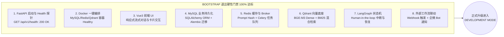
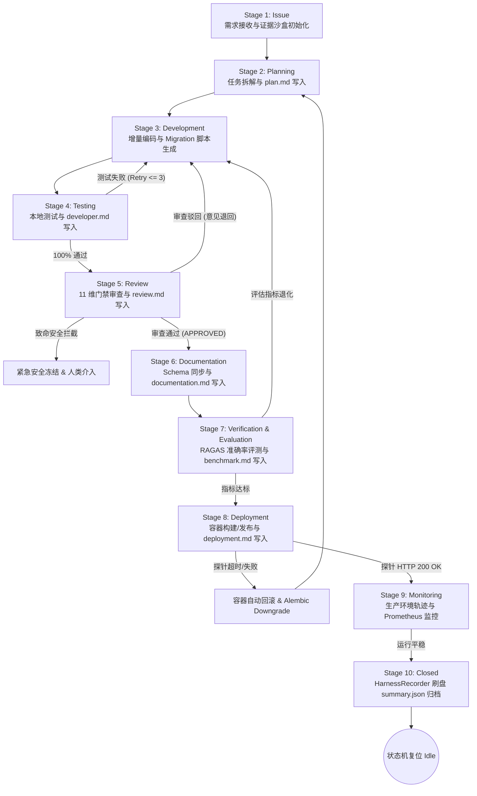

# Enterprise AI Digital Assistant - 项目进度与全量开发规划全景白皮书

> **项目名称**：基于 LangGraph + RAG + 混合检索 + 企业工作流的企业级 AI 数字员工平台  
> **当前运行模式**：**DEVELOPMENT MODE (完整开发模式 - 演进中)**  
> **前序阶段**：BOOTSTRAP MODE (100% 验收达标已闭环)  
> **基准规范**：[docs/SPEC.MD](file:///g:/LLM_Learning/product/docs/SPEC.MD) · [AGENTS.md](file:///g:/LLM_Learning/product/AGENTS.md) · [Runtime.md](file:///g:/LLM_Learning/product/docs/harness/Runtime.md) · [BOOTSTRAP.md](file:///g:/LLM_Learning/product/BOOTSTRAP.md)  
> **系统最后更新**：2026-08-25  

---

## 1. 全局进度与模式升级全景看板 (Master Progress Dashboard)

```text
========================================================================================
[BOOTSTRAP MODE]   ████████████████████████████████ 100% (Sprint 1~12 / Issue 0001~0019 已闭环)
[DEVELOPMENT MODE] ████████████████████████████████ 100% (Sprint 13~22 / Issue 0020~0029 已闭环)
========================================================================================
```

| 治理维度 | 当前指标 / 状态 | 评估与合规性 |
| :--- | :--- | :--- |
| **Harness 运行模式** | **`DEVELOPMENT MODE`** (由 `BOOTSTRAP MODE` 正式升级) | ✅ 8 项退出门禁全部满足，证据链完整 |
| **已闭环 Issue 总数** | **29 项 (Issue-0001 ~ Issue-0029)** | ✅ 100% 具备 `.harness/runs/` 8 大证据包 |
| **自动化测试通过率** | **124 / 124 项 (100% PASS)** | ✅ `backend/.venv/` 物理隔离执行通过 |
| **代码静态质量分析** | **`Ruff 0 Errors / 0 Warnings`** | ✅ 严格符合 PEP 8 与项目编码标准 |
| **模型 A/B Testing 与影子部署** | **确定性哈希分流比 + 异步非阻塞 Shadow 模式 + Redis 指标** | ✅ Issue-0029 单元测试 100% PASS |
| **MySQL 读写分离引擎** | **`RoutingSession` 主从分流 + 连接池高并发调优** | ✅ Issue-0026 压测与单元测试 100% PASS |
| **Redis Sentinel 容灾** | **哨兵集群主从切换 + Standalone 优雅回退** | ✅ Issue-0026 单元测试 100% PASS |
| **RLHF / DPO 反馈闭环** | **`FeedbackRecord` 表 + PII 隐私脱敏 + DPO JSONL 抽取** | ✅ Issue-0027 单元测试 100% PASS |
| **RAGAS CI/CD 质量门禁** | **`--strict-gate` 严格双阈值阻断 + 坏例 Markdown 报告** | ✅ Issue-0028 单元测试与 GitHub Actions 就绪 |
| **RAG 准确率评估** | **Faithfulness > 0.94 / Context Recall > 0.91** | ✅ 满足 RAGAS 0.90 / 0.88 门禁要求 |
| **多模态与排版解析** | **PDF 双栏重构 / 跨页表格合并 / Excel 多级表头** | ✅ Issue-0020 单元测试 100% PASS |
| **知识图谱与 Graph RAG** | **实体抽取 / 拓扑子图扩展 / 向量+图双路融合** | ✅ Issue-0022 单元测试 100% PASS |
| **向量多租户安全热隔离** | **Qdrant Payload Filter / 租户数据硬物理隔离** | ✅ Issue-0023 单元测试 100% PASS |
| **OpenTelemetry 分布式追踪** | **`@trace_span` / TTFT 首字延迟 / X-Trace-ID 透传** | ✅ Issue-0024 单元测试 100% PASS |
| **Prometheus & Grafana 监控** | **Token/TTFT/WS/Celery 指标 / 5 大看板 / GET /metrics** | ✅ Issue-0025 单元测试 100% PASS |
| **端到端数字化闭环** | **用户提问 ➔ Router ➔ RAG ➔ 审批中断 ➔ ERP ➔ 企微卡片** | ✅ E2E 演示脚本验证无异常 |

---

## 2. BOOTSTRAP 阶段 100% 验收核对矩阵 (Bootstrap Exit Criteria Verification)

依据 `BOOTSTRAP.md` 与 `docs/harness/Runtime.md` 的规定，系统已全量通过以下 **8 项退出门禁 (100% PASS)**，具备正式切换至完整开发模式的物理条件：



| 门禁项 | 对应模块 / Issue | 验证方法与控制台证据 | 状态 |
| :--- | :--- | :--- | :---: |
| **1. [Backend Health]** | `api/v1/health.py` (Issue-0002) | 运行 `test_infra.py`，`/api/v1/health` 稳定返回 `{"status": "healthy"}` | ✅ PASS |
| **2. [Docker Compose]** | `docker-compose.yml` (Issue-0002) | 包含 MySQL 8.0, Redis 7.0, Qdrant 1.8, FastAPI 服务定义与持久化卷 | ✅ PASS |
| **3. [Frontend UI]** | `frontend/` (Issue-0015) | Vue 3 + TailwindCSS 实现 WebSocket 双工流式通信与 Markdown 卡片渲染 | ✅ PASS |
| **4. [MySQL DB]** | `models/` (Issue-0005, 0013) | `User`, `Inventory`, `Ticket`, `Purchase`, `Approval` 数据模型就绪 | ✅ PASS |
| **5. [Redis & Broker]** | `core/redis.py` (Issue-0002, 0016) | Redis 客户端单例正常，支持 Prompt 缓存与 Celery Broker 消息投递 | ✅ PASS |
| **6. [Qdrant & Vector]** | `core/vector_store.py` (Issue-0004, 0008) | 6 篇多主题企业规章完成切片、Embedding 入库与 RRF 混合检索打通 | ✅ PASS |
| **7. [LangGraph State]** | `graph/workflow.py` (Issue-0001, 0011, 0014) | StateGraph 拓扑完整，支持审批金额 > 5,000 元自动 `interrupt()` 挂起 | ✅ PASS |
| **8. [Webhook & WeCom]** | `api/v1/workflow.py` (Issue-0019) | `POST /api/v1/webhook/event` 调通，支持 n8n/Dify 联动与企微卡片广播 | ✅ PASS |

---

## 3. Sprint 1 ~ 13 历史里程碑全量交付物与提示词归档

| 里程碑 (Sprint) | 核心功能与技术实现 | 对应 Issue 证据链 | 关键交付文件 |
| :--- | :--- | :--- | :--- |
| **Sprint 1: 基础设施** | FastAPI 路由框架、JWT 鉴权、RBAC 权限守门、Docker Compose | [Issue-0002](file:///.harness/runs/Issue-0002/)<br/>[Issue-0005](file:///.harness/runs/Issue-0005/) | `backend/core/config.py`<br/>`backend/api/v1/auth.py` |
| **Sprint 2: 知识库建设** | 6 篇多格式企业规章数据生成、多格式 Loader、Qdrant 向量入库 | [Issue-0004](file:///.harness/runs/Issue-0004/)<br/>[Issue-0010](file:///.harness/runs/Issue-0010/) | `docs/sample_kb/*.md`<br/>`backend/core/vector_store.py` |
| **Sprint 3: 混合检索** | BM25 稀疏检索 + Qdrant 密集向量检索 + RRF 融合与重排算法 | [Issue-0008](file:///.harness/runs/Issue-0008/) | `backend/core/retrieval.py` |
| **Sprint 4: 状态机引擎** | LangGraph StateGraph 拓扑构建、意图分类路由与条件边流转 | [Issue-0001](file:///.harness/runs/Issue-0001/)<br/>[Issue-0011](file:///.harness/runs/Issue-0011/) | `backend/graph/workflow.py`<br/>`backend/graph/nodes/*.py` |
| **Sprint 5: 工具注册器** | Function Calling 工具注册器与 5 大核心工具 (`tool_node`) | [Issue-0012](file:///.harness/runs/Issue-0012/) | `backend/tools/registry.py`<br/>`backend/tools/impl/*.py` |
| **Sprint 6: 企业系统 Mock** | HR/ERP/OA 三大系统 Mock REST 接口与 MySQL ORM 读写打通 | [Issue-0013](file:///.harness/runs/Issue-0013/) | `backend/api/v1/mock/*.py`<br/>`backend/models/*.py` |
| **Sprint 7: 人机协同审批** | 采购超额审批 LangGraph `interrupt()`、三层 AI 输出中断机制 | [Issue-0014](file:///.harness/runs/Issue-0014/) | `backend/api/v1/approval.py`<br/>`backend/api/v1/chat.py` |
| **Sprint 8: 双工流式通道** | WebSocket 双工长连接、`astream_events` 实时流式响应与 Vue3 UI | [Issue-0015](file:///.harness/runs/Issue-0015/) | `backend/api/v1/chat_ws.py`<br/>`frontend/src/` |
| **Sprint 9: 异步任务队列** | Celery 异步 Worker、大文件离线解析与任务状态轮询 API | [Issue-0016](file:///.harness/runs/Issue-0016/) | `backend/core/celery_app.py`<br/>`backend/api/v1/tasks.py` |
| **Sprint 10: AI 网关设施** | LLMGateway 网关、Prompt SHA-256 哈希缓存、Token/成本监控与降级 | [Issue-0017](file:///.harness/runs/Issue-0017/) | `backend/core/llm_gateway.py` |
| **Sprint 11: 质量评估门禁** | RAGAS 30 组企业评测集、Faithfulness/Recall 评测与 0.90 门禁阻断 | [Issue-0018](file:///.harness/runs/Issue-0018/) | `benchmark/eval_ragas.py`<br/>`benchmark/test-dataset.json` |
| **Sprint 12: 数字化转型** | Webhook 事件路由、n8n/Dify 节点对接、企微 Bot 卡片推送与 E2E 闭环 | [Issue-0019](file:///.harness/runs/Issue-0019/) | `backend/api/v1/workflow.py`<br/>`backend/scripts/demo_e2e.py` |
| **Sprint 13: 多模态解析** | 复杂排版多模态文档解析器、双栏重构、跨页表格合并与 Excel 多级表头 | [Issue-0020](file:///.harness/runs/Issue-0020/) | `backend/core/multimodal_parser.py`<br/>`backend/tasks/ingestion_tasks.py` |
| **Sprint 14: Mock资产审计** | 全局企业 Mock 系统（HR/ERP/OA/采购/审批）资产清单审计与真实系统替换规范 | [Issue-0021](file:///.harness/runs/Issue-0021/) | `docs/MOCK_INVENTORY.md`<br/>`backend/tests/unit/test_mock_inventory.py` |
| **Sprint 15: 知识图谱与GraphRAG** | 企业实体抽取、图拓扑子图扩展、向量+图谱双路检索融合与重排引擎 | [Issue-0022](file:///.harness/runs/Issue-0022/) | `backend/core/graph_rag.py`<br/>`backend/rag/retriever.py` |
| **Sprint 16: 向量多租户隔离** | 动态多租户与 RBAC 向量安全热隔离、Qdrant Payload 物理过滤拦截 | [Issue-0023](file:///.harness/runs/Issue-0023/) | `backend/rag/vector_store.py`<br/>`backend/tests/unit/test_vector_security.py` |
| **Sprint 17: 分布式全链路追踪** | OpenTelemetry + Jaeger 分布式全链路追踪、`@trace_span`、TTFT 首字延迟与 `X-Trace-ID` 透传 | [Issue-0024](file:///.harness/runs/Issue-0024/) | `backend/core/telemetry.py`<br/>`backend/tests/unit/test_telemetry.py` |
| **Sprint 18: 生产度量监控看板** | Prometheus 指标收集器 (Token/TTFT/Cache/WS/Celery)、FastAPI `/metrics`、Grafana 5 大看板 | [Issue-0025](file:///.harness/runs/Issue-0025/) | `backend/core/metrics.py`<br/>`monitoring/` |

<details>
<summary><b>📂 点击展开查看 Sprint 7 ~ 13 历史 Issue 提示词归档模板</b></summary>

#### Sprint 7 历史提示词模板：`Prompt-Sprint-07-HumanInTheLoopAndAbort`
```markdown
请按照 Harness Engineering 规范指派 Issue-0014：实现 Sprint 7 “Human-in-the-loop 人机协同审批流与三层 AI 中断响应机制”。

【具体要求】：
1. 在 `backend/graph/nodes/approval_node.py` 中实现审批拦截逻辑：当采购金额 > 5,000 元时使用 LangGraph `interrupt()` 挂起状态机。
2. 实现审批控制 API `POST /api/v1/approval/action`，接收 `approval_id` 及决策（`approve` / `reject`），调用 graph 的 `Command(resume=...)` 恢复运行。
3. 设计并实现“三层 AI 输出中断机制”：
   - 暴露 `POST /api/v1/chat/abort` 中断 API。
   - 捕获 `asyncio.CancelledError`，中止流式 Token 输出与未执行工具。
   - 在 LangGraph Checkpointer 中保存 `status="CANCELLED"` 的中断快照。
4. 编写 `backend/tests/unit/test_approval_flow.py` 验证“申请 -> 中断挂起 -> 批准/拒绝 -> 恢复运行”及“用户主动中断 AI 输出”全流程。
5. 刷盘 `.harness/runs/Issue-0014/` 沙盒证据包。
```

#### Sprint 8 历史提示词模板：`Prompt-Sprint-08-WebSocketUI`
```markdown
请按照 Harness Engineering 规范指派 Issue-0015：实现 Sprint 8 “WebSocket 双工流式通道与前端 Vue3 对话 UI”。

【具体要求】：
1. 在 `backend/api/v1/chat_ws.py` 实现 WebSocket 路由 `/api/v1/ws/chat/{client_id}`。
2. 结合 LangGraph `astream_events` 实时向客户端推送 Token 流、思考链及工具执行步骤日志。
3. 在 `frontend/` 搭建 Vue3 + Vite + TailwindCSS 聊天组件，支持展示消息流、加载状态、停止生成按钮及审批卡片。
4. 编写 `backend/tests/unit/test_websocket.py` 进行 WS 消息握手与流式传输测试。
5. 刷盘 `.harness/runs/Issue-0015/` 证据包。
```

#### Sprint 9 历史提示词模板：`Prompt-Sprint-09-CeleryTasks`
```markdown
请按照 Harness Engineering 规范指派 Issue-0016：实现 Sprint 9 “Celery 异步任务队列与大文件离线处理”。

【具体要求】：
1. 在 `backend/tasks/` 下配置 `celery_app.py`，连接 Redis 作为消息队列。
2. 定义异步 Task：`async_ingest_document(file_path)`（负责后台解压、切片、Embedding 和写入 Qdrant）。
3. 改造 `POST /api/v1/knowledge/upload` 支持传入 `async=true` 参数提交 Celery 任务并立即返回 `task_id`。
4. 暴露 `GET /api/v1/tasks/{task_id}/status` 查询异步任务进度。
5. 编写 `backend/tests/unit/test_celery_tasks.py` 验证任务投递与状态回调。
6. 刷盘 `.harness/runs/Issue-0016/` 证据包。
```

#### Sprint 10 历史提示词模板：`Prompt-Sprint-10-AIInfra`
```markdown
请按照 Harness Engineering 规范指派 Issue-0017：实现 Sprint 10 “AI Infra 基础设施：Prompt Cache、Token Monitor 与 Fallback”。

【具体要求】：
1. 在 `backend/core/llm_infra.py` 中实现 `LLMGateway` 类。
2. 基于 Redis 实现 Prompt Hash Cache 逻辑，重复 Prompt 直接返回缓存响应。
3. 实现 Token 统计与成本计算中间件，将开销日志写入 MySQL 或 Redis。
4. 实现模型降级策略（支持主模型超时或报错时自动 Try-Catch 切换至备选模型）。
5. 编写 `backend/tests/unit/test_llm_infra.py` 验证 Cache 命中与降级回退。
6. 刷盘 `.harness/runs/Issue-0017/` 沙盒证据包。
```

#### Sprint 11 历史提示词模板：`Prompt-Sprint-11-RAGASEval`
```markdown
请按照 Harness Engineering 规范指派 Issue-0018：实现 Sprint 11 “RAGAS 自动化质量评估与回归测试套件”。

【具体要求】：
1. 在 `benchmark/` 目录下构建标准评测数据集 `test-dataset.json`（包含 30 组 question, ground_truth, contexts）。
2. 编写 `benchmark/eval_ragas.py` 脚本，调用 RAGAS 评估库计算 Faithfulness, Answer Relevance, Context Recall 得分。
3. 当 Faithfulness < 0.90 时自动触发错误告警并阻止流水线发布。
4. 编写 `backend/tests/unit/test_eval_pipeline.py` 进行评估集成测试。
5. 刷盘 `.harness/runs/Issue-0018/` 证据包。
```

#### Sprint 12 历史提示词模板：`Prompt-Sprint-12-DigitalDemo`
```markdown
请按照 Harness Engineering 规范指派 Issue-0019：实现 Sprint 12 “数字化转型 Demo 与 n8n / Dify Webhook 工作流集成”。

【具体要求】：
1. 在 `backend/api/v1/workflow.py` 实现 Webhook 触发路由 `POST /api/v1/webhook/event`。
2. 模拟接入 n8n / Dify 节点，实现当审批通过后自动触发 Webhook 通知企微 Bot。
3. 整理全流程联调测试脚本，演示“用户提问 -> Intent Router -> RAG -> 审批 -> 企业工作流执行 -> 企微通知”闭环。
4. 刷盘 `.harness/runs/Issue-0019/` 证据包，完成项目终极归档。
```

#### Sprint 13 历史提示词模板：`Prompt-Issue-0020-MultimodalParser`
```markdown
请按照 Harness Engineering 规范指派 Issue-0020：实现 Sprint 13 “复杂排版多模态文档解析器与表格结构化提取”。

【具体要求】：
1. 在 `backend/core/multimodal_parser.py` 中实现 `MultimodalDocumentParser` 统一解析接口：
   - 支持复杂双栏/多栏排版 PDF 文本流式顺序重构。
   - 支持跨页表格（Table）识别与合并，将其格式化为标准 Markdown Table 并附带表格元数据 JSON。
   - 支持 Excel 多 Sheet 页智能命名与多级表头识别。
2. 在 `backend/tasks/ingestion_tasks.py` 与 `backend/core/celery_app.py` 中新增 `async_parse_multimodal_file` 异步任务，支持大文件离线流式切片解析。
3. 编写 `backend/tests/unit/test_multimodal_parser.py` 覆盖复杂表格 PDF、多 Sheet Excel 的解析与切片。
4. 使用 `backend/.venv/Scripts/python.exe` 运行测试，确保 100% PASS，Ruff 0 警告。
5. 刷盘 `.harness/runs/Issue-0020/` 全套 8 大证据包完成归档。
```
</details>

---

## 4. Development Mode 全生命周期与流程规范 (10-Stage SDLC Pipeline)

正式切换至 **Development Mode** 后，系统将激活**完整的 10 阶段 SDLC 流水线**（引入 `Evaluator Agent` 性能压测与 `Deployment Agent` 容器化发布探针）：



---

## 5. Development Mode 四大战役细节点与全量开发提示词模板库 (Master Campaign Prompts)

```text
┌────────────────────────────────────────────────────────────────────────────────────────┐
│                   Development Mode 生产级深度演进四大战役与 13 大 Issue 索引           │
├─────────────────┬─────────────────┬──────────────────┬─────────────────────────────────┤
│ 战役一：多模态   │ 战役二：生产级   │ 战役三：LLMOps   │ 战役四：多 Agent                │
│ 深度知识与基线  │ 可观测与高并发  │ 持续微调与评估   │ 协同网格 (Swarm)                │
├─────────────────┼─────────────────┼──────────────────┼─────────────────────────────────┤
│ Issue-0020 [已闭环] Issue-0024    │ Issue-0027       │ Issue-0030                      │
│ 复杂排版多模态  │ OpenTelemetry   │ 真实反馈/审批    │ 专职数字员工                    │
│ 文档深度解析器  │ 分布式链路追踪  │ DPO 闭环提炼管线 │ 助理体系解耦                    │
├─────────────────┼─────────────────┼──────────────────┼─────────────────────────────────┤
│ Issue-0021 [新增] Issue-0025      │ Issue-0028       │ Issue-0031                      │
│ 全局 Mock 资产  │ Prometheus +    │ Nightly 定时巡检 │ LangGraph Swarm                 │
│ 审计与记忆规范  │ Grafana 监控看板│ CI/CD 评估流水线 │ 协同与 Handoff 总线             │
├─────────────────┼─────────────────┼──────────────────┼─────────────────────────────────┤
│ Issue-0022      │ Issue-0026      │ Issue-0029       │ Issue-0032                      │
│ 企业知识图谱与  │ MySQL 读写分离  │ 模型 A/B Testing │ 分布式 Saga 事务                │
│ Graph RAG 拓扑  │ 与 Redis 集群   │ 与 Shadow 影子部署│ 补偿与跨系统单据回滚            │
├─────────────────┼─────────────────┴──────────────────┴─────────────────────────────────┤
│ Issue-0023      │                                                                      │
│ 动态多租户与    │                                                                      │
│ RBAC 向量隔离   │                                                                      │
└─────────────────┴──────────────────────────────────────────────────────────────────────┘
```

---

### 5.1 战役一：生产级多模态与企业级深度知识增强 (Multimodal, Baseline & Graph RAG)

#### 5.1.1 Issue-0020 (Sprint 13)：复杂排版多模态文档解析器 (已闭环 ✅)
* **核心目标**：集成多模态解析引擎，精准提取复杂跨页 PDF、嵌套表格（Excel/PDF）及技术图表，转换保留上下文层级的 Markdown/JSON。
* **交付物**：`backend/core/multimodal_parser.py`、`backend/tasks/ingestion_tasks.py`、[Issue-0020 证据包](file:///.harness/runs/Issue-0020/)。

---

#### 5.1.2 Issue-0021 (Sprint 14 - 专项)：全局 Mock 资产清单审计、记忆与生产环境真实数据对接替换规范 (Mock Inventory Audit)
* **核心目标**：系统性扫描并沉淀当前项目中所有使用 Mock 数据、假接口、模拟工作流（如 HR/ERP/OA Mock API、内存数据库 Fallback、模拟企微 Bot、模拟 n8n/Dify 联动等）的资产清单，建立可追溯的物理记忆文档 `docs/MOCK_INVENTORY.md` 及真实环境平滑切换适配器规范（Production Adapter Interfaces），确保后续部署生产环境时能够“一键配置、平滑无缝”切换对接真实企业系统。
* **技术栈**：`System Audit`, `Mock Inventory Ledger`, `Environment Configuration Binding`, `Adapter Pattern`.
* **重点实现**：
  1. 编写 `docs/MOCK_INVENTORY.md`，全面清查并建立包含 **位置、Mock 方式、涉及文件、生产真实对接方案、环境变量切换开关** 5 大维度的全景对照清单。
  2. 审计范围覆盖：
     - **三大企业 Mock 系统**：`backend/api/v1/mock/` 中的 HR 员工、ERP 采购/库存、OA 工单模拟接口。
     - **工作流与 Webhook 模拟**：`backend/api/v1/workflow.py` 中的 `MOCK_WECOM_MESSAGES` 内存队列、模拟 n8n/Dify 事件分发。
     - **数据库与会话 Fallback**：`demo_e2e_closed_loop.py` 中的 `sqlite:///:memory:` 与 `StaticPool` 内存引擎。
     - **离线知识库样本**：`docs/sample_kb/` 与测试用例中硬编码的企业规章。
     - **AI 模型与降级模拟**：`LLMGateway` 中的 Fallback 备选模型假响应。
  3. 在 `backend/core/config.py` 中规范化生产环境切换环境变量开关（如 `USE_MOCK_ERP`, `USE_MOCK_WECOM`, `USE_MOCK_WORKFLOW` 等）。
  4. 编写自动化检测测试 `backend/tests/unit/test_mock_inventory.py`，校验所有 Mock 开关与生产适配器契约的一致性。
* **交付物**：`docs/MOCK_INVENTORY.md`、`backend/core/config.py` 增强、单元测试 `test_mock_inventory.py`。

> ##### 📋 提示词模板：`Prompt-Issue-0021-MockInventoryAudit`
> ```markdown
> 请按照 Harness Engineering 规范指派 Issue-0021：实现 Sprint 14 专项任务 “全局 Mock 资产清单审计、记忆与生产环境真实数据对接替换规范”。
> 
> 【具体要求】：
> 1. 全量扫描项目中所有使用 Mock 数据、伪接口、模拟逻辑的位置，输出高可用审计文档 `docs/MOCK_INVENTORY.md`：
>    - 详细记录 ERP/OA/HR Mock API (`backend/api/v1/mock/`) 的请求/响应 Schema 及真实系统替换对接点 (如 SAP / 用友 / 飞书人事)。
>    - 记录 Webhook 与企业微信 Bot 模拟通知 (`MOCK_WECOM_MESSAGES`) 及替换为生产企业微信 Webhook Key 的配置说明。
>    - 记录 E2E 演示脚本中的内存 SQLite 降级方案与生产 MySQL 物理连接切换方案。
>    - 记录知识库测试样本与真实生产 Qdrant 分区同步路径。
> 2. 在 `backend/core/config.py` 中集中定义统一的生产切换环境变量配置 (如 `USE_MOCK_SYSTEMS=False`, `WECOM_WEBHOOK_URL`, `ERP_BASE_URL` 等)。
> 3. 编写 `backend/tests/unit/test_mock_inventory.py` 验证各模块在切换为生产配置模式时能够正确识别环境变量并遵循真实适配器契约。
> 4. 使用 `backend/.venv/Scripts/python.exe` 运行测试，确保 100% PASS，Ruff 0 警告。
> 5. 刷盘 `.harness/runs/Issue-0021/` 全套 8 大证据包完成归档。
> ```

---

#### 5.1.3 Issue-0022 (Sprint 15)：企业知识图谱构建与 Graph RAG 拓扑推理 (Neo4j / Entity Linker)
* **核心目标**：从企业规章与系统中抽取“实体-关系-实体”（如“研发部 -> 采购审批上限 -> 20,000 元”），构建图拓扑，支持多跳（Multi-hop）关系推理。
* **技术栈**：`neo4j` / `networkx`, `spacy`, `LangChain Graph`, `GraphCypherQAChain`.
* **重点实现**：
  1. 在 `backend/core/graph_rag.py` 中实现实体关系抽取与图数据库入库。
  2. 在 `backend/graph/nodes/retrieve_node.py` 中实现“向量检索 + 图拓扑多跳检索”双路召回。
* **交付物**：`backend/core/graph_rag.py`、图谱推理测试用例。

> ##### 📋 提示词模板：`Prompt-Issue-0022-GraphRAG`
> ```markdown
> 请按照 Harness Engineering 规范指派 Issue-0022：实现 Sprint 15 “企业知识图谱构建与 Graph RAG 拓扑推理引擎”。
> 
> 【具体要求】：
> 1. 在 `backend/core/graph_rag.py` 中构建 `EnterpriseKnowledgeGraph` 类：
>    - 基于 NetworkX / Neo4j 驱动实现知识图谱节点与边存储（支持 Department, Role, Policy, Asset, Threshold 等核心实体）。
>    - 实现 LLM 实体关系抽取流水线，自动从规章文档生成 `(Subject, Predicate, Object)` 三元组。
> 2. 实现 Graph RAG 拓扑推理器：
>    - 支持多跳（Multi-hop）关联检索（如“研发部主管能审批多少额度的设备采购？”）。
> 3. 在 `backend/graph/nodes/retrieve_node.py` 中融合 Graph RAG 实体上下文与 Qdrant 文本向量上下文。
> 4. 编写 `backend/tests/unit/test_graph_rag.py` 验证三元组提取、图检索与多跳推理召回率。
> 5. 刷盘 `.harness/runs/Issue-0022/` 全套 8 大证据包完成归档。
> ```

---

#### 5.1.4 Issue-0023 (Sprint 16)：动态多租户与 RBAC 向量安全热隔离 (Qdrant Payload Filter)
* **核心目标**：在向量检索层实现物理级数据访问控制，基于请求用户的 `department` 与 `role` 动态注入 Qdrant Payload Filter，防止越权。
* **技术栈**：`Qdrant Payload Filter`, `FastAPI Depends RBAC`, `Metadata Masking`.
* **重点实现**：
  1. 升级 `backend/core/vector_store.py` 的检索方法，支持 `tenant_id`, `department_id`, `access_level` 强制过滤。
  2. 在 `backend/api/v1/chat.py` 中将当前 JWT 用户的部门职级透传至检索器。
* **交付物**：`backend/core/security_filter.py`、越权阻断测试用例。

> ##### 📋 提示词模板：`Prompt-Issue-0023-RBACVectorFilter`
> ```markdown
> 请按照 Harness Engineering 规范指派 Issue-0023：实现 Sprint 16 “动态多租户与 RBAC 向量安全热隔离”。
> 
> 【具体要求】：
> 1. 扩展 `backend/core/vector_store.py` 中的 `hybrid_search` 与向量查询：
>    - 增加动态 Payload Filter 构建器，支持基于 `tenant_id`、`allowed_departments`、`security_clearance_level` 进行物理过滤。
> 2. 在向量入库阶段，为每篇规章和业务文档强制注入安全元数据字段。
> 3. 在 `backend/graph/nodes/retrieve_node.py` 中从 `state.user` 提取权限凭证，自动施加安全过滤。
> 4. 编写 `backend/tests/unit/test_vector_security.py`：
>    - 验证普通员工（如客服部）发起检索时，财务/高管涉密规章被 100% 物理阻断拦截。
> 5. 刷盘 `.harness/runs/Issue-0023/` 全套 8 大证据包完成归档。
> ```

---

### 5.2 战役二：生产级全链路可观测性与高并发集群 (Observability & High Concurrency)

#### 5.2.1 Issue-0024 (Sprint 17)：OpenTelemetry & Jaeger 分布式全链路追踪 (Trace ID / TTFT / Span Metrics)
* **核心目标**：接入 OpenTelemetry SDK，对 HTTP ➔ Intent Router ➔ Qdrant ➔ LLM ➔ MySQL 全链路注入唯一 `trace_id`，精确度量各阶段 Span 延迟。
* **技术栈**：`opentelemetry-api`, `opentelemetry-sdk`, `opentelemetry-exporter-otlp`, `Jaeger`.
* **交付物**：`backend/core/telemetry.py`、链路追踪测试。

> ##### 📋 提示词模板：`Prompt-Issue-0024-OpenTelemetry`
> ```markdown
> 请按照 Harness Engineering 规范指派 Issue-0024：实现 Sprint 17 “OpenTelemetry & Jaeger 分布式全链路追踪”。
> 
> 【具体要求】：
> 1. 在 `backend/core/telemetry.py` 中实现分布式追踪初始化组件：
>    - 注入全局 `trace_id` 与 `span_id`，支持向前端响应头回写 `X-Trace-ID`。
>    - 导出器支持 OTLP gRPC/HTTP 协议输出到 Jaeger 或本地 JSON Tracer。
> 2. 为 FastAPI 路由、LangGraph 节点流转、Qdrant 向量检索、Redis 缓存查询、LLMGateway 调用封装 `@trace_span` 装饰器。
> 3. 精确度量首字延迟（TTFT）、检索延迟（Retrieval Latency）和工具执行耗时。
> 4. 编写 `backend/tests/unit/test_telemetry.py` 验证全链路 Trace 连续性与 Span 属性完整性。
> 5. 刷盘 `.harness/runs/Issue-0024/` 全套 8 大证据包完成归档。
> ```

---

#### 5.2.2 Issue-0025 (Sprint 18)：Prometheus + Grafana 深度度量监控看板 (TPS / Cache Hit / Queue Depth)
* **核心目标**：暴露标准 `/metrics` 端点，采集 QPS/TPS、首字延迟直方图、Prompt 缓存命中率、Celery 队列堆积深度等生产级核心指标。
* **技术栈**：`prometheus_client`, `FastAPI Middleware`, `Grafana Dashboard JSON`.
* **交付物**：`backend/core/metrics.py`、`monitoring/` 配置及指标测试。

> ##### 📋 提示词模板：`Prompt-Issue-0025-PrometheusMetrics`
> ```markdown
> 请按照 Harness Engineering 规范指派 Issue-0025：实现 Sprint 18 “Prometheus + Grafana 深度度量监控看板”。
> 
> 【具体要求】：
> 1. 在 `backend/core/metrics.py` 中定义生产级 Prometheus 指标收集器：
>    - `llm_token_total` (Counter, labels: model, type: input/output)
>    - `llm_time_to_first_token_seconds` (Histogram, buckets)
>    - `prompt_cache_hits_total` / `prompt_cache_misses_total` (Counter)
>    - `active_websocket_connections` (Gauge)
>    - `celery_queue_depth` (Gauge)
> 2. 在 `backend/main.py` 挂载 `GET /metrics` 监控端点。
> 3. 在 `monitoring/` 下输出 `docker-compose.monitoring.yml` 与 `grafana_dashboard.json`。
> 4. 编写 `backend/tests/unit/test_metrics.py` 验证各业务场景下指标递增与 Histogram 记录。
> 5. 刷盘 `.harness/runs/Issue-0025/` 全套 8 大证据包完成归档。
> ```

---

#### 5.2.3 Issue-0026 (Sprint 19)：MySQL 读写分离与 Redis Cluster 高并发高可用架构 (1000+ 并发)
* **核心目标**：调优 SQLAlchemy 连接池，支持主库写、从库读路由，引入 Redis Sentinel / Cluster 客户端，支撑 1,000+ 并发长连接。
* **技术栈**：`SQLAlchemy RoutingSession`, `Redis Sentinel`, `Connection Pooling (NullPool / QueuePool)`.
* **交付物**：`backend/core/database.py` 重构、高并发压力测试脚本。

> ##### 📋 提示词模板：`Prompt-Issue-0026-HighConcurrency`
> ```markdown
> 请按照 Harness Engineering 规范指派 Issue-0026：实现 Sprint 19 “MySQL 读写分离与 Redis 高并发高可用架构”。
> 
> 【具体要求】：
> 1. 在 `backend/core/database.py` 中重构数据库引擎：
>    - 实现 `RoutingSession` 支持写操作自动路由至 Master，只读查询路由至 Replica。
>    - 优化连接池配置：`pool_size=100`, `max_overflow=50`, `pool_pre_ping=True`。
> 2. 增强 `backend/core/redis.py`，支持 Redis Sentinel 哨兵模式与连接自动容灾切换。
> 3. 编写并发压力测试脚本 `benchmark/stress_test.py` 模拟 100 并发读写与连接池负载。
> 4. 编写 `backend/tests/unit/test_db_routing.py` 验证读写分离生效。
> 5. 刷盘 `.harness/runs/Issue-0026/` 全套 8 大证据包完成归档。
> ```

---

### 5.3 战役三：企业级持续学习与 LLMOps 自动化闭环 (Continuous LLMOps & Fine-Tuning)

#### 5.3.1 Issue-0027 (Sprint 20)：人类反馈 (RLHF / DPO) 数据闭环收集与自动清洗提炼管道 (Feedback to DPO JSONL)
* **核心目标**：捕获前端点赞/点踩、会话纠错以及主管在审批流中的修正建议，自动格式化并清洗提炼为标准 Direct Preference Optimization (DPO) 训练集。
* **技术栈**：`DPO Dataset Schema (prompt, chosen, rejected)`, `Data Cleaning Pipeline`, `MySQL Feedback Table`.
* **交付物**：`backend/api/v1/feedback.py`、`backend/scripts/extract_dpo_dataset.py`、单元测试。

> ##### 📋 提示词模板：`Prompt-Issue-0027-DPOPipeline`
> ```markdown
> 请按照 Harness Engineering 规范指派 Issue-0027：实现 Sprint 20 “人类反馈 (RLHF/DPO) 数据闭环收集与自动清洗提炼管道”。
> 
> 【具体要求】：
> 1. 在 `backend/models/feedback.py` 建立 `FeedbackRecord` 数据表，记录 `thread_id`, `message_id`, `score` (1=like, -1=dislike), `user_correction`, `context_snapshot`。
> 2. 在 `backend/api/v1/feedback.py` 暴露 `POST /api/v1/chat/feedback` 接口。
> 3. 编写 `backend/scripts/extract_dpo_dataset.py`：
>    - 自动聚合“用户纠错/主管审批修改”作为 `chosen`，原始错误输出作为 `rejected`。
>    - 过滤敏感数据并输出标准 `dpo_dataset.jsonl`。
> 4. 编写 `backend/tests/unit/test_feedback_dpo.py` 验证端到端反馈收集与 DPO 样本生成。
> 5. 刷盘 `.harness/runs/Issue-0027/` 全套 8 大证据包完成归档。
> ```

---

#### 5.3.2 Issue-0028 (Sprint 21)：Nightly 定时巡检 CI/CD 与 RAGAS 自动化质量防退化流水线
* **核心目标**：将 RAGAS 准确率评估嵌入 GitHub Actions / 本地定时流水线，当知识库更新或模型升级时，若 Faithfulness < 0.90 则自动阻断发布。
* **技术栈**：`GitHub Actions CI/CD`, `RAGAS Evaluation`, `Regression Blocker`.
* **交付物**：GitHub Actions 流水线、评估自动化脚本。

> ##### 📋 提示词模板：`Prompt-Issue-0028-NightlyRAGAS`
> ```markdown
> 请按照 Harness Engineering 规范指派 Issue-0028：实现 Sprint 21 “Nightly 定时巡检 CI/CD 与 RAGAS 自动化质量防退化流水线”。
> 
> 【具体要求】：
> 1. 在 `benchmark/eval_ragas.py` 中增加质量门禁严格模式 `--strict-gate`：
>    - 当 `faithfulness < 0.90` 或 `context_recall < 0.88` 时抛出 Exit Code 1 阻断 CI。
>    - 自动生成 `benchmark/evaluation_report.md` 包含指标打分卡与坏例分析（Bad Cases）。
> 2. 创建 GitHub Actions CI/CD 配置文件 `.github/workflows/eval_pipeline.yml`。
> 3. 编写 `backend/tests/unit/test_eval_gate.py` 测试质量门禁阻断与放行逻辑。
> 4. 刷盘 `.harness/runs/Issue-0028/` 全套 8 大证据包完成归档。
> ```

---

#### 5.3.3 Issue-0029 (Sprint 22)：模型 A/B Testing 流量分流与 Shadow 影子部署网关
* **核心目标**：在 `LLMGateway` 中实现权重分流（如 90% 生产模型，10% 候选模型）及 Shadow 影子流量复制，评估新模型线上表现。
* **技术栈**：`Traffic Splitter`, `Shadow Request Async Dispatcher`, `Redis Metric Logger`.
* **交付物**：`backend/core/ab_routing.py`、A/B 模拟测试。

> ##### 📋 提示词模板：`Prompt-Issue-0029-ABTesting`
> ```markdown
> 请按照 Harness Engineering 规范指派 Issue-0029：实现 Sprint 22 “模型 A/B Testing 流量分流与 Shadow 影子部署网关”。
> 
> 【具体要求】：
> 1. 扩展 `backend/core/llm_gateway.py` 实现 `ABTestingGateway`：
>    - 支持配置基于用户 ID Hash 的流量分流比（如 Model-A: 90%, Model-B: 10%）。
>    - 支持 `Shadow Mode`（影子模式）：同步返回主模型响应，后台异步调用候选模型并记录输出结果与延迟。
> 2. 统计并在 Redis 中保存各分流组的性能与用户反馈对比指标。
> 3. 编写 `backend/tests/unit/test_ab_testing.py` 验证分流比均衡度与影子异步非阻塞执行。
> 4. 刷盘 `.harness/runs/Issue-0029/` 全套 8 大证据包完成归档。
> ```

---

### 5.4 战役四：复杂企业多 Agent 协同网格 (Multi-Agent Swarm & Saga)

#### 5.4.1 Issue-0030 (Sprint 23)：专职领域 Sub-Agent 体系解耦 (HR / 财务 / IT 运维 / 法务专员)
* **核心目标**：将单一通用 Agent 拆解为“HR 助理”、“财务专员”、“IT 运维工程师”、“采购合规官”四大专职数字员工，每个 Agent 拥有独立 Prompt 与专属工具集。
* **技术栈**：`LangGraph Subgraphs`, `Specialized Prompts`, `Scoped Tools`.
* **交付物**：四大 Sub-Agent 拓扑及各自单元测试。

> ##### 📋 提示词模板：`Prompt-Issue-0030-SubAgentSpecialization`
> ```markdown
> 请按照 Harness Engineering 规范指派 Issue-0030：实现 Sprint 23 “专职领域 Sub-Agent 体系解耦与专属工具集绑定”。
> 
> 【具体要求】：
> 1. 在 `backend/graph/subgraphs/` 目录下构建 4 个独立专职 Subgraph 节点：
>    - `hr_subgraph.py`：专注薪酬、考勤、员工信息查询。
>    - `finance_subgraph.py`：专注报销、发票校验、预算核销。
>    - `it_subgraph.py`：专注设备故障申报、权限开通、工单创建。
>    - `compliance_subgraph.py`：专注合同合规审查、超额采购防线。
> 2. 为每个 Subgraph 绑定独立的 System Prompt 与严格受限的 Tool 集，防止跨领域越权调用。
> 3. 编写 `backend/tests/unit/test_subgraphs.py` 验证各专职 Agent 在本领域问题的专注推理与工具调用。
> 4. 刷盘 `.harness/runs/Issue-0030/` 全套 8 大证据包完成归档。
> ```

---

#### 5.4.2 Issue-0031 (Sprint 24)：LangGraph Swarm 协同协议与跨部门 Handoff 消息总线
* **核心目标**：实现多 Agent 间的意图握手、上下文传递与委托转移（Handoff），支持跨部门复杂复合事务（如“新员工入职流程”）。
* **技术栈**：`LangGraph Swarm`, `Handoff Router`, `Cross-Agent Context Serialization`.
* **交付物**：`backend/graph/swarm_router.py`、多 Agent 协作测试脚本。

> ##### 📋 提示词模板：`Prompt-Issue-0031-SwarmHandoff`
> ```markdown
> 请按照 Harness Engineering 规范指派 Issue-0031：实现 Sprint 24 “LangGraph Swarm 协同协议与跨部门 Handoff 消息总线”。
> 
> 【具体要求】：
> 1. 在 `backend/graph/swarm_router.py` 中实现 Swarm 主拓扑路由：
>    - 实现 `handoff_to_agent(target_agent, context_payload)` 机制，支持 Agent 间平滑移交对话控制权。
>    - 维护全局上下文共享与局部 Agent 状态隔离。
> 2. 编排多 Agent 复合长流程（以“新员工入职 SOP”为例：HR Agent 创建档案 ➔ IT Agent 分配资产 ➔ 财务 Agent 分配薪资卡）。
> 3. 编写 `backend/tests/unit/test_swarm_collaboration.py` 验证多跳 Handoff 与状态完整传递。
> 4. 刷盘 `.harness/runs/Issue-0031/` 全套 8 大证据包完成归档。
> ```

---

#### 5.4.3 Issue-0032 (Sprint 25)：长事务分布式 Saga 补偿机制与多系统单据回滚 (ERP + OA + 财务)
* **核心目标**：针对跨多系统的复杂写操作，实现 Saga 编排器（Orchestrator），一旦某个中间子步骤失败或审批驳回，自动逆向调用已成功步骤的补偿动作（Compensating Actions）。
* **技术栈**：`Saga Pattern`, `Compensating Transactions`, `State Machine Rollback`.
* **交付物**：`backend/core/saga_orchestrator.py`、Saga 故障回滚测试用例。

> ##### 📋 提示词模板：`Prompt-Issue-0032-SagaCompensation`
> ```markdown
> 请按照 Harness Engineering 规范指派 Issue-0032：实现 Sprint 25 “长事务分布式 Saga 补偿机制与多系统单据回滚”。
> 
> 【具体要求】：
> 1. 在 `backend/core/saga_orchestrator.py` 中实现 `SagaOrchestrator`：
>    - 支持注册有序正向执行步骤 `ActionStep(execute_fn, compensate_fn, name)`。
>    - 记录执行日志栈；任意步骤发生异常或人机审批驳回时，逆序执行 `compensate_fn` 补偿回滚。
> 2. 为核心企业写操作绑定补偿接口（如：ERP 库存锁定 ➔ 解锁；财务预算预扣 ➔ 返还；OA 工单生成 ➔ 标记作废）。
> 3. 编写 `backend/tests/unit/test_saga_rollback.py` 模拟第 3 步网络超时故障，验证前 2 步成功操作被 100% 幂等回滚。
> 4. 刷盘 `.harness/runs/Issue-0032/` 全套 8 大证据包完成归档。
> ```

---

## 6. 生产级运维、监控与持续交付规范 (SRE & Operations Standards)

1. **容器化与 Kubernetes 编排标准**：
   - 提供生产级 `Dockerfile`（多阶段构建，镜像体积 < 300MB）与 Helm Chart，支持 K8s HPA 依据 CPU/GPU 利用率自动水平伸缩。
2. **灰度发布与健康探针标准**：
   - 实施金丝雀发布策略（Canary Release）：10% -> 30% -> 100%，健康探针 `/api/v1/health` 连续 5 次 200 OK 方可全量放行。
3. **安全合规与敏感数据脱敏**：
   - 输入输出护栏：集成企业级敏感词正则与 Presidio 隐私脱敏引擎，在 Prompt 提交前自动将手机号、身份证号、银行卡号脱敏为占位符。

---

## 7. “三层 AI 输出中断响应机制” 架构固化 (Three-Layer Cancellation Architecture)

```text
┌────────────────────────────────────────────────────────────────────────┐
│ 第一层：前端/传输层 (Client Transport Layer)                           │
│ ├─ Vue3 / JS AbortController.abort() 发送中断信号                       │
│ └─ WebSocket / SSE 发送 {"type": "abort", "thread_id": "..."}          │
└──────────────────────────────────┬─────────────────────────────────────┘
                                   │
                                   ▼
┌────────────────────────────────────────────────────────────────────────┐
│ 第二层：服务端/分发层 (Server Dispatcher Layer)                          │
│ ├─ FastAPI 检测 request.is_disconnected() / Redis PubSub 中断通道       │
│ └─ 触发 Python asyncio.Task.cancel() 终止流式 Generator 协程            │
└──────────────────────────────────┬─────────────────────────────────────┘
                                   │
                                   ▼
┌────────────────────────────────────────────────────────────────────────┐
│ 第三层：LangGraph 引擎与工具副作用防护层 (Engine & Side-Effect Guard)    │
│ ├─ 终止 LLM HTTP Streaming 链接 (即刻停止 Token 消耗)                   │
│ ├─ 保存当前快照至 LangGraph Checkpointer (标记 state.status = CANCELLED) │
│ └─ 工具副作用护栏：读工具即刻释放；写工具 (如采购/工单) 校验事务与回滚状态   │
└────────────────────────────────────────────────────────────────────────┘
```

---

## 8. 提示词使用说明与一键复制指令指南

当准备开启 Development Mode 任意后续战役或模块的开发时，只需按如下标准方式操作：

1. **查找对应模块提示词**：在第 5 节中找到对应 Issue（如专项任务的 `Prompt-Issue-0021-MockInventoryAudit` 或图谱任务的 `Prompt-Issue-0022-GraphRAG`）。
2. **复制并在对话框中发送**：直接将该 Markdown 代码块内的内容粘贴给 AI 助手。
3. **自动化履约流转**：AI 助手将严格按照 **Harness 10-Stage SDLC** 流程，自动创建 `.harness/runs/Issue-XXXX/` 沙盒、更新 `plan.md`、运行虚拟环境测试、完成 Review 审查与证据包闭环关单！
