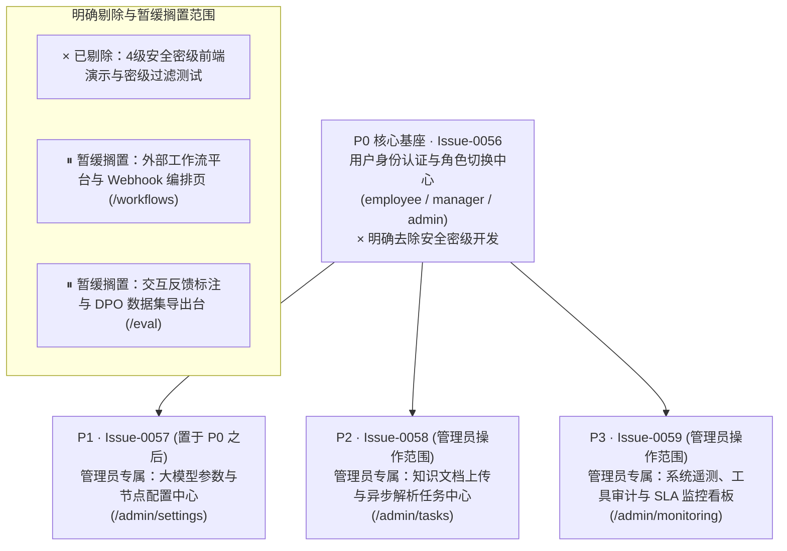

# Enterprise AI Digital Assistant - 项目进展与重构规划路线图
# Project Progress, RBAC & Admin Control Plane Roadmap

> **项目名称**：基于 LangGraph + RAG + 混合检索的企业级 AI 数字员工平台  
> **当前运行模式**：**PRAGMATIC REALIZATION & COGNITIVE ROUTING MODE (Sprint R-05 管理员控制面全量闭环 · 推进 Sprint R-06 认知意图路由与多轮语境改写演进)**  
> **模式说明**：已完成底层数据库持久化、真实向量底座、Ollama/OpenAI 流式推理、Vuebits 原生交互与 RBAC 三大管理员控制面；当前进入「多轮认知路由、语境改写与语义槽位提取」专项升级阶段  
> **基准规范**：[AGENTS.md](file:///g:/LLM_Learning/product/AGENTS.md) · [docs/FRONTEND_PROGRESS.md](file:///g:/LLM_Learning/product/docs/FRONTEND_PROGRESS.md) · [docs/MOCK_INVENTORY.md](file:///g:/LLM_Learning/product/docs/MOCK_INVENTORY.md) · [Runtime.md](file:///g:/LLM_Learning/product/docs/harness/Runtime.md)  
> **系统最后更新**：2026-11-24

---

## 1. 全局真实现状与基线诊断看板 (Reality-Check Master Dashboard)

```text
====================================================================================================
【工程底座与生产化硬化】   ████████████████████████████████ 100% (Bootstrap / Dev / Staging Issue-0001~0037)
【前端现代交互工作台】     ████████████████████████████████ 100% (Sprint F-01~F-09 + Vuebits 12 组件全交付)
【真实化链路 R-01~R-04】   ████████████████████████████████ 100% (Issue-0038~0055 会话/向量/RAG/CoT全闭环)
【RBAC 基座与管理员后台】  ████████████████████████████████ 100% (Issue-0056~0059 全部闭环)
【认知路由与改写 R-06】    ████████████████░░░░░░░░░░░░░░░░  50% (Issue-0060~0061 闭环 · Issue-0062~0063 待推)
====================================================================================================
```

| 治理维度 | 当前物理基线状态 (2026-11-24 实测核验) | 现存业务差距与下阶段决策 |
| :--- | :--- | :--- |
| **数据库与会话持久化** | 🟢 **已全量闭环 (`Issue-0038`, `Issue-0054`, `Issue-0056`)**：`chat_sessions` 与 `chat_messages`（含 `thought`、`duration_seconds`、`thought_steps`）已持久化，且已按 JWT Bearer Token / WS Token 实现 `employee`/`manager`/`admin` 会话归属隔离 | 🟢 `chatStore.js` 与 WebSocket 已彻底移除 `u_vue3_user`，按当前认证用户名严格隔离 |
| **认知路由与语境改写** | 🟢 **P0 认知路由 & P1 语境改写已双闭环 (`Issue-0060`, `Issue-0061`)**：`router_node.py` 落地三层混合认知意图路由；`query_rewriter.py` 升级为「规则预处理 + 轻量非思考 LLM 上下文改写 (`arewrite`) + 增强确定性回退」三段式引擎，支持 6 轮上下文显式代词/无代词隐式省略/3 轮链式平行追问、自定义上传文档实体承接与全 6 域自适应子查询拆解；`retriever.py` 取消推断单域硬锁改为跨领域软加权 + 多样性保底；`retrieve_node.py` 将 `standalone_query` 传入 Graph RAG；`chat_ws.py` 阻断 `router`/`retrieve` 内部 LLM 流泄露 | 🟡 下一阶段推进 `Issue-0062`（后端语义槽位提取及前端 `ChatContainer.vue` 演示 `purchase_args` 彻底剥离）与 `Issue-0063`（黄金评测集、可观测联动与历史 2 项遗留测试清零） |
| **向量库与真实 RAG** | 🟢 **已全量闭环 (`Issue-0039`, `Issue-0040`, `Issue-0048~0051`, `Issue-0058`, `Issue-0061`)**：`fastembed` / BGE / LocalSemantic + Qdrant UUID5 幂等入库 + 混合多轮 `QueryRewriter` + 跨领域软加权 `Reranker` + 启动自动同步 `backend/data/` 上传文档至内存 BM25 + 6 个 `ToolRegistry` 函数全量注册；已上线管理员知识库运维与异步任务中心 (`/admin/tasks`) | 🟢 `knowledge.py` 与 `tasks.py` 已收紧写操作与任务控制面至 `admin`，服务重启后上传文档同时保留于 Qdrant 向量与内存 BM25，全量同步杜绝重复切片 |
| **大模型推理与思考流** | 🟢 **已全量闭环 (`Issue-0043~0053`, `Issue-0057`, `Issue-0059`)**：`NativeOllamaChatModel` + `EnterpriseChatOpenAI` + `LLM_THINKING` 思考开关，支持 Vue Bits `<ThoughtLine />` 真实推理流，并已落地 `/api/v1/admin/config` 热调配台与全链路 TTFT/Token/Cache/Tool 遥测采集 | 🟢 管理员可通过 `/admin/settings` 动态调配推理参数与行为规范，并通过 `/admin/monitoring` 实时观测首字响应分桶、Token 拆分与缓存命中率 |
| **前端工作台与双主题** | 🟢 **Sprint R-05 身份基座与三大管理员控制台全量就绪 (`Issue-0056~0059`)**：已上线 `authStore`、`/login`、角色切换器、`router.beforeEach` 守卫、`/admin/settings` 模型配置中心、`/admin/tasks` 知识库运维中心、`/admin/monitoring` 系统监控与 SLA 看板，以及分层 `<Settings />` 偏好弹层 | 🟢 原管理员预留插槽已 100% 升级为真实功能页面，侧边栏与移动端抽屉按 `employee`/`manager`/`admin` 严格隔离展示 |
| **工程质量与测试基线** | 🟢 **静态与构建全绿**：`ruff check backend/ benchmark/` 0 错误；Issue-0061 涉及的 9 个后端与单测文件 `mypy` (`--follow-imports=skip`) 0 错误；`vite build` 7,920 模块 0 错误；`test_contextual_query_rewriter.py` 10/10 全通，15 套件核心联测 87/87 全通，全量 `pytest` 实测 `301 passed, 2 failed`；Mock 台账已更新至 `docs/MOCK_INVENTORY.md` (V2.4) | 🟡 存留 2 项既有历史测试（`test_graph_unittest.py` 旧 Mock 文案断言、`test_thought_persistence.py` 受前置 `test_mock_systems.py` 未清 `dependency_overrides` 影响，单独复跑 `1 passed`），已排期于 `Issue-0063` 统一清零；全仓 `mypy` 其余 12 个未改历史模块存留 29 项既有静态类型待治理 |

---

## 2. 规划纠偏、范围裁剪与优先级重构决议 (Scope Re-Prioritization)

基于产品实际使用场景与用户角色职责边界的深度评估，对剩余未开发页面模块执行如下**战略级优先级重排与范围裁剪**：



### 核心决策说明
1. **第五点（用户身份与角色切换）跃升为第一优先级前置基座 (`P0 / Issue-0056`)**：
   - 大模型参数、LangGraph 节点策略、知识库文档入库以及系统遥测监控，**绝不是普通员工需要考虑和接触的功能**，而应由企业系统管理员（`admin`）依据公司安全、算力与业务规范统一调配。
   - 因此，必须先建立身份认证与角色上下文切换基座，实现前后端 RBAC 菜单与接口权限隔离，后续所有管理能力才能安全挂载。
2. **明确去除“安全密级”功能开发（Scope Removal）**：
   - 本项目主要聚焦职责角色权限隔离（普通员工 / 部门主管 / 系统管理员）与企业业务闭环。
   - 决定**去除“4 级安全密级（1=公开 / 2=内部 / 3=机密 / 4=绝密）”的前端切换演示与密级访问阻断开发**（`backend/rag/vector_store.py` 既有历史元数据字段保持向后兼容、不破坏现有单测即可，前端与新业务不再围绕密级展开）。
3. **管理员专属核心三模块建立在 P0 之上依次交付 (`P1 ~ P3`)**：
   - **P1 (`Issue-0057`)**：管理员专属·大模型参数与 LangGraph 节点配置中心（`/admin/settings`，置于身份切换之后；普通用户点击左下角设置仅见外观主题等个人偏好，管理员可进入完整模型与节点调配台）。
   - **P2 (`Issue-0058`)**：管理员专属·知识文档上传与异步解析任务中心（`/admin/tasks`，限 `admin` 操作，接通上传、Celery 解析进度与 Qdrant 状态重建）。
   - **P3 (`Issue-0059`)**：管理员专属·系统遥测、工具审计与 SLA 监控看板（`/admin/monitoring`，限 `admin` 操作，展示指标监控与工具/工单履约情况）。
4. **明确暂缓搁置范围（Deferred Scope）**：
   - **原第三点**：外部工作流平台集成与 Webhook 编排前端视图（`/workflows`，Dify/N8N 编排台与企微消息模拟器）—— **暂缓搁置**（保留现有后端 `backend/api/v1/workflow.py` 接口）。
   - **原第六点**：交互反馈标注与 DPO 数据集导出工作台（`/eval` / `/feedback`）—— **暂缓搁置**（保留现有后端 `backend/api/v1/feedback.py` 接口）。

---

## 3. 已闭环务实攻坚里程碑归档 (Completed Realization Sprints R-01 ~ R-04)

| 阶段 / Issue | 核心交付内容 | 关键资产落盘 | 状态 |
| :--- | :--- | :--- | :---: |
| **Sprint R-01 (`Issue-0038`)** | 数据库会话历史持久化、`ChatSession`/`ChatMessage` ORM 与 REST/WS 双向落库 | `backend/models/chat.py`, `backend/api/v1/chat.py`, `test_chat_persistence.py` | ✅ COMPLETED (98分) |
| **Sprint R-02 (`Issue-0039`)** | 真实 Embedding 引擎（FastEmbed/OpenAI/LocalSemantic）、离线切片入库 CLI 与 Qdrant 状态探针 | `backend/rag/embeddings.py`, `backend/scripts/ingest_knowledge.py`, `backend/api/v1/knowledge.py` | ✅ COMPLETED (99分) |
| **Sprint R-03 (`Issue-0040`)** | 统一 LLM 客户端封装、RAG 自校验反思（Self-Correction）与 WebSocket 逐字 Token 流式输出 | `backend/core/llm.py`, `backend/graph/nodes/generate_node.py`, `test_rag_pipeline_and_streaming.py` | ✅ COMPLETED (99分) |
| **Sprint R-04 (`Issue-0041~0045`)** | 前端多会话真实拉取、Windows 批处理编码自愈、本地回环禁用代理破除 502、WS 断连防御与人设去套话 | `backend/core/llm.py`, `backend/api/v1/chat_ws.py`, `frontend/src/stores/chatStore.js`, `*.bat` | ✅ COMPLETED |
| **Sprint R-04 (`Issue-0046~0049`)** | Vue Bits `<ThoughtLine />` 官方规范集成、实时思考计时、WS 心跳/Abort 独立协程隔离、RAG-First 路由与 `search_knowledge_base` 工具注册、TTFT 预热提速 | `frontend/src/components/ui/ThoughtLine.vue`, `backend/tools/impl/knowledge_tools.py`, `backend/main.py` | ✅ COMPLETED (100分) |
| **Sprint R-04 (`Issue-0050~0055`)** | 根除 2B 模型思考死锁与假制度倒流、Query 改写拆分子查询与 Rerank 强阈值截断、消除 Emoji 统一字体、`NativeOllamaChatModel` 与 `LLM_THINKING` 极速切换、思考链历史持久化、边栏会话展示对称修复 | `backend/rag/query_rewriter.py`, `backend/core/llm.py`, `backend/models/chat.py`, `frontend/src/components/layout/Sidebar.vue` | ✅ COMPLETED (100分) |

---

## 4. 下一阶段攻坚规划：Sprint R-05 身份基座与管理员控制台闭环

```text
┌──────────────────────────────────────────────────────────────────────────────────────────────────────────┐
│                     Sprint R-05: 身份基座优先 + 管理员专属控制面三剑客规划矩阵                              │
├───────────────────────────┬───────────────────────────┬───────────────────────────┬──────────────────────┤
│ P0: Issue-0056            │ P1: Issue-0057            │ P2: Issue-0058            │ P3: Issue-0059       │
├───────────────────────────┼───────────────────────────┼───────────────────────────┼──────────────────────┤
│ 身份认证与角色切换基座      │ 管理员大模型与节点配置中心  │ 管理员文档上传与任务中心    │ 管理员遥测与 SLA 看板 │
│ (不含安全密级)             │ (/admin/settings)         │ (/admin/tasks)            │ (/admin/monitoring)  │
│                           │                           │                           │                      │
│ · authStore + JWT 鉴权    │ · 仅 admin 角色可访        │ · 仅 admin 角色可访        │ · 仅 admin 角色可访   │
│ · 员工/主管/管理员一键切换 │ · 思考模式/温度/Token热配 │ · 批量拖拽上传 PDF/Word   │ · TTFT/Token 指标图表 │
│ · 替换硬编码"张经理"       │ · RAG 阈值与节点策略调节   │ · Celery 进度轮询监控      │ · Tool调用成功率审计 │
│ · 动态路由与侧栏权限隔离   │ · 盘活底部 Settings 死按钮 │ · Qdrant 点位与一键 Sync  │ · P0~P4 SLA 履约监控  │
└───────────────────────────┴───────────────────────────┴───────────────────────────┴──────────────────────┘
```

### 角色权限隔离矩阵 (Role-Based Access Matrix — 无安全密级)

| 角色 (`RoleEnum`) | 默认演示账号 (参考 `backend/core/rbac.py`) | 可访问工作台与路由 | 禁用与隐藏模块 |
| :--- | :--- | :--- | :--- |
| **`employee` (普通员工)** | `employee` / `emp123` (HR) | `/` (AI 对话工作台)、`/knowledge` (规章制度阅读)、个人主题外观偏好弹窗 | 隐藏 `/approvals` 审批操作或仅看个人申请；**完全隐藏并禁止访问** `/admin/settings`、`/admin/tasks`、`/admin/monitoring` |
| **`manager` (部门主管)** | `manager` / `manager123` (Procurement) | `/` (AI 对话工作台)、`/approvals` (待我审批与批量核准)、`/knowledge` (规章制度阅读)、个人主题外观偏好弹窗 | **禁止访问**管理员级大模型参数调配、知识库入库运维与全局遥测看板 |
| **`admin` (系统管理员)** | `admin` / `admin123` (IT Management) | **全部工作台** + 管理员控制域：`/admin/settings` (模型与节点配置)、`/admin/tasks` (文档上传与任务中心)、`/admin/monitoring` (系统遥测与 SLA 监控) | — |

---

## 5. Harness Engineering 规范标准提示词库 (Standardized Harness Prompts for Execution)

> **使用说明**：当需要启动以下任意一个 Issue 的开发任务时，请将「5.0 全局前置约束」与对应 Issue 的标准提示词一并发送给 Agent。严禁跳过 `.harness/runs/Issue-XXXX/` 证据包流程或违背 `Runtime.md` / `FRONTEND_PROGRESS.md` 规范。

### 5.0 全局 Harness 执行总控前置声明 (Mandatory Harness Preamble)

```markdown
请严格遵循仓库 Harness Engineering 最高规范执行本次任务：
1. 先行读取 `AGENTS.md`、`docs/harness/Runtime.md`、`docs/harness/Lifecycle.md`、`docs/harness/evidence-design.md` 与 `docs/FRONTEND_PROGRESS.md`（第 9 节）。
2. 严禁裸写代码：必须在 `.harness/runs/Issue-XXXX/` 下按顺序生成物理隔离的 8 大只读证据包（`issue.md`, `plan.md`, `developer.md`, `review.md`, `documentation.md`, `verification.md`, `summary.json`, `timeline.md`/`runtime.log`），并同步更新 `docs/plans/sprint-active.md`。
3. 后端 Python 命令必须统一使用 `backend/.venv/Scripts/python.exe`；每次提交前必须实测运行 `ruff check backend/ benchmark/`、`pytest` 与前端 `npm run build`（`vite build`）。
4. 前端严格遵循“双零铁律”与双主题拟合规范：严禁任何系统 Emoji 与技术调试黑话（如 `thread_id`/`TTFT` 严禁泄漏给普通员工终端视图，管理员监控大屏仅以规范中文业务指标呈现）；统一使用 `lucide-vue-next` 与 `@hugeicons/vue` 矢量图标；保证日间温润白与夜间曜石灰双主题 WCAG AA/AAA 对比度。
5. 架构边界硬约束：严格剔除“安全密级 (Security Clearance)”相关开发；严格按 `employee` / `manager` / `admin` 职责角色做路由、菜单与后端 `require_role` 鉴权隔离。
```

---

### 5.1 P0 前置基座：`Prompt-Issue-0056-IdentityAndRoleSwitching`

```markdown
请按照 Harness Engineering 规范接收并执行 **Issue-0056：“用户身份认证、角色上下文切换基座与 RBAC 视图隔离（不含安全密级）”**。

【工程目标与范围边界】：
作为 Sprint R-05 的最高优先级前置基座，彻底移除前端硬编码的“张经理 / 研发部”与固定 `u_vue3_user`，打通后端 `/api/v1/auth/login` 与 `/api/v1/auth/me` JWT 鉴权链路，构建 Pinia `authStore` 与全局角色切换器，实现 `employee`（普通员工）、`manager`（部门主管）、`admin`（系统管理员）三角色路由守卫、菜单隔离及会话数据隔离。
**明确范围剔除**：不开发任何 4 级安全密级（Security Clearance）前端切换或密级访问阻断演示功能。

【落实步骤 (Step-by-Step Flow)】：
- Step 1 [Harness 沙盒初始化与拆解]：在 `.harness/runs/Issue-0056/` 创建 `issue.md` 与 `plan.md`，同步将 `Issue-0056` 登记至 `docs/plans/sprint-active.md`。
- Step 2 [后端鉴权与角色接口对齐]：核查 `backend/core/rbac.py` 与 `backend/api/v1/auth.py`，补充面向演示与开发的快捷身份列表查询/角色切换支撑接口（或标准化登录返回 `username`、`display_name`、`role`、`department`），确保 `backend/api/v1/chat.py`、`backend/api/v1/approval.py` 在携带 Bearer Token 时优先按当前认证用户身份隔离会话与审批人署名（同时保持无头单元测试向后兼容）。
- Step 3 [前端认证仓储与请求注入]：新建 `frontend/src/stores/authStore.js`，管理 `token`、`user` (`username`, `displayName`, `role`, `department`)、`isAuthenticated`、`isAdmin`、`isManager`，持久化至 `localStorage` 并提供一键演示角色切换方法（普通员工 / 部门主管 / 系统管理员）与标准账号登录页/弹窗；重构 `frontend/src/stores/chatStore.js` 与 `useChatStream.js`，将写死的 `u_vue3_user` 替换为当前 `authStore.user.username`，切换身份后自动刷新会话列表。
- Step 4 [侧边栏、顶栏与移动端头像改造]：改造 `frontend/src/components/layout/Sidebar.vue`、`Header.vue`、`MobileDrawer.vue`，消除硬编码的“张经理 / 研发部”，动态渲染当前角色名、部门与角色徽章；新增角色切换触发入口；仅当 `role === 'manager' || role === 'admin'` 时显示待审批导航权限（或明确审批操作权限边界），仅当 `role === 'admin'` 时显示「系统管理控制台」导航分组入口（为 Issue-0057~0059 预留标准导航插槽）。
- Step 5 [Vue Router 角色路由守卫]：更新 `frontend/src/router/index.js`，新增 `/login` 登录视图（或快捷角色切换引导）及基于 `meta.roles` 的 `router.beforeEach` 守卫，拦截普通员工/主管越权直访 `/admin/*` 路径并给出优雅的中文无权限提示跳转。
- Step 6 [测试、构建与证据归档]：编写后端 RBAC 鉴权与会话隔离测试 `backend/tests/unit/test_auth_role_isolation.py`；运行 `backend/.venv/Scripts/python.exe -m ruff check backend/ benchmark/`、`pytest` 与 `frontend` `npm run build`；完成 Reviewer 11 维审查（ReviewScore ≥ 90）并归档 `.harness/runs/Issue-0056/` 全套 8 大证据包。

【核心受影响资产】：
- 后端：`backend/core/rbac.py`, `backend/api/v1/auth.py`, `backend/api/v1/chat.py`, `backend/api/v1/approval.py`, `backend/tests/unit/test_auth_role_isolation.py`
- 前端：`frontend/src/stores/authStore.js`, `frontend/src/stores/chatStore.js`, `frontend/src/router/index.js`, `frontend/src/views/LoginView.vue`, `frontend/src/components/layout/{Sidebar,Header,MobileDrawer}.vue`
```

---

### 5.2 P1（置于 P0 之后）：`Prompt-Issue-0057-AdminLLMAndNodeSettings`

```markdown
请按照 Harness Engineering 规范接收并执行 **Issue-0057：“管理员专属·大模型参数与 LangGraph 节点配置中心 (`/admin/settings`)”**。

【前置依赖校验】：
必须确认 **Issue-0056 (P0 身份认证与角色切换基座)** 已完成并合入。普通员工与部门主管严禁看到或修改任何模型推理参数与节点配置，本页面严格限定 `RoleEnum.ADMIN` 专属操作。

【工程目标】：
打通前后端管理员级大模型参数与节点策略动态配置能力，使企业管理员可根据公司算力预算、合规要求与业务精度动态调配推理模式（极速模式 vs 深度思考 `LLM_THINKING`）、模型底座、采样参数及 RAG/LangGraph 节点行为，并盘活侧边栏与移动端抽屉左下角死链 `<Settings />` 按钮（普通用户仅打开个人主题/界面偏好轻量抽屉，管理员可直达 `/admin/settings`）。

【落实步骤 (Step-by-Step Flow)】：
- Step 1 [Harness 沙盒初始化与拆解]：在 `.harness/runs/Issue-0057/` 创建 `issue.md` 与 `plan.md`，同步更新 `docs/plans/sprint-active.md`。
- Step 2 [后端运行时配置服务与管理员 API]：新建 `backend/core/runtime_config.py`（支持读写并持久化覆盖 `settings` 中的安全可调白名单参数，严禁向前端明文回传 `LLM_API_KEY` 与 `SECRET_KEY`，仅回传脱敏掩码状态），新建 `backend/api/v1/admin_config.py` 并挂载至 `backend/main.py`（`/api/v1/admin/config`），使用 `Depends(require_role([RoleEnum.ADMIN]))` 强制拦截非管理员请求（HTTP 403）。可调配置项包括：`LLM_PROVIDER`、`LLM_MODEL`、`LLM_API_BASE`、`LLM_THINKING`（极速/深度思考开关）、`LLM_TEMPERATURE`、`LLM_MAX_TOKENS`、RAG 检索 `top_k` 与 `min_score` 阈值、以及企业助手系统级行为规范附加指令；确保 `backend/core/llm.py` (`get_chat_llm`) 与 `backend/rag/retriever.py` / `generate_node.py` 动态读取生效参数。
- Step 3 [前端管理员配置工作台]：新建 `frontend/src/views/AdminSettingsView.vue` 并注册路由 `/admin/settings`（`meta: { roles: ['admin'] }`），采用 `ui-ux-pro-max` 双主题毛玻璃卡片设计（零 Emoji、Lucide/Hugeicons 矢量图标）：包含「推理引擎与思考模式」切换卡（极速 2.8s 响应 vs 深度思考展示 CoT）、「模型参数滑块」(`Temperature` / `Max Tokens`)、「LangGraph 节点与 RAG 检索策略」调参面板、「连通性探活测试」与「恢复默认配置」操作。
- Step 4 [盘活设置按钮与分层入口]：修改 `frontend/src/components/layout/Sidebar.vue` 与 `MobileDrawer.vue` 中原本无事件的 `<Settings />` 按钮——若当前为 `admin`，提供直达 `/admin/settings` 入口；若为普通员工/主管，仅弹出「个人外观与显示偏好」轻量弹层（日夜主题切换、会话视图偏好），彻底隔离大模型底层参数。
- Step 5 [测试、构建与证据归档]：编写 `backend/tests/unit/test_admin_config_rbac.py`（覆盖普通员工/主管 403 拒绝、管理员读写、API Key 脱敏不回显、配置热生效）；运行 `ruff`、`pytest` 与 `npm run build`；完成 Reviewer 审计（ReviewScore ≥ 90）并落盘 `.harness/runs/Issue-0057/` 8 大证据包。

【核心受影响资产】：
- 后端：`backend/core/runtime_config.py`, `backend/api/v1/admin_config.py`, `backend/core/llm.py`, `backend/graph/nodes/generate_node.py`, `backend/main.py`, `backend/tests/unit/test_admin_config_rbac.py`
- 前端：`frontend/src/views/AdminSettingsView.vue`, `frontend/src/router/index.js`, `frontend/src/components/layout/{Sidebar,MobileDrawer}.vue`
```

---

### 5.3 P2（管理员操作范围）：`Prompt-Issue-0058-AdminKnowledgeTasksCenter`

```markdown
请按照 Harness Engineering 规范接收并执行 **Issue-0058：“管理员专属·知识文档上传与异步解析任务中心 (`/admin/tasks`)”**。

【前置依赖校验】：
建立在 **Issue-0056 (P0 身份基座)** 的 `admin` 管理员操作范围内。普通员工仅保留 `/knowledge` 的制度阅读与提问权限，知识库文档上传、任务调度与全库重建索引统一归口管理员控制面。

【工程目标】：
为管理员打造可视化的企业知识库摄入与任务监控中心，打通后端已有 `POST /api/v1/knowledge/upload`、`POST /api/v1/knowledge/sync`、`GET /api/v1/knowledge/status` 与 `GET /api/v1/tasks/{task_id}/status` 链路，并收紧写操作 RBAC 鉴权为管理员权限。

【落实步骤 (Step-by-Step Flow)】：
- Step 1 [Harness 沙盒初始化与拆解]：在 `.harness/runs/Issue-0058/` 创建 `issue.md` 与 `plan.md`，同步更新 `docs/plans/sprint-active.md`。
- Step 2 [后端管理员权限收紧与任务台账增强]：修改 `backend/api/v1/knowledge.py`，将 `upload_knowledge_file` 与 `sync_knowledge_base` 的 RBAC 鉴权收紧至 `require_role([RoleEnum.ADMIN])`（同步保留 `get_knowledge_status` 与 `/search` 给已登录员工/主管），补充已上传文件历史列表/单文件校验与异步降级兜底状态返回（确保未开启 Celery Worker 时同步模式亦可流畅反馈进度与结果）。
- Step 3 [前端拖拽上传与异步解析看板]：新建 `frontend/src/views/AdminTasksView.vue` 并注册路由 `/admin/tasks`（`meta: { roles: ['admin'] }`），实现：
  1. 知识库向量底座概览卡片（Qdrant 运行模式、已入库 Point 总数、向量维度、Embedding 引擎与已索引文档清单）；
  2. 多格式文件（`.md`, `.pdf`, `.xlsx`, `.xls`, `.txt`）拖拽上传区与业务分类选择器（同步快速入库 / Celery 异步入库切换）；
  3. 实时任务进度追踪列表（轮询 `/api/v1/tasks/{task_id}/status`，结合 `@vue-bits/StatusMark` 展现排队 -> 文档解析 -> 语义切片 -> 向量入库 -> 完成/失败状态）；
  4. 「一键全量增量同步 (`Sync`)」按钮与二次确认保护（`@vue-bits/FuseButton`）。
- Step 4 [侧边栏管理入口挂接与测试归档]：在 `Sidebar.vue` 与 `MobileDrawer.vue` 的管理员菜单区挂载「知识库运维与任务中心」入口；编写 `backend/tests/unit/test_admin_knowledge_tasks.py` 验证非管理员上传/同步返回 403、管理员状态探针与上传闭环；运行 `ruff`、`pytest` 与 `npm run build`；落盘 `.harness/runs/Issue-0058/` 8 大证据包（ReviewScore ≥ 90）。

【核心受影响资产】：
- 后端：`backend/api/v1/knowledge.py`, `backend/api/v1/tasks.py`, `backend/tests/unit/test_admin_knowledge_tasks.py`
- 前端：`frontend/src/views/AdminTasksView.vue`, `frontend/src/router/index.js`, `frontend/src/components/layout/{Sidebar,MobileDrawer}.vue`
```

---

### 5.4 P3（管理员操作范围）：`Prompt-Issue-0059-AdminTelemetryAndSLADashboard`

```markdown
请按照 Harness Engineering 规范接收并执行 **Issue-0059：“管理员专属·系统遥测、工具审计与 SLA 监控看板 (`/admin/monitoring`)”**。

【前置依赖校验】：
建立在 **Issue-0056 (P0 身份基座)** 的 `admin` 管理员操作范围内，严禁普通员工与主管访问全局系统监控指标与调用审计明细。

【工程目标】：
把后端已沉淀的 `backend/core/metrics.py` Prometheus 指标（TTFT 分布、Token 消耗、Prompt Cache 命中、活跃 WS 连接）、Tool 执行审计与业务工单 SLA 数据转化为前端可视化管理大屏，帮助管理员实时掌握系统健康度、推理耗时与业务闭环效率。

【落实步骤 (Step-by-Step Flow)】：
- Step 1 [Harness 沙盒初始化与拆解]：在 `.harness/runs/Issue-0059/` 创建 `issue.md` 与 `plan.md`，同步更新 `docs/plans/sprint-active.md`。
- Step 2 [后端结构化遥测与 SLA 聚合 API]：新建 `backend/api/v1/monitoring.py` 并挂载至 `backend/main.py`（`/api/v1/admin/monitoring/overview`），强制使用 `Depends(require_role([RoleEnum.ADMIN]))` 保护；从 `prometheus_client.REGISTRY`（`backend/core/metrics.py`）以及数据库会话/审批/工单表（`ChatSession`, `ChatMessage`, `Approval`, `Ticket`）聚合生成结构化 JSON 数据：包含总会话与消息量、TTFT 分桶统计、输入/输出 Token 累计、缓存命中率、工具调用统计与 P0~P4 工单 SLA 履约率。
- Step 3 [前端系统遥测与 SLA 大屏]：新建 `frontend/src/views/AdminMonitoringView.vue` 并注册路由 `/admin/monitoring`（`meta: { roles: ['admin'] }`），遵守 `ui-ux-pro-max` 双主题对比度与零 Emoji 规范，实现：
  1. 核心 KPI 状态卡片（活跃连接数、累计 Token 消耗、缓存命中率、待办与已闭环审批数）；
  2. TTFT 首字延迟分布与工具调用统计可视化图表（响应式 SVG/轻量图表，适配日夜主题）；
  3. 企业工单与服务 SLA 履约追踪表格（P0~P4 响应时效与当前状态）；
  4. 支持手动刷新与自动静默轮询（15s/30s 可切换）。
- Step 4 [侧边栏挂接、测试与证据归档]：在 `Sidebar.vue` 与 `MobileDrawer.vue` 管理员区域挂接「系统监控与 SLA 看板」入口；编写 `backend/tests/unit/test_admin_monitoring_api.py` 验证 RBAC 隔离与指标聚合正确性；运行 `ruff`、`pytest` 与 `npm run build`；落盘 `.harness/runs/Issue-0059/` 8 大证据包（ReviewScore ≥ 90）。

【核心受影响资产】：
- 后端：`backend/api/v1/monitoring.py`, `backend/core/metrics.py`, `backend/main.py`, `backend/tests/unit/test_admin_monitoring_api.py`
- 前端：`frontend/src/views/AdminMonitoringView.vue`, `frontend/src/router/index.js`, `frontend/src/components/layout/{Sidebar,MobileDrawer}.vue`
```

---

## 6. 暂缓搁置与明确剔除清单 (Deferred & Excluded Backlog)

| 原规划项 | 处置决议 | 架构原因与保留边界 |
| :--- | :--- | :--- |
| **原第五点内嵌子项：4 级安全密级（Security Clearance）前端切换与密级测试** | **❌ 明确去除开发** | 非本项目核心关注点，避免引入冗余密级管理复杂度；权限体系聚焦纯粹的 `employee` / `manager` / `admin` 职责角色隔离 |
| **原第三点：外部工作流平台集成与 Webhook 编排前端视图 (`/workflows`)** | **⏸️ 暂缓搁置** | 优先确保内部员工对话、主管审批与管理员三大控制台真闭环；后端 `backend/api/v1/workflow.py` 保持可用不删除 |
| **原第六点：交互反馈标注与 DPO 数据集导出工作台 (`/eval` / `/feedback`)** | **⏸️ 暂缓搁置** | DPO 数据标注工作台属于离线模型对齐进阶需求，当前版本暂不排期前端界面；后端 `backend/api/v1/feedback.py` 保持可用不删除 |
