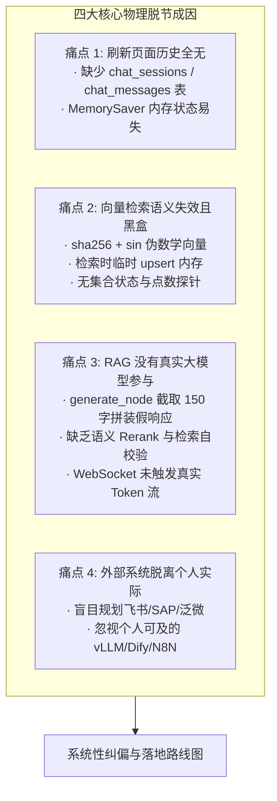

# Enterprise AI Digital Assistant - 项目进展与真实化落地攻坚路线图
# Project Progress & Pragmatic Realization Roadmap

> **项目名称**：基于 LangGraph + RAG + 混合检索 + 开源工作流的企业级 AI 数字员工平台  
> **当前运行模式**：**PRAGMATIC REALIZATION & HARDENING MODE (务实真实化重构与交付攻坚模式)**  
> **模式说明**：面向个人开发者真实可运行、可交付、可 Demo 体验视角，卸除虚假宣传与不可及的企业假设，主攻核心链路真闭环  
> **基准规范**：[docs/MOCK_INVENTORY.md](file:///g:/LLM_Learning/product/docs/MOCK_INVENTORY.md) · [AGENTS.md](file:///g:/LLM_Learning/product/AGENTS.md) · [docs/SPEC.MD](file:///g:/LLM_Learning/product/docs/SPEC.MD)  
> **系统最后更新**：2026-09-23  

---

## 1. 全局真实现状诊断与纠偏看板 (Reality-Check Master Dashboard)

```text
====================================================================================================
【核心基础设施与前端界面】       ████████████████████████████████ 100% (Vue3 现代界面/路由框架/测试基础设施已交付)
【核心业务链路真实性差距】       ██████████░░░░░░░░░░░░░░░░░░░░ 30% (存在假Embedding/硬编码生成/缺失会话表)
【目标模式：个人高保真真闭环】   ████████████████░░░░░░░░░░░░░░░░ 50% (全面转向个人可及技术栈：LLM/Qdrant/Dify/N8N)
====================================================================================================
```

| 治理维度 | 物理排查结论与真实现状 | 纠偏决策与整改目标 |
| :--- | :--- | :--- |
| **数据库持久化** | 🔴 **严重缺失**：仅有 User/Inventory/Ticket/Approval，**完全缺少**会话表（`chat_sessions`）与历史消息表（`chat_messages`）；LangGraph 仅用内存 `MemorySaver` | 🎯 **Sprint R-01 攻坚**：新建 `ChatSession` 与 `ChatMessage` 表，提供分页历史查询 API 与持久化存储，前端支持历史会话回显与切换 |
| **向量库与 Embedding** | 🔴 **伪算法与黑盒**：`get_embedding` 采用 `sha256 + sin` 计算伪 1024 维向量；Qdrant 掉线静默退化到内存；每次检索临时读文件临时 upsert；开发者无法得知库内现状 | 🎯 **Sprint R-02 攻坚**：替换为真实轻量级 Embedding（`fastembed` / BGE / API）；编写一键切片入库脚本 `scripts/ingest_knowledge.py`；新增 `/api/v1/knowledge/status` 探针 |
| **RAG 检索与生成链路** | 🔴 **假回显无真实 LLM**：`generate_node.py` 将检索前 150 字符硬编码拼装为假文本；无真实模型调用；无语义 Rerank 与检索自校验机制 | 🎯 **Sprint R-03 攻坚**：重构 `generate_node`，接入真实 LLM 流式生成（打字机效果）；增加相关性阈值过滤与无上下文时的优雅自校验反思 |
| **大模型推理引擎 (LLM)** | 🟡 **调用层空置**：`llm_gateway.py` 为模拟休眠与假字符串生成，未真正接入任何 API 提供商或本地推理服务 | 🎯 **Sprint R-03/04 攻坚**：封装统一的通用 OpenAI 兼容客户端，一键配置商用 API（DeepSeek / Qwen / OpenAI）或本地推理引擎（vLLM / Ollama） |
| **开源工作流平台 (Dify/n8n)**| 🟡 **内存伪事件**：`workflow.py` 仅在内存列表记录事件，未真正与外部自动化工作流对接 | 🎯 **Sprint R-04 攻坚**：主攻个人可自建部署的 **Dify**（Workflow/Agent API）与 **N8N**（Webhook 自动化编排），实现真实的双向事件联动 |
| **外部企业系统 (HR/ERP/OA)**| 🟢 **定位纠偏**：飞书人事、SAP ERP、泛微 OA 等企业专有系统个人无账号无内网，强行割接不现实 | 🎯 **保持高质量标准化模拟桩**：保留本地 REST API 模拟桩（完整覆盖员工、库存、采购、工单读写与单据流转），无需采购商业软件 |
| **前端终端体验** | 🟢 **100% 验收就绪**：Vue 3 + Tailwind + Lucide + 零黑话，支持流式对话卡片、审批卡片、移动端视口适配 | 🎯 **持续保持**：与后端新持久化 API 对接，打通历史会话抽屉与多轮对话连续性 |

---

## 2. 用户视角实操痛点归因与差距分析 (Gap Analysis)

在真实 Demo 使用过程中暴露的四大核心短板与物理成因：



### 痛点 1：数据库遗漏会话历史与工单审批上下文孤岛
- **现象**：用户在前端发消息聊天后，刷新页面聊天记录无法找回；工单和审批记录散落在单点接口中，未与特定会话线程强绑定。
- **成因**：前序设计侧重于单次请求的单元测试通过率，仅在 LangGraph 中使用了内存型的 `MemorySaver()`，未在 SQLAlchemy 中建立 `chat_sessions` 和 `chat_messages` 实体表。

### 痛点 2：向量库黑盒且使用伪向量算法
- **现象**：开发者在本地启动项目后，完全不知道 Qdrant 有没有部署、规章制度文档有没有切片入库、检索到底有没有命中。
- **成因**：`backend/rag/vector_store.py` 内部使用 `hashlib.sha256 + sin` 计算假向量，无法度量语义相似度；每次查询时重新扫描本地文件插入内存，缺乏持久化的知识库离线构建管道。

### 痛点 3：RAG 全链路无真实大模型流式生成与自校验
- **现象**：用户提问任何规章制度，系统返回的都是一段机械的 `[RAG Answer]: Based on corporate knowledge base...` 开头的截取文本。
- **成因**：`generate_node.py` 中写死了纯字符串拼接逻辑，完全没有通过 LangChain 或 SDK 调用真实大模型（OpenAI/DeepSeek 等）；也缺少判断检索内容是否相关的自校验（Self-Correction）机制。

### 痛点 4：对接方向脱离个人实际
- **现象**：文档中规划了大量“无感割接到飞书、SAP ERP、泛微 OA、企业微信”，但个人开发者既无企业凭证也无企业内网，造成大量代码空置。
- **成因**：规划初期直接套用了大型外企架构蓝图。纠偏后，应坚决将企业系统降级为**本地高质量模拟桩**，将精力聚焦于个人完全可玩转的 **OpenAI兼容大模型 / 本地 vLLM / Ollama** 以及 **开源自建工作流平台 Dify / N8N**。

---

## 3. 务实攻坚路线图与阶段规划 (Pragmatic Sprint Plan)

为了面向用户视角彻底打通真实的端到端体验，制定以下四个真实化攻坚 Sprint：

```text
┌────────────────────────────────────────────────────────────────────────────────────────────────────────┐
│                        PRAGMATIC REALIZATION: 4 大真实化攻坚 Sprint 规划                               │
├───────────────────┬───────────────────┬────────────────────┬───────────────────────────────────────────┤
│ Sprint R-01       │ Sprint R-02       │ Sprint R-03        │ Sprint R-04                               │
├───────────────────┼───────────────────┼────────────────────┼───────────────────────────────────────────┤
│ 数据库与会话持久化 │ 真实向量库与构建探针 │ 真实 RAG 与 LLM 生成│ 个人工作流与引擎集成                      │
│ (Chat Persistence)│ (Real Vector KB)  │ (Real RAG Pipeline)│ (vLLM / Dify / N8N Integration)           │
│                   │                   │                    │                                           │
│ · 新增 Session 表 │ · 真实 Embedding  │ · 接入真实大模型   │ · 适配 OpenAI / DeepSeek / vLLM / Ollama  │
│ · 新增 Message 表 │ · 离线切片入库脚本│ · 重构生成节点     │ · Dify Workflow API 真实调用              │
│ · 历史列表与回显  │ · 向量状态监控探针│ · 检索自校验反思   │ · N8N Webhook 真实事件通知                │
│ · 状态机持久化    │ · 语义相似度测试  │ · 真实流式 Token   │ · 完善个人一键启动部署指南                │
└───────────────────┴───────────────────┴────────────────────┴───────────────────────────────────────────┘
```

---

### 3.1 Sprint R-01: 数据库与会话持久化真身落地 (Chat & Session Persistence)

* **攻坚目标**：补齐数据库中缺失的对话实体表，打通会话历史持久化，使前端支持刷新后多轮历史回显与多会话管理。
* **交付内容**：
  1. **新建 SQLAlchemy 模型**（`backend/models/chat.py`）：
     - `ChatSession`：会话唯一标识 `session_id`、用户 ID、会话标题 `title`、创建与更新时间、软删除标记。
     - `ChatMessage`：消息 ID、关联 `session_id`、角色 `role`（user / assistant / system / tool）、消息文本 `content`、检索引用的源文件元数据 `sources`、时间戳。
  2. **会话管理 REST API**（`backend/api/v1/chat.py`）：
     - `GET /api/v1/chat/sessions`：获取当前用户的历史会话列表（分页、按最新更新时间倒序）。
     - `GET /api/v1/chat/sessions/{session_id}/messages`：获取指定会话的历史消息记录。
     - `DELETE /api/v1/chat/sessions/{session_id}`：删除指定会话及其消息。
     - `PUT /api/v1/chat/sessions/{session_id}/title`：修改会话标题。
  3. **WebSocket 与状态机持久化联动**：
     - 用户通过 WebSocket 发送消息时，自动创建/更新 `ChatSession`，并向 `ChatMessage` 插入用户提问。
     - LLM 生成回答完毕后，自动向 `ChatMessage` 插入助手回复与引用溯源。
     - 前端左侧历史会话抽屉对接上述 API，点击历史会话即可无缝加载上下文。

---

### 3.2 Sprint R-02: 真实向量库底座与知识库离线构建全可观测 (Real Vector & Ingestion)

* **攻坚目标**：彻底消灭伪哈希向量算法，接入真实轻量级 Embedding，提供一键离线切片入库工具与向量库运行状态探针。
* **交付内容**：
  1. **真实 Embedding 引擎接入**（`backend/rag/embeddings.py`）：
     - 引入轻量级、免本地复杂 GPU 环境的 `fastembed`（默认载入 `BAAI/bge-small-zh-v1.5`，CPU 秒级运行，纯本地推理零成本），或支持配置 OpenAI 兼容的远程 Embedding API。
  2. **一键离线切片入库脚本**（`backend/scripts/ingest_knowledge.py`）：
     - 递归读取 `docs/sample_kb/` 及自定义知识库目录下的 Markdown、PDF、Excel、TXT 文件。
     - 按照递归字符/语义规则分块（Chunking），提取元数据（部门、分类、安全密级）。
     - 批量调用真实 Embedding 并持久化写入 Qdrant 集合中。
     - 控制台打印明晰日志：解析文件数、切片 Chunk 数、写入 Point 数、耗时，并自动运行 1 道测试 Query 验证召回正确性。
  3. **知识库状态可观测探针**（`backend/api/v1/knowledge.py`）：
     - `GET /api/v1/knowledge/status`：返回 Qdrant 运行状态、当前集合 Point 总数、向量维度与度量方式、已入库文件清单与切片分布。

---

### 3.3 Sprint R-03: 端到端真实 RAG 闭环与大模型流式生成 (Real RAG Pipeline & LLM)

* **攻坚目标**：重构生成节点，接入真实大模型进行语义理解与内容生成，实现真正的打字机流式输出、检索自校验与引用溯源。
* **交付内容**：
  1. **统一大模型调用层**（`backend/core/llm.py`）：
     - 封装 `get_chat_llm()`，提供通用 OpenAI 兼容协议支持。
     - 用户只需在 `.env` 中配置 `OPENAI_API_BASE`、`OPENAI_API_KEY` 与 `LLM_MODEL`，即可零代码接入 DeepSeek、通义千问 Qwen、OpenAI 或本地部署的 vLLM / Ollama。
  2. **重构生成节点**（`backend/graph/nodes/generate_node.py`）：
     - 注入系统角色设定（System Prompt）：企业数字员工助理，基于知识库真实严谨作答。
     - 将检索到的候选 Context 与历史对话注入 Prompt，调用真实模型完成回答合成。
     - 对接 WebSocket 的 `on_chat_model_stream` 事件，实现真正的逐字 Token 流式推送。
  3. **检索质量自校验与反思机制 (Self-Correction)**：
     - 引入相似度阈值过滤（如 Rerank/Vector 得分 < 0.25 的切片自动过滤）。
     - 若未检索到高相关性内容，触发自校验优雅反思：“在当前企业知识库中未找到与您问题直接匹配的制度条款，建议咨询 HR/IT 相关负责人或调整提问关键词”，杜绝模型凭空编造。
  4. **精确引用溯源**：在回复末尾清晰标注文档名与对应章节（如 `[参考: 采购审批管理制度.md (第 3 章 审批权限)]`）。

---

### 3.4 Sprint R-04: 个人可及的开源工作流集成与部署指南 (Workflows & Runbook)

* **攻坚目标**：打通自建开源工作流平台（Dify、N8N）的真实调用，收拢规范 HR/ERP/OA 本地模拟桩，提供个人一键启动与使用白皮书。
* **交付内容**：
  1. **N8N 真实 Webhook 联动**：
     - 当系统触发采购审批、报修工单时，真正通过 HTTP POST 向用户配置的 N8N Webhook 发送 JSON 载荷，验证 N8N 自动化流的触发与执行。
  2. **Dify Workflow API 联动**：
     - 编写 Dify 客户端适配器，支持向本地或云端部署的 Dify 发起任务请求并解析结构化返回。
  3. **HR / ERP / OA 本地标准化模拟桩固化**：
     - 明确其作为“开箱即用优质模拟桩”的定位，确保即使在完全离线无外部企业账号的情况下，员工查询、库存增减、采购单创建、工单流转也 100% 能够自闭环运行。
  4. **个人高保真部署与运行指南**（`docs/PERSONAL_RUNBOOK.md`）：
     - 提供极简的一键环境拉起（Docker 运行 Qdrant/MySQL，或单机免 Docker 的 SQLite+本地Embedding+商用API）。
     - 提供保姆级 `.env` 配置说明与常见问题排查指南。

---

## 4. 历史阶段已交付稳态资产 (Preserved Foundations)

前序开发中已经沉淀的扎实工程骨架将被 100% 继承并作为坚实底座：

1. **前端 ChatGPT / Gemini 现代化终端体验 (100% 交付)**：
   - Vue 3 + Tailwind CSS + Lucide 图标库；
   - 响应式侧边栏、移动端抽屉、Markdown 实时渲染、流式打字机视觉组件；
   - 采购与审批人机协同卡片交互。
2. **LangGraph 状态机拓扑与核心骨架 (100% 交付)**：
   - 完整的 StateGraph 意图路由节点、条件边流转、工具调用节点（Tool Node）以及中断挂起（Interrupt）机制。
3. **工程合规与测试框架 (100% 交付)**：
   - `ruff check` 0 告警代码质量控制；
   - 模块化单测套件与自动化测试基线；
   - 统一配置管理 `backend/core/config.py` 与异常处理基类。

---

## 5. 总结与下一步行动

通过本次重整：
- 我们坦诚直面了前序阶段在**会话持久化、向量化有效性、真实大模型接入与可及性边界**上的差距；
- 确立了以**“个人可运行、高保真、真闭环”**为核心指导思想的 4 个真实化攻坚 Sprint（R-01 ~ R-04）；
- 接下来即可依据此路线图，逐项落地真实代码与数据库表结构，将企业级 AI 数字员工平台打造成真正经得起用户深度实操的优质产品！
