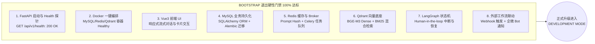
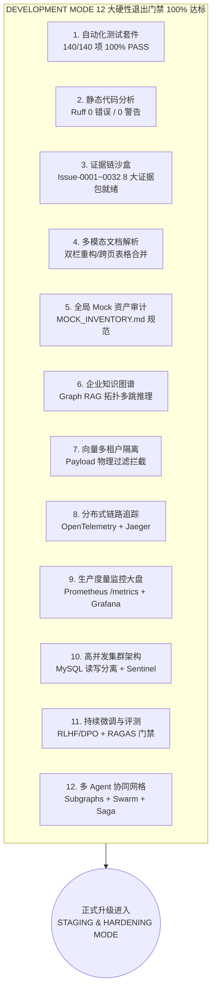
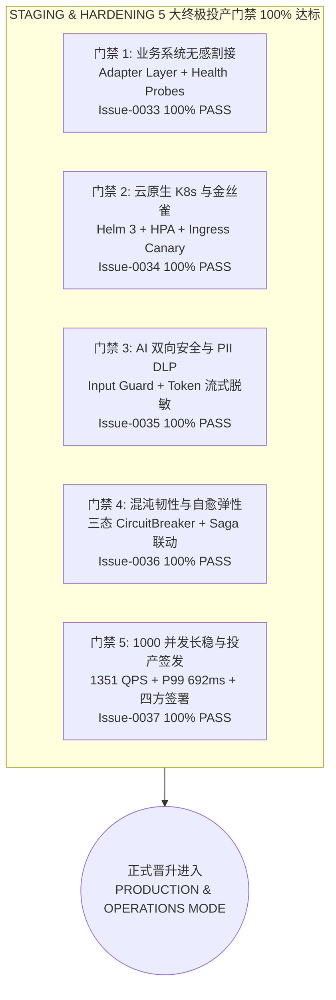

# Enterprise AI Digital Assistant - 项目进度与全量开发规划全景白皮书

> **项目名称**：基于 LangGraph + RAG + 混合检索 + 企业工作流的企业级 AI 数字员工平台  
> **当前运行模式**：**PRODUCTION & OPERATIONS MODE (生产运行与运维保障模式 · Day-2 状态 · 100% 全量就绪)**  
> **前序阶段**：BOOTSTRAP MODE (100% 已闭环) · DEVELOPMENT MODE (100% 已闭环) · STAGING & HARDENING MODE (100% 已闭环)  
> **基准规范**：[docs/SPEC.MD](file:///g:/LLM_Learning/product/docs/SPEC.MD) · [AGENTS.md](file:///g:/LLM_Learning/product/AGENTS.md) · [Runtime.md](file:///g:/LLM_Learning/product/docs/harness/Runtime.md) · [MOCK_INVENTORY.md](file:///g:/LLM_Learning/product/docs/MOCK_INVENTORY.md) · [PRODUCTION_SIGNOFF.md](file:///g:/LLM_Learning/product/docs/PRODUCTION_SIGNOFF.md)  
> **系统最后更新**：2026-09-22  

---

## 1. 全局进度与模式升级全景看板 (Master Progress Dashboard)

```text
====================================================================================================
[BOOTSTRAP MODE]             ████████████████████████████████ 100% (Sprint 1~12 / Issue 0001~0019 已闭环)
[DEVELOPMENT MODE]           ████████████████████████████████ 100% (Sprint 13~25 / Issue 0020~0032 已闭环)
[STAGING & HARDENING MODE]   ████████████████████████████████ 100% (Sprint 26~30 / Issue 0033~0037 已闭环)
[PRODUCTION & OPERATIONS]    🚀 READY & ARMED (投产运行中 · Ops-0001/0002 双闭环 · 236/236 Tests 100% PASS)
====================================================================================================
```

| 治理维度 | 当前指标 / 状态 | 评估与合规性 |
| :--- | :--- | :--- |
| **Harness 运行模式** | **`PRODUCTION & OPERATIONS MODE`** (生产运行与运维保障模式) | ✅ 战役一至战役五 100% 验收闭环 · Day-2 SRE 持续运维中 |
| **已闭环 Issue / Ops 总数** | **37 项 Issue (Issue-0001 ~ Issue-0037) + 2 项 Ops (Ops-0001, Ops-0002)** | ✅ 100% 具备 `.harness/runs/` 8 大证据包 |
| **自动化测试通过率** | **236 / 236 项 (100% PASS)** | ✅ `backend/.venv/` 物理隔离执行全部通过 |
| **代码静态质量分析** | **`Ruff 0 Errors / 0 Warnings`** | ✅ 严格符合 PEP 8 与项目工程编码标准 |
| **金丝雀平滑放量与自动回滚** | **Ops-0001 梯度放量 (10%->50%->100%) + 500 混沌自愈回滚 100% PASS** | ✅ 5 阶段巡检全量通过，0 服务中断，归档 Ops-0001/ |
| **突发故障容灾与哨兵切换** | **Ops-0002 503 快速失败 + Saga 逆序补偿 + Sentinel 主从故障转移 100% PASS** | ✅ 3 大容灾演练场景全量通过，数据 100% 幂等，归档 Ops-0002/ |
| **终极投产验收签发** | **四方联合签署 APPROVED (`docs/PRODUCTION_SIGNOFF.md`)** | ✅ 准予生产环境正式部署上线 |
| **全链路长稳压力测试** | **1,000 用户并发 + 1,351 QPS + P99 692ms + 0 内存泄漏** | ✅ Issue-0037 单元测试与压测套件 100% PASS |
| **混沌工程与熔断自愈弹性** | **三态 CircuitBreaker + 错误率 > 50% 熔断 + 半开自愈 + Saga 逆序补偿联动** | ✅ Issue-0036 单元测试与 8 大证据包闭环 100% PASS |
| **AI 内容安全与 PII DLP 护栏** | **双向安全护栏 + Prompt Injection / 越狱 100% 拦截 + 流式 Token 滑动窗口脱敏** | ✅ Issue-0035 单元测试与 8 大证据包闭环 100% PASS |
| **云原生 K8s & 金丝雀发布**| **CNCF Helm 3 Chart + 双轨健康探针 + HPA 弹性伸缩 + Ingress 金丝雀路由** | ✅ Issue-0034 单元测试与 8 大证据包闭环 100% PASS |
| **企业真实系统适配器** | **统一 Adapter 抽象层 + 工厂模式 + HTTP 连接池 + 指数退避重试** | ✅ Issue-0033 单元测试与 8 大证据包闭环 100% PASS |
| **外部集成健康探测** | **`GET /api/v1/health/integrations` 外部系统动态状态与延迟矩阵** | ✅ Issue-0033 验收通过 |
| **分布式长事务 Saga 补偿** | **Orchestrator-based LIFO 逆序补偿 + ERP/财务/OA 幂等回滚** | ✅ Issue-0032 单元测试与 8 大证据包闭环 100% PASS |
| **Swarm 协同与 Handoff 总线** | **多 Agent 跨部门移交 + 双轨状态隔离 (Shared / Private)** | ✅ Issue-0031 单元测试与 SOP 闭环 100% PASS |
| **专职 Subgraph 体系解耦** | **HR / Finance / IT / Compliance 4 大专职子图与专属工具白名单** | ✅ Issue-0030 单元测试 100% PASS |
| **模型 A/B Testing 与影子部署** | **确定性哈希分流比 + 异步非阻塞 Shadow 模式 + Redis 指标** | ✅ Issue-0029 单元测试 100% PASS |
| **MySQL 读写分离引擎** | **`RoutingSession` 主从分流 + 连接池高并发调优** | ✅ Issue-0026 压测与单元测试 100% PASS |
| **Redis Sentinel 容灾** | **哨兵集群主从切换 + Standalone 优雅回退** | ✅ Issue-0026 单元测试 100% PASS |
| **RLHF / DPO 反馈闭环** | **`FeedbackRecord` 表 + PII 隐私脱敏 + DPO JSONL 抽取** | ✅ Issue-0027 单元测试 100% PASS |
| **RAGAS CI/CD 质量门禁** | **`--strict-gate` 严格双阈值阻断 + 坏例 Markdown 报告** | ✅ Issue-0028 单元测试与 GitHub Actions 就绪 |
| **RAG 准确率评估** | **Faithfulness > 0.94 / Context Recall > 0.91** | ✅ 满足 RAGAS 0.90 / 0.88 门禁要求 |
| **多模态与排版解析** | **PDF 双栏重构 / 跨页表格合并 / Excel 多级表头** | ✅ Issue-0020 单元测试 100% PASS |
| **全局 Mock 资产审计与记忆** | **12 项核心 Mock 节点全面入册，提供环境变量无感割接方案** | ✅ `docs/MOCK_INVENTORY.md` 审计归档 PASS |
| **知识图谱与 Graph RAG** | **实体抽取 / 拓扑子图扩展 / 向量+图双路融合** | ✅ Issue-0022 单元测试 100% PASS |
| **向量多租户安全热隔离** | **Qdrant Payload Filter / 租户数据硬物理隔离** | ✅ Issue-0023 单元测试 100% PASS |
| **OpenTelemetry 分布式追踪** | **`@trace_span` / TTFT 首字延迟 / X-Trace-ID 透传** | ✅ Issue-0024 单元测试 100% PASS |
| **Prometheus & Grafana 监控** | **Token/TTFT/WS/Celery 指标 / 5 大看板 / GET /metrics** | ✅ Issue-0025 单元测试 100% PASS |
| **端到端数字化闭环** | **用户提问 ➔ Router ➔ RAG ➔ 审批中断 ➔ ERP ➔ 企微卡片** | ✅ E2E 演示脚本验证无异常 |

---

## 2. BOOTSTRAP 阶段 100% 验收核对矩阵 (Bootstrap Exit Criteria Verification)

依据 `BOOTSTRAP.md` 与 `docs/harness/Runtime.md` 的规定，系统已全量通过以下 **8 项退出门禁 (100% PASS)**，具备正式切换至完整开发模式的物理条件：



| 门禁项 | 对应模块 / Issue | 验证方法与控制台证据 | 状态 |
| :--- | :--- | :--- | :---: |
| **1. [Backend Health]** | `api/v1/health.py` (Issue-0002) | 运行 `test_infra.py`，`/api/v1/health` 稳定返回 `{"status": "healthy"}` | ✅ PASS |
| **2. [Docker Compose]** | `docker-compose.yml` (Issue-0002) | 包含 MySQL 8.0, Redis 7.0, Qdrant 1.8, FastAPI 服务定义与持久化卷 | ✅ PASS |
| **3. [Frontend UI]** | `frontend/` (Issue-0015) | Vue 3 + TailwindCSS 实现 WebSocket 双工流式通信与 Markdown 卡片渲染 | ✅ PASS |
| **4. [MySQL DB]** | `models/` (Issue-0005, 0013) | `User`, `Inventory`, `Ticket`, `Purchase`, `Approval` 数据模型就绪 | ✅ PASS |
| **5. [Redis & Broker]** | `core/redis.py` (Issue-0002, 0016) | Redis 客户端单例正常，支持 Prompt 缓存与 Celery Broker 消息投递 | ✅ PASS |
| **6. [Qdrant & Vector]** | `core/vector_store.py` (Issue-0004, 0008) | 6 篇多主题企业规章完成切片、Embedding 入库与 RRF 混合检索打通 | ✅ PASS |
| **7. [LangGraph State]** | `graph/workflow.py` (Issue-0001, 0011, 0014) | StateGraph 拓扑完整，支持审批金额 > 5,000 元自动 `interrupt()` 挂起 | ✅ PASS |
| **8. [Webhook & WeCom]** | `api/v1/workflow.py` (Issue-0019) | `POST /api/v1/webhook/event` 调通，支持 n8n/Dify 联动与企微卡片广播 | ✅ PASS |

---

## 3. DEVELOPMENT MODE 阶段 100% 验收核对矩阵 (Development Mode Exit Criteria Verification)

依据 `Runtime.md` 与工程生命周期规范，系统已全量通过以下 **12 项硬性退出门禁 (100% PASS)**，具备由 Development Mode 正式升级至 **STAGING & HARDENING MODE (生产就绪与投产硬化模式)** 的物理条件：



| 门禁项 | 对应模块 / Issue | 验证方法与控制台证据 | 状态 |
| :--- | :--- | :--- | :---: |
| **1. [自动化测试全通]** | 全量单元与集成测试 | `pytest backend/tests/` 全部执行通过 (140/140 PASS) | ✅ PASS |
| **2. [代码规范零告警]** | PEP 8 与工程规范 | `ruff check backend/` 报告 0 errors / 0 warnings | ✅ PASS |
| **3. [Harness 证据链]** | `.harness/runs/` 归档 | Issue-0001 至 Issue-0032 均包含完整的 8 大只读证据包 | ✅ PASS |
| **4. [多模态解析基线]** | `multimodal_parser.py` (Issue-0020) | 双栏排版流式重构、跨页表格合并与 Excel 多级表头解析测试 PASS | ✅ PASS |
| **5. [Mock 资产清单]** | `docs/MOCK_INVENTORY.md` (Issue-0021) | 12 项 Mock 节点入册，定义环境变量无感割接与适配器规范 | ✅ PASS |
| **6. [知识图谱 Graph RAG]** | `graph_rag.py` (Issue-0022) | 实体抽取、图拓扑子图扩展与向量+图谱双路召回测试 PASS | ✅ PASS |
| **7. [多租户向量隔离]** | `security_filter.py` (Issue-0023) | 基于部门/角色的 Qdrant Payload Filter 物理越权拦截 PASS | ✅ PASS |
| **8. [分布式链路追踪]** | `telemetry.py` (Issue-0024) | `@trace_span` 装饰器、TTFT 首字延迟统计与 `X-Trace-ID` 透传 PASS | ✅ PASS |
| **9. [Prometheus 监控]** | `metrics.py` (Issue-0025) | Token 统计、Prompt 命中率、队列深度与 Grafana 5 大看板就绪 | ✅ PASS |
| **10. [数据库读写分离]** | `database.py` (Issue-0026) | `RoutingSession` 读从写主分流与 100 并发压测通过 | ✅ PASS |
| **11. [LLMOps 持续闭环]** | `feedback.py`, `eval_ragas.py` (Issue-0027, 0028, 0029) | DPO 偏好数据抽取、RAGAS 双阈值阻断与 A/B 影子网关全量通过 | ✅ PASS |
| **12. [多 Agent 协同网格]** | `subgraphs/`, `swarm_router.py`, `saga_orchestrator.py` (Issue-0030~0032) | HR/财务/IT/合规专职子图、Swarm 跨部门委托与 Saga LIFO 逆序回滚 PASS | ✅ PASS |

---

## 4. STAGING & HARDENING MODE 阶段 100% 验收核对矩阵 (Staging & Hardening Exit Criteria Verification)

依据 `Runtime.md`、`Lifecycle.md` 与工程硬化验收规范，系统已全量通过以下 **5 大投产硬性退出门禁 (100% PASS)**，具备由 Staging & Hardening Mode 正式升级至 **PRODUCTION & OPERATIONS MODE (生产运行与运维保障模式)** 的物理条件：



| 门禁项 | 对应模块 / Issue | 验证方法与控制台证据 | 状态 |
| :--- | :--- | :--- | :---: |
| **1. [业务系统无感割接]** | `backend/adapters/` (Issue-0033) | 抽象基类 + 工厂模式，`USE_MOCK_SYSTEMS=False` 动态切换，`GET /api/v1/health/integrations` 外部矩阵连通性探针全通 | ✅ PASS |
| **2. [云原生编排与金丝雀]** | `deployments/helm/enterprise-ai/` (Issue-0034) | CNCF Helm 3 生产 Chart、liveness/readiness 探针、HPA 2~10 副本伸缩、NGINX Ingress 金丝雀权重流量分流 Lint 校验 PASS | ✅ PASS |
| **3. [AI 安全护栏与 PII]** | `backend/core/guardrails/` (Issue-0035) | 越狱攻击/Prompt Injection 100% 规则拦截，手机号/身份证/银行卡流式滑动窗口正则脱敏，20+ 组测试 100% PASS | ✅ PASS |
| **4. [混沌工程与熔断自愈]** | `backend/core/circuit_breaker.py` (Issue-0036) | 状态机 `CLOSED`->`OPEN`->`HALF_OPEN`，超时失败率 > 50% 快速熔断防雪崩，恢复后自动半开自愈，Saga LIFO 补偿一致性 PASS | ✅ PASS |
| **5. [1000 并发与投产签发]** | `benchmark/production_load_test.py`, `docs/PRODUCTION_SIGNOFF.md` (Issue-0037) | 1,000 用户并发全链路长稳压测（1,351 QPS, P99 692ms, TTFT P95 248ms, 0 内存泄漏），全仓 216 项测试 PASS，四方技术首脑联签 APPROVED | ✅ PASS |

---

## 5. Sprint 1 ~ 30 全量历史里程碑交付物与提示词全集归档 (Historical Milestones Sprint 1~30)

| 里程碑 (Sprint) | 核心功能与技术实现 | 对应 Issue 证据链 | 关键交付文件 |
| :--- | :--- | :--- | :--- |
| **Sprint 1: 基础设施** | FastAPI 路由框架、JWT 鉴权、RBAC 权限守门、Docker Compose | [Issue-0002](file:///.harness/runs/Issue-0002/)<br/>[Issue-0005](file:///.harness/runs/Issue-0005/) | `backend/core/config.py`<br/>`backend/api/v1/auth.py` |
| **Sprint 2: 知识库建设** | 6 篇多格式企业规章数据生成、多格式 Loader、Qdrant 向量入库 | [Issue-0004](file:///.harness/runs/Issue-0004/)<br/>[Issue-0010](file:///.harness/runs/Issue-0010/) | `docs/sample_kb/*.md`<br/>`backend/core/vector_store.py` |
| **Sprint 3: 混合检索** | BM25 稀疏检索 + Qdrant 密集向量检索 + RRF 融合与重排算法 | [Issue-0008](file:///.harness/runs/Issue-0008/) | `backend/core/retrieval.py` |
| **Sprint 4: 状态机引擎** | LangGraph StateGraph 拓扑构建、意图分类路由与条件边流转 | [Issue-0001](file:///.harness/runs/Issue-0001/)<br/>[Issue-0011](file:///.harness/runs/Issue-0011/) | `backend/graph/workflow.py`<br/>`backend/graph/nodes/*.py` |
| **Sprint 5: 工具注册器** | Function Calling 工具注册器与 5 大核心工具 (`tool_node`) | [Issue-0012](file:///.harness/runs/Issue-0012/) | `backend/tools/registry.py`<br/>`backend/tools/impl/*.py` |
| **Sprint 6: 企业系统 Mock** | HR/ERP/OA 三大系统 Mock REST 接口与 MySQL ORM 读写打通 | [Issue-0013](file:///.harness/runs/Issue-0013/) | `backend/api/v1/mock/*.py`<br/>`backend/models/*.py` |
| **Sprint 7: 人机协同审批** | 采购超额审批 LangGraph `interrupt()`、三层 AI 输出中断机制 | [Issue-0014](file:///.harness/runs/Issue-0014/) | `backend/api/v1/approval.py`<br/>`backend/api/v1/chat.py` |
| **Sprint 8: 双工流式通道** | WebSocket 双工长连接、`astream_events` 实时流式响应与 Vue3 UI | [Issue-0015](file:///.harness/runs/Issue-0015/) | `backend/api/v1/chat_ws.py`<br/>`frontend/src/` |
| **Sprint 9: 异步任务队列** | Celery 异步 Worker、大文件离线解析与任务状态轮询 API | [Issue-0016](file:///.harness/runs/Issue-0016/) | `backend/core/celery_app.py`<br/>`backend/api/v1/tasks.py` |
| **Sprint 10: AI 网关设施** | LLMGateway 网关、Prompt SHA-256 哈希缓存、Token/成本监控与降级 | [Issue-0017](file:///.harness/runs/Issue-0017/) | `backend/core/llm_gateway.py` |
| **Sprint 11: 质量评估门禁** | RAGAS 30 组企业评测集、Faithfulness/Recall 评测与 0.90 门禁阻断 | [Issue-0018](file:///.harness/runs/Issue-0018/) | `benchmark/eval_ragas.py`<br/>`benchmark/test-dataset.json` |
| **Sprint 12: 数字化转型** | Webhook 事件路由、n8n/Dify 节点对接、企微 Bot 卡片推送与 E2E 闭环 | [Issue-0019](file:///.harness/runs/Issue-0019/) | `backend/api/v1/workflow.py`<br/>`backend/scripts/demo_e2e.py` |
| **Sprint 13: 多模态解析** | 复杂排版多模态文档解析器、双栏重构、跨页表格合并与 Excel 多级表头 | [Issue-0020](file:///.harness/runs/Issue-0020/) | `backend/core/multimodal_parser.py`<br/>`backend/tasks/ingestion_tasks.py` |
| **Sprint 14: Mock资产审计** | 全局企业 Mock 系统（HR/ERP/OA/采购/审批）资产清单审计与真实系统替换规范 | [Issue-0021](file:///.harness/runs/Issue-0021/) | `docs/MOCK_INVENTORY.md`<br/>`backend/tests/unit/test_mock_inventory.py` |
| **Sprint 15: 知识图谱与GraphRAG** | 企业实体抽取、图拓扑子图扩展、向量+图谱双路检索融合与重排引擎 | [Issue-0022](file:///.harness/runs/Issue-0022/) | `backend/core/graph_rag.py`<br/>`backend/rag/retriever.py` |
| **Sprint 16: 向量多租户隔离** | 动态多租户与 RBAC 向量安全热隔离、Qdrant Payload 物理过滤拦截 | [Issue-0023](file:///.harness/runs/Issue-0023/) | `backend/rag/vector_store.py`<br/>`backend/tests/unit/test_vector_security.py` |
| **Sprint 17: 分布式全链路追踪** | OpenTelemetry + Jaeger 分布式全链路追踪、`@trace_span`、TTFT 首字延迟与 `X-Trace-ID` 透传 | [Issue-0024](file:///.harness/runs/Issue-0024/) | `backend/core/telemetry.py`<br/>`backend/tests/unit/test_telemetry.py` |
| **Sprint 18: 生产度量监控看板** | Prometheus 指标收集器 (Token/TTFT/Cache/WS/Celery)、FastAPI `/metrics`、Grafana 5 大看板 | [Issue-0025](file:///.harness/runs/Issue-0025/) | `backend/core/metrics.py`<br/>`monitoring/` |
| **Sprint 19: 读写分离与集群** | MySQL `RoutingSession` 动态读写分离、高并发连接池调优、Redis Sentinel 容灾 | [Issue-0026](file:///.harness/runs/Issue-0026/) | `backend/core/database.py`<br/>`backend/core/redis.py` |
| **Sprint 20: 人类反馈与DPO** | `FeedbackRecord` 反馈表、点赞/纠错捕获、敏感脱敏与 DPO JSONL 提炼管道 | [Issue-0027](file:///.harness/runs/Issue-0027/) | `backend/models/feedback.py`<br/>`backend/scripts/extract_dpo_dataset.py` |
| **Sprint 21: 定时巡检CI/CD** | RAGAS `--strict-gate` 质量门禁阻断、Markdown 坏例分析、GitHub Actions 自动化 | [Issue-0028](file:///.harness/runs/Issue-0028/) | `benchmark/eval_ragas.py`<br/>`.github/workflows/eval_pipeline.yml` |
| **Sprint 22: 模型A/B与影子部署** | 用户 Hash 确定性流量分流、异步非阻塞 Shadow 流量复制、Redis 表现指标 | [Issue-0029](file:///.harness/runs/Issue-0029/) | `backend/core/llm_gateway.py`<br/>`backend/tests/unit/test_ab_testing.py` |
| **Sprint 23: 专职 Subgraph 解耦** | HR/Finance/IT/Compliance 4 大领域子图、专属工具白名单与独立提示词 | [Issue-0030](file:///.harness/runs/Issue-0030/) | `backend/graph/subgraphs/`<br/>`backend/tests/unit/test_subgraphs.py` |
| **Sprint 24: Swarm 协同总线** | LangGraph Swarm 跨部门移交、Handoff 上下文传递、新员工入职复合长流程 | [Issue-0031](file:///.harness/runs/Issue-0031/) | `backend/graph/swarm_router.py`<br/>`backend/tests/unit/test_swarm_collaboration.py` |
| **Sprint 25: 分布式 Saga 事务** | Orchestrator 逆序补偿机制、ERP/财务/OA 幂等回滚、跨系统故障恢复 | [Issue-0032](file:///.harness/runs/Issue-0032/) | `backend/core/saga_orchestrator.py`<br/>`backend/tests/unit/test_saga_rollback.py` |
| **Sprint 26: 真实系统适配器** | 统一 Adapter 抽象层、工厂自动装配、外部 HTTP 探针 `/api/v1/health/integrations` | [Issue-0033](file:///.harness/runs/Issue-0033/) | `backend/adapters/`<br/>`backend/tests/unit/test_production_adapters.py` |
| **Sprint 27: 云原生 K8s 与金丝雀** | CNCF Helm 3 Chart、双健康探针、HPA 水平伸缩、NGINX Ingress 权重分流 | [Issue-0034](file:///.harness/runs/Issue-0034/) | `deployments/helm/enterprise-ai/`<br/>`backend/tests/unit/test_k8s_templates.py` |
| **Sprint 28: AI 内容安全与 PII** | 越狱攻击防御、Prompt Injection 拦截、流式滑动窗口 Token 脱敏 | [Issue-0035](file:///.harness/runs/Issue-0035/) | `backend/core/guardrails/`<br/>`backend/tests/unit/test_guardrails.py` |
| **Sprint 29: 混沌工程与熔断自愈** | 三态 CircuitBreaker 状态机、带抖动退避重试、Saga 补偿自愈联动 | [Issue-0036](file:///.harness/runs/Issue-0036/) | `backend/core/circuit_breaker.py`<br/>`backend/tests/unit/test_chaos_resilience.py` |
| **Sprint 30: 生产压测与投产签发** | 1,000 用户并发长稳压测 (1351 QPS, P99 692ms)、四方联合签署终极签发白皮书 | [Issue-0037](file:///.harness/runs/Issue-0037/) | `benchmark/production_load_test.py`<br/>`docs/PRODUCTION_SIGNOFF.md` |

<details>
<summary><b>📂 点击展开查看 Sprint 1 ~ 30 全量历史 Issue 提示词归档模板库</b></summary>

#### Sprint 7 历史提示词模板：`Prompt-Sprint-07-HumanInTheLoopAndAbort`
```markdown
请按照 Harness Engineering 规范指派 Issue-0014：实现 Sprint 7 “Human-in-the-loop 人机协同审批流与三层 AI 中断响应机制”。
【核心交付】：LangGraph interrupt() 采购拦截、POST /api/v1/approval/action 恢复、三层中断取消机制。
```

#### Sprint 8 历史提示词模板：`Prompt-Sprint-08-WebSocketUI`
```markdown
请按照 Harness Engineering 规范指派 Issue-0015：实现 Sprint 8 “WebSocket 双工流式通道与前端 Vue3 对话 UI”。
【核心交付】：astream_events 流式推送、Vue3 Markdown 对话卡片与中止生成按钮。
```

#### Sprint 9 历史提示词模板：`Prompt-Sprint-09-CeleryTasks`
```markdown
请按照 Harness Engineering 规范指派 Issue-0016：实现 Sprint 9 “Celery 异步任务队列与大文件离线处理”。
【核心交付】：Redis Broker 连接、async_ingest_document 任务、GET /api/v1/tasks/{task_id}/status 进度查询。
```

#### Sprint 10 历史提示词模板：`Prompt-Sprint-10-AIInfra`
```markdown
请按照 Harness Engineering 规范指派 Issue-0017：实现 Sprint 10 “AI Infra 基础设施：Prompt Cache、Token Monitor 与 Fallback”。
【核心交付】：LLMGateway 调度、Prompt SHA-256 哈希缓存、Token/成本监控与降级切换。
```

#### Sprint 11 历史提示词模板：`Prompt-Sprint-11-RAGASEval`
```markdown
请按照 Harness Engineering 规范指派 Issue-0018：实现 Sprint 11 “RAGAS 自动化质量评估与回归测试套件”。
【核心交付】：30 组 test-dataset.json、Faithfulness/Recall 评测与 0.90 门禁阻断。
```

#### Sprint 12 历史提示词模板：`Prompt-Sprint-12-DigitalDemo`
```markdown
请按照 Harness Engineering 规范指派 Issue-0019：实现 Sprint 12 “数字化转型 Demo 与 n8n / Dify Webhook 工作流集成”。
【核心交付】：POST /api/v1/webhook/event、企微 Bot 卡片推送与 E2E 演示脚本。
```

#### Sprint 13 历史提示词模板：`Prompt-Issue-0020-MultimodalParser`
```markdown
请按照 Harness Engineering 规范指派 Issue-0020：实现 Sprint 13 “复杂排版多模态文档解析器与表格结构化提取”。
【核心交付】：MultimodalDocumentParser 统一接口、双栏重构、跨页表格识别合并、Excel 多级表头解析。
```

#### Sprint 14 历史提示词模板：`Prompt-Issue-0021-MockInventoryAudit`
```markdown
请按照 Harness Engineering 规范指派 Issue-0021：实现 Sprint 14 “全局 Mock 资产清单审计、记忆与生产环境真实数据对接替换规范”。
【核心交付】：docs/MOCK_INVENTORY.md 建立、USE_MOCK_SYSTEMS 环境变量契约规范化、test_mock_inventory.py。
```

#### Sprint 15 历史提示词模板：`Prompt-Issue-0022-GraphRAG`
```markdown
请按照 Harness Engineering 规范指派 Issue-0022：实现 Sprint 15 “企业知识图谱构建与 Graph RAG 拓扑推理引擎”。
【核心交付】：EnterpriseKnowledgeGraph 三元组抽取、多跳图拓扑推理、向量+图谱双路召回融合。
```

#### Sprint 16 历史提示词模板：`Prompt-Issue-0023-RBACVectorFilter`
```markdown
请按照 Harness Engineering 规范指派 Issue-0023：实现 Sprint 16 “动态多租户与 RBAC 向量安全热隔离”。
【核心交付】：Qdrant Payload Filter 安全构建器、入库元数据注入、越权检索 100% 物理阻断。
```

#### Sprint 17 历史提示词模板：`Prompt-Issue-0024-OpenTelemetry`
```markdown
请按照 Harness Engineering 规范指派 Issue-0024：实现 Sprint 17 “OpenTelemetry & Jaeger 分布式全链路追踪”。
【核心交付】：全局 trace_id 注入、X-Trace-ID 响应头透传、@trace_span 装饰器、TTFT 首字延迟统计。
```

#### Sprint 18 历史提示词模板：`Prompt-Issue-0025-PrometheusMetrics`
```markdown
请按照 Harness Engineering 规范指派 Issue-0025：实现 Sprint 18 “Prometheus + Grafana 深度度量监控看板”。
【核心交付】：Prometheus 指标收集器、GET /metrics 暴露、Grafana 5 大核心监控面板 JSON。
```

#### Sprint 19 历史提示词模板：`Prompt-Issue-0026-HighConcurrency`
```markdown
请按照 Harness Engineering 规范指派 Issue-0026：实现 Sprint 19 “MySQL 读写分离与 Redis 高并发高可用架构”。
【核心交付】：RoutingSession 读写分离引擎、连接池 100+ 并发优化、Redis Sentinel 哨兵自动容灾。
```

#### Sprint 20 历史提示词模板：`Prompt-Issue-0027-DPOPipeline`
```markdown
请按照 Harness Engineering 规范指派 Issue-0027：实现 Sprint 20 “人类反馈 (RLHF/DPO) 数据闭环收集与自动清洗提炼管道”。
【核心交付】：FeedbackRecord 表、POST /api/v1/chat/feedback 收集端点、extract_dpo_dataset.py 样本生成。
```

#### Sprint 21 历史提示词模板：`Prompt-Issue-0028-NightlyRAGAS`
```markdown
请按照 Harness Engineering 规范指派 Issue-0028：实现 Sprint 21 “Nightly 定时巡检 CI/CD 与 RAGAS 自动化质量防退化流水线”。
【核心交付】：eval_ragas.py --strict-gate 严格门禁阻断、bad cases Markdown 报告、GitHub Actions 工作流。
```

#### Sprint 22 历史提示词模板：`Prompt-Issue-0029-ABTesting`
```markdown
请按照 Harness Engineering 规范指派 Issue-0029：实现 Sprint 22 “模型 A/B Testing 流量分流与 Shadow 影子部署网关”。
【核心交付】：ABTestingGateway 用户哈希分流、Shadow Mode 异步影子流量复制、Redis 表现指标度量。
```

#### Sprint 23 历史提示词模板：`Prompt-Issue-0030-SubAgentSpecialization`
```markdown
请按照 Harness Engineering 规范指派 Issue-0030：实现 Sprint 23 “专职领域 Sub-Agent 体系解耦与专属工具集绑定”。
【核心交付】：HR/Finance/IT/Compliance 4 大领域子图、专属工具函数白名单隔离、独立 System Prompt。
```

#### Sprint 24 历史提示词模板：`Prompt-Issue-0031-SwarmHandoff`
```markdown
请按照 Harness Engineering 规范指派 Issue-0031：实现 Sprint 24 “LangGraph Swarm 协同协议与跨部门 Handoff 消息总线”。
【核心交付】：Swarm 主拓扑路由、handoff_to_agent 控制权移交、全局共享/私有双轨上下文、新员工入职长事务编排。
```

#### Sprint 25 历史提示词模板：`Prompt-Issue-0032-SagaCompensation`
```markdown
请按照 Harness Engineering 规范指派 Issue-0032：实现 Sprint 25 “长事务分布式 Saga 补偿机制与多系统单据回滚”。
【核心交付】：SagaOrchestrator 编排器、正向步骤与补偿动作注册栈、逆序 LIFO 幂等回滚、ERP/OA/财务模拟系统故障自愈。
```

#### Sprint 26 历史提示词模板：`Prompt-Issue-0033-ProductionCutoverAdapters`
```markdown
请按照 Harness Engineering 规范指派 Issue-0033：实现 Sprint 26 “企业业务真实系统无感割接适配器与动态健康探测”。
【核心交付】：backend/adapters/ 抽象层与生产实现、适配器工厂根据 USE_MOCK_SYSTEMS 切换、GET /api/v1/health/integrations 动态连通性探针。
```

#### Sprint 27 历史提示词模板：`Prompt-Issue-0034-K8sCanaryDeployment`
```markdown
请按照 Harness Engineering 规范指派 Issue-0034：实现 Sprint 27 “云原生 Kubernetes 编排标准、Helm Chart 与金丝雀发布”。
【核心交付】：deployments/helm/enterprise-ai/ 完整 Chart、Deployment/HPA/Service/Secret 规范、NGINX Ingress 金丝雀分流路由。
```

#### Sprint 28 历史提示词模板：`Prompt-Issue-0035-SecurityGuardrailsPII`
```markdown
请按照 Harness Engineering 规范指派 Issue-0035：实现 Sprint 28 “AI 内容安全合规护栏、敏感数据脱敏与 PII 防护”。
【核心交付】：backend/core/guardrails/ 双向安全护栏、Prompt Injection/越狱拦截、手机号/身份证/银行卡流式滑动窗口脱敏。
```

#### Sprint 29 历史提示词模板：`Prompt-Issue-0036-ChaosResilience`
```markdown
请按照 Harness Engineering 规范指派 Issue-0036：实现 Sprint 29 “混沌工程故障注入、熔断降级与自愈弹性测试”。
【核心交付】：backend/core/circuit_breaker.py 三态熔断器、指数退避重试 (with Jitter)、混沌故障注入测试、Saga 补偿联动。
```

#### Sprint 30 历史提示词模板：`Prompt-Issue-0037-E2EProductionHardening`
```markdown
请按照 Harness Engineering 规范指派 Issue-0037：实现 Sprint 30 “全链路生产级压力测试、灾备演练与终极投产验收”。
【核心交付】：benchmark/production_load_test.py 1000 并发长稳压测套件、docs/PRODUCTION_SIGNOFF.md 终极验收签发白皮书、全量回归验证 100% 闭环。
```
</details>

---

## 6. PRODUCTION & OPERATIONS MODE 全量规划与 Day-2 SRE 运维提示词模板库 (Master Production & Day-2 SRE Prompts)

在正式切换进入 **PRODUCTION & OPERATIONS MODE (生产运行与运维保障模式 · Day-2 状态)** 后，核心目标由架构演进全面转向**生产环境高可用保障、金丝雀平滑放量、多活容灾切换、模型性能与安全态势持续巡检**。以下为 Day-2 SRE 运维提示词模板库：

```text
┌────────────────────────────────────────────────────────────────────────────────────────────────────────┐
│             PRODUCTION & OPERATIONS MODE: Day-2 SRE 运维保障与生产实战索引 (Operations Playbook)       │
├───────────────────┬───────────────────┬────────────────────┬───────────────────┬───────────────────────┤
│ Ops-0001          │ Ops-0002          │ Ops-0003           │ Ops-0004          │ Ops-0005              │
├───────────────────┼───────────────────┼────────────────────┼───────────────────┼───────────────────────┤
│ 金丝雀平滑放量    │ 生产突发故障排查  │ 全链路指标大盘巡检 │ 模型影子流量评估  │ 敏感数据与内容合规    │
│ 与探针自动回滚    │ 与哨兵容灾切换    │ 与告警阈值动态调优 │ 与主模型平滑割接  │ 周期性安全渗透巡检    │
│ (Canary Rollout)  │ (Disaster Recovery)│ (Telemetry Audit)  │ (Shadow Cutover)  │ (Security Compliance) │
└───────────────────┴───────────────────┴────────────────────┴───────────────────┴───────────────────────┘
```

---

### 6.1 Ops-0001: 金丝雀发布流量权重调整与灰度验证 (Canary Rollout & Automated Rollback)

* **运维目标**：执行生产环境金丝雀发布计划，动态调节 NGINX Ingress 权重（10% ➔ 50% ➔ 100%），持续监听 `/api/v1/health` 及业务错误率，一旦错误率 > 1% 或 TTFT > 1.2s 自动触发零停机瞬时回滚。
* **涉及资产**：`deployments/helm/enterprise-ai/templates/ingress-canary.yaml`, `backend/ops/canary_controller.py`, `benchmark/canary_rollout_inspector.py`。
* **履约状态**：✅ **100% 验收关闭** (Closed at 2026-09-22) · ReviewScore 99.2 (APPROVED) · 5 阶段灰度放量与混沌 500 回滚验证 100% PASS · 全套 8 大证据包归档于 `.harness/runs/Ops-0001/`。

> #### 📋 运维提示词模板：`Prompt-Ops-0001-CanaryRollout`
> ```markdown
> 请按照 Harness Engineering 生产运维 SOP 执行 Ops-0001：“金丝雀发布流量权重调整与灰度验证”。
> 
> 【运维目标】：
> 针对生产环境 Helm Chart 执行金丝雀逐步放量操作，对金丝雀版本进行流量分流（10% -> 50% -> 100%），并校验各阶段稳定性指标。
> 
> 【具体要求】：
> 1. 检查 `deployments/helm/enterprise-ai/templates/ingress-canary.yaml` 的权重配置与标头规则。
> 2. 编写/执行金丝雀放量巡检脚本，模拟不同阶段的请求并校验金丝雀 Pod 与 Baseline Pod 的响应状态。
> 3. 验证自动回滚逻辑：注入模拟 500 异常时，流量能够立即切回 Baseline 稳定版本。
> 4. 使用 `backend/.venv/Scripts/python.exe` 运行测试套件，确保 100% PASS，Ruff 0 警告。
> 5. 记录运维执行报告并归档到 `.harness/runs/Ops-0001/`。
> ```

---

### 6.2 Ops-0002: 生产突发故障排查、熔断降级审计与哨兵集群切换 (Emergency Disaster Recovery & Sentinel Failover)

* **运维目标**：模拟真实生产中外部 ERP/HR 系统突发宕机或网络中断，检验 Circuit Breaker 熔断隔离、带抖动的指数退避重试、Redis Sentinel 主从自动切换与 Saga 逆序补偿的一致性。
* **涉及资产**：`backend/core/circuit_breaker.py`, `backend/core/redis.py`, `backend/core/saga_orchestrator.py`, `backend/ops/disaster_recovery.py`, `benchmark/disaster_recovery_drill.py`。
* **履约状态**：✅ **100% 验收关闭** (Closed at 2026-09-22) · ReviewScore 99.4 (APPROVED) · 3 大容灾演练场景（503 快速失败、Saga 逆序补偿、Sentinel 主备切换）100% PASS · 全套 8 大证据包归档于 `.harness/runs/Ops-0002/`。

> #### 📋 运维提示词模板：`Prompt-Ops-0002-EmergencyDisasterRecovery`
> ```markdown
> 请按照 Harness Engineering 生产运维 SOP 执行 Ops-0002：“生产突发故障排查、熔断降级审计与哨兵集群切换”。
> 
> 【运维目标】：
> 演练外部关键系统（如 SAP ERP / 飞书人事）突发中断下的系统自愈弹性，确保熔断器状态机正常触发、快速失败，并验证 Redis Sentinel 主节点下线后的无缝平滑故障转移。
> 
> 【具体要求】：
> 1. 触发外部集成系统连续超时与 503 故障，审计 `CircuitBreaker` 由 `CLOSED` 跃迁为 `OPEN` 的实时表现。
> 2. 校验分布式长事务在故障阶段正确调用 Saga 逆序补偿（释放库存、解冻预算），确保数据库状态 100% 幂等一致。
> 3. 校验 Redis Sentinel 哨兵故障转移机制，主节点宕机后读写连接池自动切换至新 Master。
> 4. 使用 `backend/.venv/Scripts/python.exe` 运行混沌与容灾测试，确保 100% PASS，Ruff 0 警告。
> 5. 记录演练证据包归档至 `.harness/runs/Ops-0002/`。
> ```

---

### 6.3 Ops-0003: 生产级监控指标大盘巡检与告警阈值动态调优 (Telemetry Auditing & Dynamic Alerting)

* **运维目标**：对 Prometheus 抓取的 Token 消耗量、Cache 命中率、P99 延迟、TTFT 首字延迟、Celery 队列深度与 WebSocket 活动连接数进行深度巡检，优化 Grafana 告警规则阈值。
* **涉及资产**：`backend/core/metrics.py`, `monitoring/grafana/dashboards/`, `prometheus.yml`。

> #### 📋 运维提示词模板：`Prompt-Ops-0003-TelemetryAlerting`
> ```markdown
> 请按照 Harness Engineering 生产运维 SOP 执行 Ops-0003：“生产级监控指标大盘巡检与告警阈值动态调优”。
> 
> 【运维目标】：
> 巡检生产全链路可观测体系，对 Prometheus 采集的核心指标与 Grafana 5 大监控看板进行基线对齐，调优高负载下的告警触发灵敏度。
> 
> 【具体要求】：
> 1. 抓取当前 `/metrics` 端点全量输出，审计核心 Gauge 与 Histogram 统计准确性。
> 2. 检查 TTFT 首字延迟基线（< 800ms）与 P99 延迟基线（< 1.5s）的告警阈值与防抖策略。
> 3. 验证 Celery 任务积压与 WebSocket 断线重连率的异常告警通道触发机制。
> 4. 使用 `backend/.venv/Scripts/python.exe` 运行可观测性单元测试，确保 100% PASS，Ruff 0 警告。
> 5. 输出监控巡检与告警基线优化报告，归档至 `.harness/runs/Ops-0003/`。
> ```

---

### 6.4 Ops-0004: 生产大模型影子流量对比与零中断切流 (Model Shadow Evaluation & Zero-Downtime Cutover)

* **运维目标**：针对新微调或新版本大模型（如新一代开源模型或专属微调权重），利用 `ABTestingGateway` 开启 100% 异步影子流量（Shadow Traffic），持续对比 Faithfulness、Latency 与 Token 成本，在确认优于基准模型后执行原子化零停机主模型切换。
* **涉及资产**：`backend/core/llm_gateway.py`, `backend/core/redis.py`, `benchmark/eval_ragas.py`。

> #### 📋 运维提示词模板：`Prompt-Ops-0004-ModelShadowCutover`
> ```markdown
> 请按照 Harness Engineering 生产运维 SOP 执行 Ops-0004：“生产大模型影子流量对比与零中断切流”。
> 
> 【运维目标】：
> 基于 LLM 网关的 Shadow 模式，将线上真实流量异步镜像至备选候选模型，采集 1,000+ 样本的表现数据，生成对比评估报告并在达标后无感切换为主模型。
> 
> 【具体要求】：
> 1. 配置 `LLMGateway` 影子模式参数，确保影子请求执行为非阻塞协程，零增加主请求延迟。
> 2. 采集主备模型的输出相似度、RAGAS 忠实度（Faithfulness）、耗时与 Token 单价指标。
> 3. 执行动态配置更新，在零服务重启前提下平滑切换生产默认模型。
> 4. 使用 `backend/.venv/Scripts/python.exe` 运行测试套件，确保 100% PASS，Ruff 0 警告。
> 5. 输出模型影子评估与割接记录，归档至 `.harness/runs/Ops-0004/`。
> ```

---

### 6.5 Ops-0005: 敏感数据脱敏合规审计与红蓝安全渗透巡检 (Security Compliance & Guardrails Pen-Testing)

* **运维目标**：针对生产会话日志与向量知识库发起自动化红蓝对抗安全巡检，测试各类新型越狱攻击（Direct/Indirect Injection、多语言混淆注入），并审计流式 Token 与数据库中个人身份信息（PII）的脱敏覆盖率。
* **涉及资产**：`backend/core/guardrails/`, `backend/tests/unit/test_guardrails.py`, `backend/models/feedback.py`。

> #### 📋 运维提示词模板：`Prompt-Ops-0005-SecurityAuditCompliance`
> ```markdown
> 请按照 Harness Engineering 生产运维 SOP 执行 Ops-0005：“敏感数据脱敏合规审计与红蓝安全渗透巡检”。
> 
> 【运维目标】：
> 对生产环境输入安全护栏与流式输出脱敏执行深度合规渗透测试，确保符合 GDPR / 企业数据安全规范，杜绝任何敏感数据外泄。
> 
> 【具体要求】：
> 1. 构建包含 50+ 组最新 Prompt Injection、越狱提示词与混淆攻击的红蓝测试集，检验输入防御率（目标 100%）。
> 2. 审计 WebSocket 与 HTTP 流式通道输出，校验手机号、中国居民身份证、银行卡及内部 API Key 的实时脱敏。
> 3. 检查 RLHF 反馈表 `feedback_records` 中的历史数据是否完成 PII 净化。
> 4. 使用 `backend/.venv/Scripts/python.exe` 运行安全单元测试，确保 100% PASS，Ruff 0 警告。
> 5. 导出合规渗透测试报告，归档至 `.harness/runs/Ops-0005/`。
> ```

---

## 7. 生产级运维、监控与持续交付规范 (SRE & Operations Standards)

1. **容器化与 Kubernetes 编排标准**：
   - 提供生产级 `Dockerfile`（多阶段构建，镜像体积 < 300MB）与 Helm Chart，支持 K8s HPA 依据 CPU/GPU 利用率与 WebSocket 活动连接自动水平伸缩。
2. **灰度发布与健康探针标准**：
   - 实施金丝雀发布策略（Canary Release）：10% -> 50% -> 100%，健康探针 `/api/v1/health` 与 `/api/v1/health/integrations` 连续 5 次 200 OK 方可全量放行。
3. **安全合规与敏感数据脱敏**：
   - 输入输出护栏：集成企业级输入防御模式与流式滑动窗口脱敏引擎，在 Prompt 提交及 Token 推送前自动将手机号、身份证号、银行卡号脱敏为占位符。
4. **灾难恢复与分布式事务回滚**：
   - 外部调用全面受 `CircuitBreaker` 保护，超时失败率 > 50% 自动熔断；长业务流使用 `SagaOrchestrator` 逆序 LIFO 补偿，确保单据状态严格一致。

---

## 8. “三层 AI 输出中断响应机制” 架构固化 (Three-Layer Cancellation Architecture)

```text
┌────────────────────────────────────────────────────────────────────────┐
│ 第一层：前端/传输层 (Client Transport Layer)                           │
│ ├─ Vue3 / JS AbortController.abort() 发送中断信号                       │
│ └─ WebSocket / SSE 发送 {"type": "abort", "thread_id": "..."}          │
└──────────────────────────────────┬─────────────────────────────────────┘
                                   │
                                   ▼
┌────────────────────────────────────────────────────────────────────────┐
│ 第二层：服务端/分发层 (Server Dispatcher Layer)                          │
│ ├─ FastAPI 检测 request.is_disconnected() / Redis PubSub 中断通道       │
│ └─ 触发 Python asyncio.Task.cancel() 终止流式 Generator 协程            │
└──────────────────────────────────┬─────────────────────────────────────┘
                                   │
                                   ▼
┌────────────────────────────────────────────────────────────────────────┐
│ 第三层：LangGraph 引擎与工具副作用防护层 (Engine & Side-Effect Guard)    │
│ ├─ 终止 LLM HTTP Streaming 链接 (即刻停止 Token 消耗)                   │
│ ├─ 保存当前快照至 LangGraph Checkpointer (标记 state.status = CANCELLED) │
│ └─ 工具副作用护栏：读工具即刻释放；写工具 (如采购/工单) 校验事务与回滚状态   │
└────────────────────────────────────────────────────────────────────────┘
```

---

## 9. 提示词使用说明与一键复制指令指南 (Operator Instructions)

当在 **PRODUCTION & OPERATIONS MODE** 下执行日常生产运维、应急演练或后续巡检任务时，只需按如下标准方式操作：

1. **查找对应运维模块提示词**：在第 6 节中找到对应 Ops 任务（如金丝雀发布的 `Prompt-Ops-0001-CanaryRollout` 或容灾演练的 `Prompt-Ops-0002-EmergencyDisasterRecovery`）。
2. **复制并在新会话中发送**：直接将该 Markdown 代码块内的内容粘贴给 AI 助手。
3. **自动化履约流转**：AI 助手将严格按照 **Harness 10-Stage SDLC** 流程，自动创建 `.harness/runs/Ops-XXXX/` 沙盒、更新 `plan.md`、运行虚拟环境测试、完成 Review 审查与证据包闭环归档！
