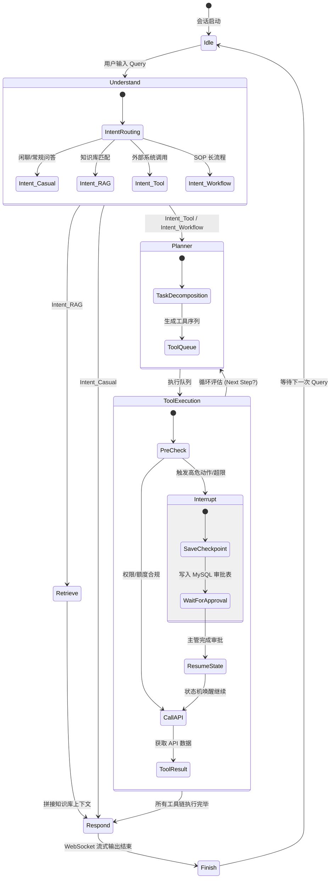
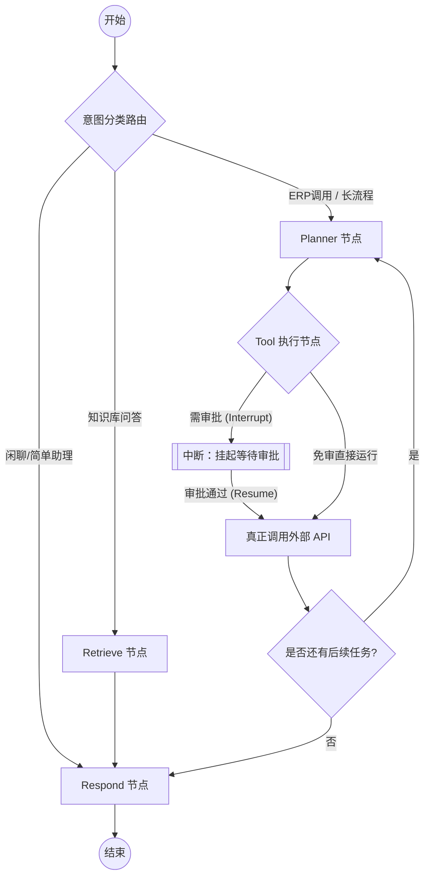

# Enterprise AI Digital Assistant - Workflow & Agent State Machine
> 企业级 AI 数字员工平台 Agent 工作流与状态机说明书 (V1.0)

---

## 1. 业务流程与架构概述

企业数字员工平台的核心控制引擎基于 **LangGraph** 实现。LangGraph 是一个将大模型交互抽象为**有向图（Graph）**的框架，通过图中的**节点（Nodes）**表达业务处理逻辑，通过**边（Edges）**表达控制流转向，并通过统一的**通道状态（State）**管理多轮对话与工具调用的共享记忆。

本系统的设计核心在于将常规 RAG（检索增强生成）与企业工作流相结合，并针对敏感业务（如采购、修改信息等）引入 **Human-in-the-loop（人机协同审批）**。

---

## 2. 状态机全生命周期设计

大模型数字员工的整个运转周期由以下状态节点构成，其迁移状态路径如下图所示：



---

## 3. LangGraph 状态机拓扑结构

系统的 LangGraph 核心图结构由以下 Python 代码框架描述的拓扑构成，包含强类型的条件路由判定。

### 3.1 状态机核心拓扑逻辑



### 3.2 节点与条件边设计

#### 1. 意图路由器 (Intent Router - Conditional Edge)
- **输入**：用户最新提问消息 `messages[-1].content`。
- **动作**：通过大模型进行语义匹配（Few-shot Classification）判断。
- **输出**：返回路由决策值：
  - `route_to_casual`: 跳转至回复节点。
  - `route_to_rag`: 跳转至检索节点。
  - `route_to_workflow`: 跳转至规划节点。

#### 2. 检索节点 (Retrieve Node - Action Node)
- **输入**：用户提问及意图。
- **动作**：提取关键词并向量化，并发调用 BM25 与 Qdrant 检索。将检索到的 Top-5 文本块序列化后，写入 `retrieved_context`。
- **输出**：更新状态机中的检索上下文。

#### 3. 规划节点 (Planner Node - Action Node)
- **输入**：消息历史、当前意图、ERP 系统 Mock 配置。
- **动作**：让 LLM 判断是否需要调用外部工具来获取信息或执行操作，并生成 `tools_to_call` 列表。
- **输出**：追加工具等待调用列表。

#### 4. 工具执行器 (Tool Executor - Action Node)
- **动作**：逐个提取 `tools_to_call` 中的工具请求，并对工具进行**安全级别预检**。
  - **安全预检策略**：
    - `query_inventory`、`query_employee`：安全级别为 **Low**，直接执行。
    - `create_purchase`（采购创建）：校验金额。若金额 > 10,000 元，判定安全级别为 **High**，强制进入 `Interrupt`（中断）。
- **中断处理**：状态机抛出 `NodeInterrupt` 异常，挂起执行，更新 `approval_needed = True`。LangGraph 的 Memory checkpointer 自动将当前的整个 Graph State 冻结并持久化归档。

---

## 4. Human-in-the-loop (人机协同) 机制深度设计

在企业流程中，AI 不能拥有完全的财务与行政自主权。本系统设计了严密的中断与恢复协议。

### 4.1 挂起与中断 (Interrupt)
当 Agent 执行到高风险节点（例如：`create_purchase(price=13500)`）时，系统执行以下控制流：

1. **状态存盘**：LangGraph 在执行 `tool_executor` 节点前触发 `interrupt()`，生成当前 Thread 唯一的检查点 ID（`checkpoint_id`）。
2. **通知创建**：FastAPI 后台捕获此事件，在 MySQL 的 `approvals` 表中插入一条关联当前 `session_id` 和 `langgraph_thread_id` 状态为 `PENDING` 的审批工单。
3. **推送到人**：通过企业微信 Webhook 或内部通知模块向主管张经理推送审批通知。
4. **会话冻结**：向前端 WebSocket 抛出 `approval_interrupt` 事件，客户端展现“已发起主管审批，会话挂起”的交互卡片。

### 4.2 唤醒与恢复 (Resume)
1. **主管操作**：张经理登录管理界面，查阅审批细节（包括 AI 检索出的采购条例依据、采购明细），点击“同意”按钮。
2. **触发回调**：前端向 FastAPI 发送请求 `POST /api/v1/workflow/approvals/182/action`，Body 携带状态 `APPROVED`。
3. **状态注入与恢复**：
   FastAPI 业务层获取到对应的 `langgraph_thread_id`，利用 LangGraph 客户端以 `approved` 状态恢复执行：
   ```python
   # 唤醒 LangGraph 状态机并注入审批通过状态
   app.update_state(
       config={"configurable": {"thread_id": thread_id}},
       values={"approval_status": "APPROVED", "approval_needed": False},
       as_node="tool_executor"
   )
   
   # 继续驱动执行后续节点
   async for event in app.astream(None, config={"configurable": {"thread_id": thread_id}}):
       # 实时向用户推送后续流式消息
       await connection_manager.send_json_message(session_id, event)
   ```
4. **闭环执行**：唤醒后的 `tool_executor` 检查到 `approval_status == 'APPROVED'`，解除拦截，成功调用真实 ERP 服务创建采购工单，将采购单号（如 ERP-20260721-09）回填入状态并正常生成回复。

---

## 5. 企业 SOP（标准作业程序）自动化执行示例

以研发部员工申请“采购 3 台组装测试用机”为例，系统 SOP 闭环执行路径如下：

| 步骤 | 角色 | 动作/状态机行为 | 数据变更 | 交互输出 |
| :--- | :--- | :--- | :--- | :--- |
| **1** | 用户 | 提出需求：“帮我买 3 台联想测试机，物料编码 PC-TEST-002” | - | 客户端展示用户 Query |
| **2** | IntentRouter | 语义匹配，识别为 **WORKFLOW_PURCHASE** 意图 | 状态更新: `current_intent = WORKFLOW_PURCHASE` | 提示：“正在为您起草采购申请...” |
| **3** | RetrieveNode | 查询知识库《研发部IT设备采购合规限制》 | 读取 Qdrant 匹配到单台限制 10,000 元 | 提示：“正在核实采购合规性...” |
| **4** | PlannerNode | 分析用户物料编码，调用 `query_inventory` 查询库存与单价 | 调用 MySQL 库存 Mock 表，单价 4500 元 | 提示：“正在向 ERP 查询物料单价...” |
| **5** | ToolExecutor | 检查到库存不足，需新购。起草采购单总额 13,500 元，超过免审额度，判定需要审批 | 写入 MySQL `tickets` 与 `approvals`；状态标记 `approval_needed=True` | 抛出 Interrupt。前端展示主管审批卡片，发送企业微信给主管 |
| **6** | 主管 | 收到企业微信通知，在 OA 页面点击“同意” | 更新 MySQL `approvals.status = APPROVED` | 界面显示：“主管已审批通过” |
| **7** | FastAPI Gateway| 接收到审批通过回调，通过 `thread_id` 唤醒 LangGraph 状态机，恢复运行 | 状态更新: `approval_status = APPROVED` | - |
| **8** | ToolExecutor | 执行 `create_purchase` 工具 | 调用 ERP 接口创建单据 | 提示：“采购单 ERP-2026-09 已创建成功” |
| **9** | RespondNode | 汇总所有执行细节，生成格式化报告 | 计入 MySQL `chat_messages`，计算 Token 成本写入 `token_logs` | 流式输出：“已成功为您向 ERP 系统提交采购。单据号：ERP-2026-09，后续审批详情...” |
