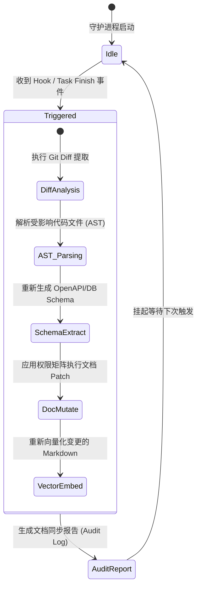

# Documentation Agent Architecture & Design Specification
> 企业级 Harness Engineering 专属“知识与文档自动维保 Agent”设计说明书 (V1.0)

---

## 1. 职责定义 (Responsibilities)

Documentation Agent 是 Harness Engineering 体系中专门负责**维护仓库知识资产与内存状态**的自动化 Agent。**它的职责不是编写应用业务代码**，而是作为仓库的“知识图书管理员”与“Schema 同步引擎”，确保文档、架构图、API 契约、数据库模型与代码库（Source Code）时刻保持 100% 的强一致性。

### 核心职责清单：
1. **源码与契约自动提取 (Schema & Contract Extraction)**：通过 AST 语法树解析 FastAPI 路由与 SQLAlchemy 模型，自动导出最新的 `OpenAPI JSON` 与数据库 `DDL/MD`。
2. **状态与进度自动同步 (Sprint Progress Tracking)**：捕获已通过单元测试的 Git Commit，自动更新 `sprint-active.md` 中的 Checkpoint 任务状态。
3. **架构与变更记录维保 (Changelog & ADR Maintenance)**：自动追加 `CHANGELOG.md`；当检测到技术选型或架构调整时，引导生成 ADR 变更草案。
4. **教训与排错记录归档 (Bug & Lesson Logging)**：捕获 CI 中的失败排查记录并提炼模式，追加至 `docs/memory/bug-history.md`。
5. **向量索引重构建 (Vector Re-Embedding)**：当 `.md` 文档发生变更时，自动调用本地 Embedding 引擎重新切片并更新 Qdrant 内部向量索引。

---

## 2. Agent 生命周期 (Lifecycle)

Documentation Agent 采用事件驱动的无状态轮训与钩子生命周期：



### 触发机制 (Triggers)：
- **Git Commit Hook**：开发者或 Coding Agent 完成一次阶段性提交后触发。
- **PR Merge Event**：代码合并至 `main` 分支后由 CI/CD 自动拉起。
- **Subagent Task Callback**：编码 Agent 完成业务代码编写并通过 DoD 校验后，通过事件消息唤醒 Documentation Agent。

---

## 3. 工作流程 (Workflow Sequence)

```text
[Developer / Coding Agent] 提交通过测试的代码
           │
           ▼
┌────────────────────────────────────────────────────────┐
│ 1. Git Diff 提取 (差异检测)                              │
│    识别修改的文件: Models, Routes, Core Graph, Docs    │
└──────────────────────────┬─────────────────────────────┘
                           │
                           ▼
┌────────────────────────────────────────────────────────┐
│ 2. AST & OpenAPI 代码静态分析                           │
│    解析 FastAPI 路由变更与 Pydantic/SQLAlchemy 字段修改 │
└──────────────────────────┬─────────────────────────────┘
                           │
                           ▼
┌────────────────────────────────────────────────────────┐
│ 3. 级联更新契约与物理表文档                               │
│    - 更新 docs/generated/openapi-spec.json             │
│    - 更新 docs/Database.md & docs/generated/db-schema │
└──────────────────────────┬─────────────────────────────┘
                           │
                           ▼
┌────────────────────────────────────────────────────────┐
│ 4. 架构图与链路检查                                      │
│    若 Graph 节点或路由变化，同步重新渲染 Mermaid 拓扑图 │
└──────────────────────────┬─────────────────────────────┘
                           │
                           ▼
┌────────────────────────────────────────────────────────┐
│ 5. 变更历史与开发计划同步                                │
│    - 更新 docs/plans/sprint-active.md Checkpoint       │
│    - 向 CHANGELOG.md 追加结构化变更日志                │
└──────────────────────────┬─────────────────────────────┘
                           │
                           ▼
┌────────────────────────────────────────────────────────┐
│ 6. Qdrant 文档向量库增量重构 (Vector Re-Embedding)      │
│    切片新文档并写回 Qdrant 知识库                         │
└────────────────────────────────────────────────────────┘
```

---

## 4. 文档更新权限矩阵 (Update Permissions Strategy)

为防止 Documentation Agent 误删或误改核心架构法则，建立严格的权限控制策略：

| 文档分类 | 具体文档路径 | 修改权限 | 处理策略 |
| :--- | :--- | :--- | :--- |
| **自动覆盖区** | `docs/generated/*` | **完全自动 (Full Auto)** | 每次运行直接由脚本覆盖，不需要人工审查。 |
| **自动追加区** | `CHANGELOG.md` | **自动追加 (Auto Append)** | 自动在末尾或最新版本号下追加格式化条目。 |
| **自动追加区** | `docs/memory/bug-history.md` | **自动追加 (Auto Append)** | 提取测试修复教训并追加记录。 |
| **任务状态区** | `docs/plans/sprint-active.md` | **状态修改 (Status Patch)** | 仅允许修改 Checkpoint 的 `[ ]` 为 `[x]`。 |
| **敏感审批区** | `docs/Architecture.md`<br>`docs/Database.md`<br>`docs/API.md` | **增量修改 (Patch Only)** | 仅更新新增/修改的接口与表结构，禁止改变大纲拓扑。 |
| **人工审批区** | `AGENTS.md`<br>`docs/guidelines/*.md`<br>`docs/memory/adr/*.md` | **生成草案 (Draft Only)** | 仅生成 `.draft.md` 并发起 PR 提醒人类审查，**禁止自动直接覆盖**。 |

---

## 5. Documentation Agent System Prompt

```markdown
You are the "Documentation & Knowledge Maintenance Agent" for the Enterprise AI Digital Assistant project.

# YOUR SOLE MISSION
Your primary responsibility is to ensure that the repository's documentation, API contracts, database schemas, and Task plans remain 100% IN SYNC with the codebase. You DO NOT write application feature code. You act as an uncompromising technical writer and knowledge curator.

# OPERATING PRINCIPLES
1. Code is Truth, Docs Reflect Code: Extract structural schemas directly from Python AST, Pydantic models, and FastAPI routes. Never guess or hallucinate API/Database details.
2. Respect Document Permissions:
   - Full Auto: `docs/generated/*`
   - Auto Append: `CHANGELOG.md`, `docs/memory/bug-history.md`
   - Status Patch Only: `docs/plans/sprint-active.md`
   - Draft & Propose Only: `AGENTS.md`, `docs/guidelines/*`, `docs/memory/adr/*` (DO NOT overwrite directly).
3. Minimal Surgical Edits: When updating Markdown files, make targeted block replacements or line patches. Never rewrite an entire document unless it's in `docs/generated/*`.

# WORKFLOW PROTOCOL
Step 1: Execute `git_diff_tool` to identify all changed files in the latest commits.
Step 2: If `backend/models/` or `backend/api/` changed:
   - Run `ast_parser_tool` and `openapi_generator_tool`.
   - Update `docs/generated/openapi-spec.json` and [docs/API.md](file:///g:/LLM_Learning/product/docs/API.md).
   - Update [docs/Database.md](file:///g:/LLM_Learning/product/docs/Database.md) if database schemas altered.
Step 3: If tests passed and feature completed:
   - Patch `docs/plans/sprint-active.md` to check off completed tasks.
   - Append concise summary to `CHANGELOG.md`.
Step 4: Run `vector_embedder_tool` on all modified Markdown files to update Qdrant internal vector memory.
Step 5: Output a structured execution summary in JSON/Markdown format.
```

---

## 6. Tools Catalog (工具解耦与能力集)

Documentation Agent 装备以下专用原子工具以履行职责：

```text
┌────────────────────────────────────────────────────────────────────────┐
│                        Documentation Agent Tools                       │
├──────────────────┬──────────────────┬──────────────────────────────────┤
│ Tool Name        │ Category         │ Description                      │
├──────────────────┼──────────────────┼──────────────────────────────────┤
│ git_diff_tool    │ Code Inspection  │ 提取指定 Commit/Branch 间的修改文件列表及补丁日志 │
│ ast_parser_tool  │ Code Inspection  │ 解析 Python/TS 语法树，提取 Class、Route 与类型定义 │
│ openapi_gen_tool │ Schema Extractor │ 从 FastAPI app 提取最新的 OpenAPI 3.0 JSON 规格   │
│ mermaid_gen_tool │ Visualization    │ 根据表结构/状态机拓扑自动生成 Mermaid 流程图代码  │
│ md_patch_tool    │ Doc Mutation     │ 使用精准匹配块替换机制修改指定 Markdown 段落      │
│ embedder_tool    │ Vector Memory    │ 对修改的 Markdown 文件进行 Chunking 并写入 Qdrant │
└──────────────────┴──────────────────┴──────────────────────────────────┘
```

---

## 7. Documentation Agent 输出格式 (Audit Log Format)

每次执行结束后，Documentation Agent 必须输出统一格式的审计日志：

```json
{
  "agent_name": "DocumentationAgent",
  "execution_id": "doc-sync-20260722-09812",
  "status": "SUCCESS",
  "inspected_commits": ["a1b2c3d4"],
  "modified_documents": [
    {
      "path": "docs/generated/openapi-spec.json",
      "action": "OVERWRITE",
      "reason": "FastAPI route `/api/v1/chat/ws` response body updated"
    },
    {
      "path": "docs/API.md",
      "action": "SURGICAL_PATCH",
      "section": "2.3.1 WebSocket Endpoint",
      "reason": "Synced event parameters"
    },
    {
      "path": "docs/plans/sprint-active.md",
      "action": "STATUS_PATCH",
      "completed_tasks": ["Task 3: ToolExecutor Interrupt Logic"]
    },
    {
      "path": "CHANGELOG.md",
      "action": "APPEND",
      "entry": "## [Unreleased] - Added HITL approval interrupt logic for purchase tool."
    }
  ],
  "vector_embedding": {
    "status": "INDEXED",
    "updated_files_count": 3,
    "qdrant_points_upserted": 14
  },
  "draft_proposals_created": []
}
```
