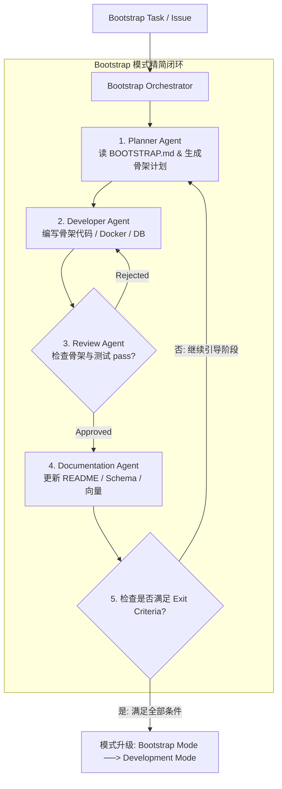

# BOOTSTRAP.md - Harness Operating Mode Specification
> Bootstrap Mode Guidance & Transition Protocol for AI Multi-Agent Harness (V1.0)

---

## 1. Purpose (为什么存在)

本仓库目前处于 **Bootstrap Mode (系统引导初始化模式)**。

在 Bootstrap Mode 期间，Harness 的唯一目标不是开发具体的上层企业业务功能（如采购流程、HR员工查询、 complex SOP 流水线），而是**建立稳定可靠的代码库底座、基础设施、CI/CD 骨架、应用服务骨架（FastAPI + Vue3）、数据库连接与 AI 基础设施**。

一旦系统满足 Exit Criteria（退出条件），Harness 将从 **Bootstrap Mode** 自动切换升级为 **Development Mode (完整开发模式)**。

---

## 2. Bootstrap Goals (里程碑目标)

在 Bootstrap Mode 下，所有 Agent（Planner, Developer, Reviewer, Documentation）必须按照以下 3 个阶段性目标递进演进：

### Sprint 1: 脚手架与基础骨架
- [x] Repository 结构与规范配置 (`AGENTS.md`, `BOOTSTRAP.md`, `docs/`)
- [x] Docker & Docker Compose 单机一键启动脚本
- [x] FastAPI 后端脚手架与基础路由框架
- [x] Vue 3 + NuxtJS 前端脚手架与基础页面结构
- [x] GitHub Actions CI 静态检查流水线

### Sprint 2: 基础数据与向量中间件集成
- [x] MySQL 8.0 数据库初始化与 SQLAlchemy ORM 骨架
- [x] Redis 7.0 高速缓存与 Message Broker 连接集成
- [x] Qdrant 向量数据库 Collection 初始化与 BGE-M3 向量加载调通

### Sprint 3: 核心 AI 框架与基本聊天通道
- [x] LangGraph 基础状态机图拓扑与内存 Checkpointer 联调
- [x] Tool Registry 工具注册器与核心 JSON Schema 契约
- [x] HTTP 与 WebSocket 基本双工 Chat 接口可运行联调

---

## 3. Bootstrap Scope (允许与禁止范围)

### 允许事项 (Allowed Actions):
- ✅ **创建与配置基础设施**：创建目录、物理文件、Docker 配置、CI 脚本、配置文件。
- ✅ **创建与搭建应用骨架**：搭建 FastAPI 路由骨架、Vue3 组件骨架、MySQL ORM 骨架、Qdrant Collection 骨架。
- ✅ **创建基础单元测试与文档**：编写基础的 `pytest` 测试脚本、`README.md`、`Architecture.md`。

### 禁止事项 (Forbidden Actions):
- ❌ **禁止开发上层企业业务工作流**：禁止在 Bootstrap 阶段编写复杂的 ERP 采购、HR 查询等特定业务工作流。
- ❌ **禁止过度优化 (No Over-Optimization)**：禁止进行性能过度调优或复杂架构重构。
- ❌ **禁止运行 Benchmark 与线上发布**：禁止运行 RAGAS 压测或进行生产环境 Deployment。

---

## 4. Forbidden Actions (Agent 专项禁令)

为了保障 Bootstrap 阶段的稳定与可控，给各 Agent 制定以下硬性禁令：

### Developer Agent 专项禁令：
- ❌ **单次提交规模限制**：一次 Commit 严禁包含超过 **10 个文件** 或修改超过 **500 行** 代码。
- ❌ **单次任务聚焦限制**：一次只能实现 1 个原子 Feature，严禁跨越多个 Sprint 目标。
- ❌ **物理门禁不可绕过**：绝对禁止跳过 Reviewer Agent 审查与 Documentation Agent 知识同步。

### Planner Agent 专项禁令：
- ❌ **规划作用域限制**：严禁一次规划多个 Sprint，必须严格聚焦在当前 Bootstrap Sprint 内。

### Documentation Agent 专项禁令：
- ❌ **契约与决策保护**：严禁修改 [docs/SPEC.MD](file:///g:/LLM_Learning/product/docs/SPEC.MD) 或 `docs/decision/*.md` 已接收的决策文件。

---

## 5. Lifecycle (Bootstrap 生命周期流程图)

Bootstrap 模式采用**精简版的单向闭环**，移除了生产部署（Deployment）、性能压测（Evaluator）与在线监控（Monitoring）：



---

## 6. Agent Responsibilities (Agent 职责链)

1. **Planner Agent**：接收任务 ──> 强制阅读 `BOOTSTRAP.md` 确定 Scope ──> 仅规划当前小步 Sprint 目标。
2. **Developer Agent**：读取计划 ──> 仅增量编写骨架代码/Docker/DB ──> 本地运行 `pytest` 校验 ──> 提交差异。
3. **Reviewer Agent**：审计 Diff ──> 校验是否违反 Bootstrap 禁令 ──> 输出 Approved/Rejected。
4. **Documentation Agent**：读取 Diff ──> 自动更新 `README.md` 与 Schema ──> 更新 Qdrant 向量 ──> 返回触发。

---

## 7. Exit Criteria (模式升级退出条件)

只有当以下条件**全部满足 (100% PASS)** 时，才允许从 Bootstrap Mode 切换升级至 Development Mode：

- [ ] **[Backend]** FastAPI 接口可顺利启动并成功响应 `GET /api/v1/health`。
- [ ] **[Docker]** `docker-compose up` 可一次性拉起全量服务且状态 Healthy。
- [ ] **[Frontend]** Vue 3 / NuxtJS 前端脚手架可正常编译并在浏览器渲染。
- [ ] **[Databases]** MySQL 数据表已初始化并可正常读写。
- [ ] **[Redis]** Redis 缓存与 Message Broker 连接正常。
- [ ] **[Qdrant]** Qdrant 向量集合正常创建且 BGE-M3 可正常向量化 Upsert。
- [ ] **[CI/CD]** GitHub Actions 流水线运行全绿色 (Pass)。
- [ ] **[Basic Chat]** 基本的 WebSocket 长连接对话通路已成功调通。

---

## 8. Deliverables (Bootstrap 阶段交付物)

Bootstrap Mode 必须产出以下核心底座交付物：

```text
enterprise-ai-agent/
├── backend/                  # FastAPI + LangGraph 应用骨架
├── frontend/                 # Vue 3 / NuxtJS 前端骨架
├── docker-compose.yml        # 一键容器编排文件
├── README.md                 # 项目最新说明文档
├── AGENTS.md                 # Master Harness 导航入口
├── BOOTSTRAP.md              # 运行模式规范 (本文件)
└── .github/workflows/        # CI 静态校验流水线
```

---

## 9. Verification (Bootstrap 验收规范)

在模式切换退出前，必须运行并通过以下 5 项物理验收检查：

```bash
# 1. 单元测试验收
pytest backend/tests/

# 2. 容器编排验收
docker compose up -d && docker compose ps

# 3. 探针与健康检查验收
curl -f http://localhost:8000/api/v1/health

# 4. CI 流水线验收
git status && ruff check backend/

# 5. 文档与架构最新校验
# 确认 README.md 及 Architecture.md 描述与现存应用骨架一致
```
