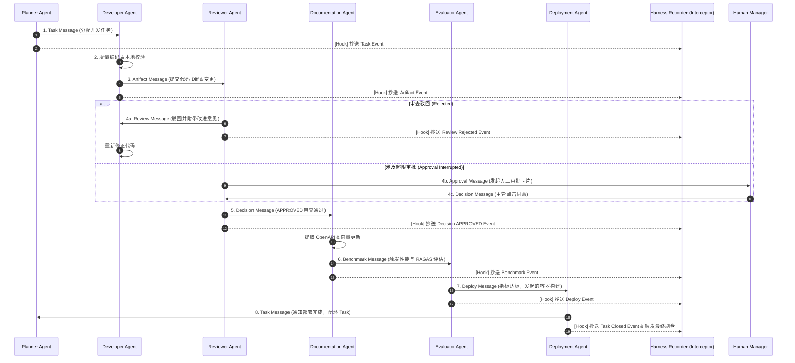
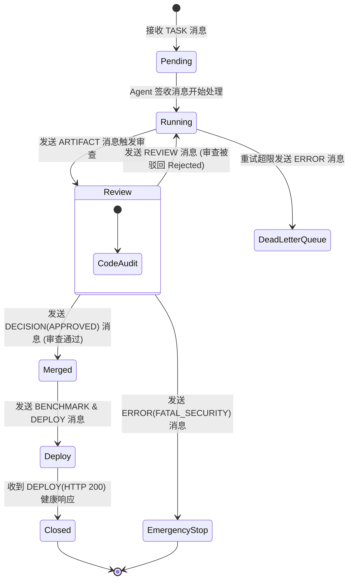

# Enterprise AI Harness - Inter-Agent Communication Specification
> 企业级 AI 数字员工平台——Multi-Agent 消息传递与通信协议规范说明书 (V1.0)

---

## 1. Communication Philosophy (通信哲学)

在 Harness Engineering 多智能体体系中，组件间的交互遵循**分布式微服务设计思想**。组件之间严禁通过拼接纯文本 Prompt 共享上下文，而是采用强类型的**消息传递（Message Passing）**机制。

```text
❌ BAD: 盲目拼接 Prompt (Prompt Stuffing)
[Planner Prompt] + [Developer Prompt] + [Reviewer Prompt] ===> 造成 Context 污染、角色越界与混乱

✅ GOOD: 基于事件与强类型消息传递 (Message Passing Architecture)
[Planner] ──(Task Message)──> [Developer] ──(Artifact Message)──> [Reviewer]
```

### 1.1 为什么 Agent 之间不能直接共享 Prompt？
1. **防止 Context Window 污染与爆炸 (Token Explosion)**：如果直接将上游 Agent 的 Raw Prompt 注入下游，会导致 Token 开销成倍膨胀，并引入无关的调试杂音（Context Rot）。
2. **防止角色防线穿透 (Role Contamination)**：开发者 Agent 如果直接看到了审查者 Agent 的 Prompt，可能会产生心理暗示去“迎合审查规则”甚至伪造测试断言，丧失专职 Agent 的中立性。
3. **消除强耦合**：Prompt 是组件内部的私有实现细节。直接共享会导致修改一个 Agent 的系统提示词时，引发全链条的不可预测崩溃。

### 1.2 为什么要采用 Message Passing（基于强类型消息传递）？
1. **解耦与契约化 (Decoupling & Schema-Driven)**：Agent 之间通过不可变的 JSON 消息体通信。每个 Agent 只关心输入消息的 Payload 格式，无需关心对方由哪个 LLM 驱动。
2. **完全可审计与可重放 (Auditability & Replayability)**：每一次消息交互都被持久化写入 `logs/trajectories/`，不仅方便进行 Post-Mortem 归因分析，还能在发生故障时重新重放（Replay）特定消息以复现 Bug。
3. **支持异步非阻塞与分布式扩展 (Asynchronous & Distributed)**：消息传递天然适配 RabbitMQ / Redis Pub-Sub / Celery，使得 Harness 可以轻松实现 Agent 的跨服务器分布式部署。

### 1.3 Harness Recorder 无侵入事件监听契约 (Event Bus Listener Hook)
所有的消息传递均自动经由底层消息总线的 **Harness Recorder 拦截器 (Interceptor Hook)** 进行无侵入广播抄送。Recorder 不阻断消息流转，仅负责静默捕获消息 JSON 结构、时间戳与 Payload 元数据，并同步增量写入 `.harness/runs/Issue-XXXX/runtime.log` 与 `timeline.md`。

---

## 2. Communication Model (通信模型与拓扑图)

Harness 消息总线（Message Bus）负责在 6 大专职 Agent、Harness Recorder 记录器与人工审批组件之间路由消息。其拓扑通信架构如下图所示：



---

## 3. Unified Message Schema (统一消息协议设计)

系统内流转的所有消息均遵循继承自基类 `HarnessBaseMessage` 的强类型 JSON Schema。

### 3.1 基础消息头定义 (Base Header)

```json
{
  "message_id": "msg_20260722_980123",
  "message_type": "TASK",
  "sender": "PlannerAgent",
  "receiver": "DeveloperAgent",
  "status": "Pending",
  "timestamp": "2026-07-22T01:56:00Z",
  "artifact": {
    "file_paths": ["backend/api/v1/chat.py"],
    "git_commit": "c7d8e9f",
    "diff_hash": "sha256:8a9b0c..."
  },
  "payload": {}
}
```

---

### 3.2 9 大消息类型范式

#### 1. Task Message (`TASK`) - 任务分发消息
用于 Planner Agent 向 Developer Agent 派发具体的开发 Checkpoint。

```json
{
  "message_id": "msg_task_001",
  "message_type": "TASK",
  "sender": "PlannerAgent",
  "receiver": "DeveloperAgent",
  "status": "Pending",
  "timestamp": "2026-07-22T01:56:05Z",
  "artifact": {
    "file_paths": ["backend/tools/erp_tools.py", "backend/tests/unit/test_erp_tools.py"],
    "git_commit": null,
    "diff_hash": null
  },
  "payload": {
    "task_id": "TASK-102",
    "title": "添加采购额度动态校验逻辑",
    "requirements": "根据用户所属部门动态加载采购额度，超额自动标记需要审批。",
    "checkpoints": ["实现 check_department_limit()", "编写单元测试"]
  }
}
```

#### 2. Artifact Message (`ARTIFACT`) - 代码制品提交消息
用于 Developer Agent 编码完成并自测通过后，向 Reviewer Agent 提交构建成果。

```json
{
  "message_id": "msg_art_002",
  "message_type": "ARTIFACT",
  "sender": "DeveloperAgent",
  "receiver": "ReviewerAgent",
  "status": "Running",
  "timestamp": "2026-07-22T02:05:12Z",
  "artifact": {
    "file_paths": ["backend/tools/erp_tools.py", "backend/tests/unit/test_erp_tools.py"],
    "git_commit": "a1b2c3d4",
    "diff_hash": "sha256:e3b0c44298fc1c149afbf4c8996fb92427ae41e4649b934ca495991b7852b855"
  },
  "payload": {
    "local_test_summary": "12 passed in 1.20s",
    "ruff_status": "PASSED",
    "mypy_status": "PASSED",
    "alembic_migration_created": false
  }
}
```

#### 3. Decision Message (`DECISION`) - 审查决策消息
用于 Reviewer Agent 输出对 Git Diff 的最终判定结果。

```json
{
  "message_id": "msg_dec_003",
  "message_type": "DECISION",
  "sender": "ReviewerAgent",
  "receiver": "DocumentationAgent",
  "status": "Merged",
  "timestamp": "2026-07-22T02:10:00Z",
  "artifact": {
    "file_paths": ["backend/tools/erp_tools.py"],
    "git_commit": "a1b2c3d4",
    "diff_hash": "sha256:e3b0c44298..."
  },
  "payload": {
    "decision": "APPROVED",
    "critical_count": 0,
    "warning_count": 1,
    "approval_note": "验证通过，允许自动合并入主干。"
  }
}
```

#### 4. Review Message (`REVIEW`) - 审查意见反馈消息
用于 Reviewer Agent 驳回代码时向 Developer Agent 提供精确的修改指令。

```json
{
  "message_id": "msg_rev_004",
  "message_type": "REVIEW",
  "sender": "ReviewerAgent",
  "receiver": "DeveloperAgent",
  "status": "Rejected",
  "timestamp": "2026-07-22T02:08:30Z",
  "artifact": {
    "file_paths": ["backend/api/v1/chat.py"],
    "git_commit": "f9e8d7c6",
    "diff_hash": "sha256:112233..."
  },
  "payload": {
    "decision": "REJECTED_WITH_CHANGES",
    "feedbacks": [
      {
        "file": "backend/api/v1/chat.py",
        "line": 84,
        "domain": "Performance",
        "issue": "使用了同步 time.sleep(2) 阻塞了 async 事件循环",
        "suggestion": "请修改为 await asyncio.sleep(2)"
      }
    ]
  }
}
```

#### 5. Benchmark Message (`BENCHMARK`) - 质量评估消息
用于 Evaluator Agent 输出 RAGAS 与 QPS 压测报告。

```json
{
  "message_id": "msg_bm_005",
  "message_type": "BENCHMARK",
  "sender": "EvaluatorAgent",
  "receiver": "DeploymentAgent",
  "status": "Running",
  "timestamp": "2026-07-22T02:15:20Z",
  "artifact": {
    "file_paths": ["benchmark/test-dataset.json"],
    "git_commit": "a1b2c3d4",
    "diff_hash": null
  },
  "payload": {
    "faithfulness_score": 0.942,
    "context_recall_score": 0.915,
    "avg_ttft_ms": 280,
    "benchmark_status": "PASSED"
  }
}
```

#### 6. Deploy Message (`DEPLOY`) - 部署触发消息
用于 Deployment Agent 提交部署指令与上报在线探针结果。

```json
{
  "message_id": "msg_dep_006",
  "message_type": "DEPLOY",
  "sender": "DeploymentAgent",
  "receiver": "HarnessOrchestrator",
  "status": "Deploy",
  "timestamp": "2026-07-22T02:20:00Z",
  "artifact": {
    "file_paths": ["docker-compose.yml"],
    "git_commit": "a1b2c3d4",
    "diff_hash": null
  },
  "payload": {
    "environment": "staging",
    "container_image": "enterprise-ai-gateway:v1.0.4",
    "health_probe_status": "HTTP 200 OK"
  }
}
```

#### 7. Approval Message (`APPROVAL`) - 人人/人机审批消息
用于挂起状态机并向主管发起审批单，或主管向系统反馈审批结果。

```json
{
  "message_id": "msg_app_007",
  "message_type": "APPROVAL",
  "sender": "HarnessOrchestrator",
  "receiver": "HumanManager",
  "status": "Review",
  "timestamp": "2026-07-22T02:07:00Z",
  "artifact": {
    "file_paths": [],
    "git_commit": null,
    "diff_hash": null
  },
  "payload": {
    "approval_id": 182,
    "thread_id": "thread_9a7d3bf0_15bd",
    "action_name": "create_purchase",
    "price_usd": 13500.00,
    "approval_status": "PENDING"
  }
}
```

#### 8. Error Message (`ERROR`) - 异常与致命故障消息
用于 Agent 发生不可恢复的致命异常或安全拦截时发出警报。

```json
{
  "message_id": "msg_err_008",
  "message_type": "ERROR",
  "sender": "ReviewerAgent",
  "receiver": "HarnessOrchestrator",
  "status": "Rejected",
  "timestamp": "2026-07-22T02:09:00Z",
  "artifact": {
    "file_paths": ["backend/config.py"],
    "git_commit": "bad_commit_001",
    "diff_hash": null
  },
  "payload": {
    "error_code": "FATAL_SECURITY_BLOCK",
    "error_message": "检测到源码中硬编码了真实数据库私钥密码",
    "stack_trace": "SecurityGuardrailError: Plaintext secret detected in backend/config.py:L12"
  }
}
```

#### 9. Retry Message (`RETRY`) - 自我修正重试消息
用于 Harness Orchestrator 指示任务节点开启自我纠错循环。

```json
{
  "message_id": "msg_ret_009",
  "message_type": "RETRY",
  "sender": "HarnessOrchestrator",
  "receiver": "DeveloperAgent",
  "status": "Running",
  "timestamp": "2026-07-22T02:06:00Z",
  "artifact": {
    "file_paths": ["backend/tools/erp_tools.py"],
    "git_commit": null,
    "diff_hash": null
  },
  "payload": {
    "retry_attempt": 2,
    "max_retries": 3,
    "previous_error": "mypy check failed: Missing return type annotation"
  }
}
```

---

## 4. Message-Driven State Transition (基于消息的状态变迁)

组件间的通信消息直接驱动物理状态机的转移，具体变迁路线如下图所示：



### 状态迁移控制矩阵：

| 初始状态 (From) | 触发消息 (Message Event) | 目标状态 (To) | 转移约束条件 (Pre-condition) |
| :--- | :--- | :--- | :--- |
| `Pending` | `TASK` | `Running` | Worker Agent 成功领取任务队列项。 |
| `Running` | `ARTIFACT` | `Review` | 代码本地 `ruff`/`pytest` 校验 100% 通过。 |
| `Review` | `REVIEW` | `Running` | 审查判定为 `REJECTED_WITH_CHANGES`（修改意见返还）。 |
| `Review` | `DECISION` | `Merged` | 审查判定为 `APPROVED`（合并代码）。 |
| `Merged` | `DEPLOY` | `Deploy` | RAGAS 质量评分 > 0.90 且评估达标。 |
| `Deploy` | `DEPLOY(Response)` | `Closed` | 线上 `/health` 探针返回 HTTP 200。 |
| `Running` | `ERROR` | `DeadLetterQueue` | 重试次数达上限 3 次，无法修复。 |

---

## 5. Retry Strategy (重试策略)

当 Agent 节点因语法错误、测试失败或网络超时导致处理中断时，通信总线执行以下重试协议：

```text
                               Message Exception
                                       │
                                       ▼
                          Transient or Fatal Error?
                             ┌─────────┴─────────┐
                             ▼ (Transient)       ▼ (Fatal)
                     Check Retry Count        Send ERROR Message
                             │                Direct to DLQ
                      ┌──────┴──────┐
                      ▼ (< 3)       ▼ (>= 3)
                Send RETRY       Send ERROR Message
                Exponential      Escalate to DLQ
                 Backoff         Alert Human Manager
```

1. **错误分类 (Classification)**：
   - **瞬态错误 (Transient Error)**：网络超时、模型 Rate Limit (HTTP 429)、静态检查未通过。允许重试。
   - **致命错误 (Fatal Error)**：密钥明文泄漏、硬性语法破坏、越权修改防护文件。禁止自动重试，直接抛出 ERROR 消息。
2. **指数避退算法 (Exponential Backoff with Jitter)**：
   重试等待时间按以下公式计算：
   $$WaitTime = \min(Time_{max}, Base \times 2^{attempt}) + Jitter$$
   其中 $Base = 2s$，$Time_{max} = 30s$，$Jitter$ 为 0~1 秒的随机抖动，防止造成模型 API 的并发冲刷。
3. **重试上限 (Max Attempts)**：最大重试尝试次数硬性限制为 **3 次**。超过 3 次依然失败，发出 `ERROR` 消息并将原消息移入死信队列。

---

## 6. Timeout Mechanism (超时控制机制)

为防止某个 Agent 节点发生无限期挂起死锁，每个消息交互流均施加严格的超时阈值：

| 消息交互链路 | 消息类型 | 硬性超时时间 (Timeout) | 超时后动作 (Timeout Action) |
| :--- | :--- | :--- | :--- |
| **Planner -> Developer** | `TASK` | **300 秒 (5 分钟)** | 终止当前 Developer 任务，标记为超时失败。 |
| **Developer -> Reviewer** | `ARTIFACT` | **120 秒 (2 分钟)** | 重新触发 Reviewer 节点或降级至静态脚本检查。 |
| **Reviewer -> Human** | `APPROVAL` | **86400 秒 (24 小时)** | 审批超时未处理自动过期，将单据置为 `EXPIRED`。 |
| **Evaluator -> Deploy** | `BENCHMARK` | **180 秒 (3 分钟)** | 放弃 RAGAS 评估，记录告警日志。 |
| **Deploy -> Health Check**| `DEPLOY` | **60 秒 (1 分钟)** | 触发自动 Docker / K8s 版本回滚（Rollback）。 |

---

## 7. Dead Letter Queue (死信队列 DLQ)

当消息无法被正常消费或重试超限时，消息总线将其转存至 **Dead Letter Queue (`logs/dlq/`)**，防止阻塞整个系统。

### 7.1 进入死信队列的触发条件：
- 连续 3 次发送 `RETRY` 消息后，Developer Agent 依然无法使 `pytest` 通过。
- 接收到 `FATAL_SECURITY_BLOCK` 致命安全抛错消息。
- 消息 JSON 结构发生严重的校验解析破坏。

### 7.2 死信队列处理流程：
```text
                          Dead Letter Queue (DLQ)
                                     │
                                     ▼
                        Persist Message to Disk
                         (logs/dlq/msg_xxx.json)
                                     │
                                     ▼
                          Send Urgent Webhook Alert
                        (Enterprise WeChat / Slack)
                                     │
                                     ▼
                           Wait for Human Override
                      (CLI Command: harness dlq replay)
```

---

## 8. Human Override (人工干预与强制重置)

Harness 提供最高权限的**人类覆盖控制接口 (Human Override API / CLI)**，允许人类架构师在极端情况下介入并强制修改通信状态。

### 8.1 人类覆盖命令行指令集中表

| 命令 | 适用场景 | 执行效果 |
| :--- | :--- | :--- |
| `harness reset --thread <id>` | 状态机陷入死锁循环 | 强制清除当前 Thread 检查点，复位至 `Idle` 状态。 |
| `harness approve --id <approval_id>` | 绕过阻碍点强行批准 | 模拟产生一条主管 `DECISION(APPROVED)` 消息注入总线。 |
| `harness reject --id <approval_id> -m "reason"` | 手动强制驳回单据 | 模拟产生一条主管 `DECISION(REJECTED)` 消息退回状态机。 |
| `harness dlq replay --msg-id <id>` | 死信队列修复后重放 | 从 `logs/dlq/` 提取死信消息，修补后重新投递入总线。 |
| `harness kill --active-task` | Agent 发生失控生成 | 立即发送终止信号强行 kill 当前运行的 Agent 进程。 |

---

### 8.2 人类强制消息注入范例
人类架构师可以通过 CLI 注入一条 `DECISION` 消息强行覆写审核判定：

```bash
harness inject-message \
  --type DECISION \
  --sender HumanAdmin \
  --receiver DocumentationAgent \
  --thread-id thread_9a7d3bf0_15bd \
  --payload '{"decision": "APPROVED", "override_reason": "人类架构师特批特办"}'
```
