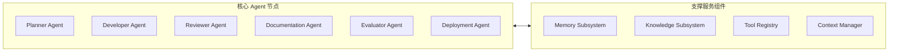
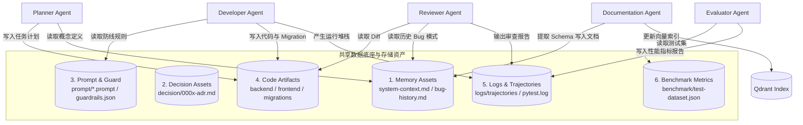
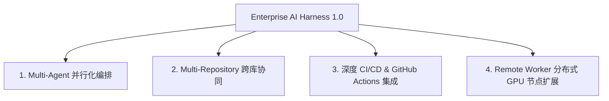

# Enterprise AI Digital Assistant - Master Harness Engineering Specification
> 企业级 AI 数字员工平台——AI 自主循环开发脚手架（AI Harness）总架构规范说明书 (V1.0)

---

## 1. 项目目标与工程哲学

### 1.1 Harness 的定位与愿景
在现代 AI 软件工程中，大语言模型（LLM）已展现出强大的代码生成能力，但在面对复杂的企业级系统时，传统的单一 Prompt 或纯无状态 Agent 面临着**幻觉累积、架构越界、接口断裂、缺乏数据库迁移轨迹、测试覆盖缺失以及文档腐化**等致命痛点。

**Harness（脚手架工程）** 是围绕大模型构建的一套**强约束、可观测、自闭环、具备安全门禁与自我进化能力的脚手架体系**。它的定位不是替代开发者，而是为 AI 提供一个标准化、确定性的软件工程物理环境，使 AI 能够像一个高纪律性的资深工程团队一样，在无人值守或人机协同的模式下，实现**需求的自主拆解、增量编码、严苛审查、测试验证、文档同步与部署上线**的闭环循环（Self-Developing Software Loop）。

```text
┌────────────────────────────────────────────────────────────────────────┐
│                        AI Harness Engineering                          │
│  ┌──────────────┐   ┌──────────────┐   ┌──────────────┐   ┌──────────┐ │
│  │ Rules & Guard│   │ Multi-Agent  │   │ Memory & ADR │   │ Automated│ │
│  │  (AGENTS.md) │   │ Orchestrator │   │   Context    │   │ DoD Check│ │
│  └──────────────┘   └──────────────┘   └──────────────┘   └──────────┘ │
└───────────────────────────────────┬────────────────────────────────────┘
                                    │ Controls & Governs
                                    ▼
┌────────────────────────────────────────────────────────────────────────┐
│               Enterprise AI Digital Assistant Repository               │
│                   (FastAPI + LangGraph + RAG + Vue3)                   │
└────────────────────────────────────────────────────────────────────────┘
```

### 1.2 Harness 与业务 Agent 的本质区别

企业数字员工平台包含两个不同层次的 Agent 概念，必须进行严格的物理与逻辑解耦：

| 对比维度 | 业务 Agent (Business Agent) | Harness Agent (Meta / Infrastructure Agent) |
| :--- | :--- | :--- |
| **存在空间** | 运行在 `backend/graph/` 内，是最终交付给企业用户的**产品功能模块**。 | 运行在仓库的控制面（Control Plane），是**开发和维保产品的元工具**。 |
| **服务对象** | 企业内部员工（HR、采购员、IT 运维人员）。 | 代码库本身（Repository）、架构规范与 CI/CD 流水线。 |
| **典型任务** | 响应“帮我查询采购单并起草审批”等业务请求。 | 响应“实现一个新的 WebSocket 长连接接口”等开发 Issue。 |
| **工具权限** | 调用 ERP API、查询 Qdrant 企业知识库、发起审批工单。 | 读取 Git Diff、执行 `pytest`/`ruff`、生成 Alembic Migration、Patch 文档。 |
| **生命周期** | 由用户提问触发，在单次 WebSocket 交互中流式响应。 | 由 Git Issue / Commit 触发，跨越完整的软件开发生命周期 (SDLC)。 |

### 1.3 为什么采用 Harness Engineering
1. **消除 Context Rot（上下文腐化）**：LLM 无法一次性记住数十万行的项目全貌。Harness 通过渐进式上下文加载（Progressive Context Retrieval）与严格的模块边界约束，保证 Agent 每次只处理与其任务直接相关的 200 行代码切片。
2. **强制实施工程纪律 (DoD Enforcement)**：未经测试和静态检查的代码严禁提交。Harness 将 `ruff`、`mypy`、`pytest` 设为不可逾越的物理门禁。
3. **保证演进轨迹可追溯**：数据库变动必须通过 Alembic 生成迁移脚本，架构调整必须写入 ADR，避免 AI 乱改表结构或引入破坏性修改。

### 1.4 为什么 Repository 是 Source of Truth（代码库即唯一真理源）
在传统的 Agent 部署中，人往往会将规则写在 System Prompt 或外置的 Wiki 网页中。这种方式会导致规则脱节、版本无法追溯以及新调用的 Agent 无法感知最新规范。

Harness 坚守 **"Repository is Source of Truth"**：
- **规则即文件**：所有的安全禁令、测试指令、排错经验全部写在代码库的 Markdown 文件中（如 `AGENTS.md`、`docs/memory/bug-history.md`）。
- **版本同源**：当代码库重构时，对应的规则与契约文件在同一次 Commit 中完成更新，版本库随时间自进化。
- **Agent 无状态接入**：任何一个新的 Agent 实例启动时，只需输入 Git 仓库地址，即可通过读取仓库文件自适应获得 100% 的工程上下文。

---

## 2. Harness 全局架构设计 (Harness Architecture)

Harness 采用封闭环路（Closed-Loop）的多智能体协作架构，由 **Harness Orchestrator（总控协调器）** 驱动 6 大专职 Agent 节点流转：

### 2.1 全局闭环架构图 (Mermaid)

```mermaid
graph TD
    %% 触发层
    Issue[Issue / User Requirement] --> Orchestrator[Harness Orchestrator]

    %% 智能体主环路
    subgraph Self_Developing_Loop [AI 自主循环开发环路]
        Orchestrator --> PlannerAgent[1. Planner Agent<br/>任务拆解与 Checkpoints]
        PlannerAgent --> DevAgent[2. Developer Agent<br/>增量编码 & Migration & Tests]
        DevAgent --> ReviewAgent{3. Review Agent<br/>11 维质量门禁审查}
        
        ReviewAgent -- Rejected (修改意见) --> DevAgent
        ReviewAgent -- Approved (通 过) --> DocAgent[4. Documentation Agent<br/>Schema & 知识同步]
        
        DocAgent --> EvalAgent[5. Evaluator Agent<br/>RAGAS & 性能回归评估]
        EvalAgent --> DeployAgent[6. Deployment Agent<br/>K8s/Docker 部署验证]
    END

    %% 反馈与闭环
    DeployAgent -- 部署健康确认 --> Monitor[Monitoring & Feedback]
    Monitor -- 新需求 / Regression Issue --> Orchestrator

    %% 长期记忆与支撑
    subgraph Subsystems [基础设施支撑层]
        MemoryEngine[(Memory Subsystem<br/>system-context / bug-history)]
        KnowledgeEngine[(Knowledge Subsystem<br/>Qdrant Docs Vector)]
        ToolRegistry[(Tool Registry)]
        ContextMgr[(Context Manager)]
    END

    PlannerAgent <--> Subsystems
    DevAgent <--> Subsystems
    ReviewAgent <--> Subsystems
    DocAgent <--> Subsystems
    EvalAgent <--> Subsystems
```

### 2.2 架构分层设计说明

系统分为五层架构：

1. **控制与编排层 (Control & Orchestration Layer)**：
   - **Harness Orchestrator**：监听事件，管理全局状态机，调度子 Agent 节点的切替，处理异常挂起。
2. **多 Agent 智能体节点层 (Multi-Agent Worker Layer)**：
   - 包含 Planner, Developer, Reviewer, Documentation, Evaluator, Deployment 六大专职 Agent。
3. **记忆与知识层 (Memory & Knowledge Layer)**：
   - **Memory**：长期存储系统概念与历史踩坑 Post-Mortem。
   - **Knowledge**：基于 Qdrant 的仓库 Markdown 文档向量索引库。
4. **工具与执行层 (Tooling & Execution Layer)**：
   - 提供安全的沙箱环境（Sandbox），支持 Git、AST 解析器、OpenAPI 导出器、Pytest 运行器与 Alembic 命令行工具。
5. **底层基础设施与验证层 (Infra & Verification Layer)**：
   - Docker Compose / K8s 环境、vLLM 推理服务器、PostgreSQL/MySQL 状态存储及 CI/CD 管道。

---

## 3. Harness 核心组件详解 (Harness Components)

本节详细拆解 Harness 体系中的 10 大核心组件及其职责契约：



### 3.1 Planner Agent (任务规划器)
- **职责**：接收自然语言 Issue 或需求单，检索系统上下文（`docs/memory/system-context.md`），将大任务拆解为原子的、可验证的增量 Task Checkpoints，写入 `docs/plans/sprint-active.md`。
- **输入**：Issue 描述 + 当前代码索引。
- **输出**：结构化的任务拆解清单及受影响文件预测。

### 3.2 Developer Agent (增量编码器)
- **职责**：依据任务清单编写增量代码。若物理表变动，自动生成 Alembic 迁移脚本；编写或更新对应的 pytest 单元测试；运行本地校验。
- **输入**：Task Checkpoint + 文件上下文。
- **输出**：代码改动 Patch、Alembic Migration 脚本、pytest 测试用例。

### 3.3 Reviewer Agent (代码审查器)
- **职责**：担当无情的质量门禁。依据 11 维审查清单（Architecture, Naming, Security, Performance, Coding Style, Prompt, Database, Migration, API, Documentation, Test Coverage）对 Git Diff 进行审计，给出 `APPROVED`、`REJECTED_WITH_CHANGES` 或 `FATAL_SECURITY_BLOCK` 决策。
- **输入**：Git Diff + 测试运行报告。
- **输出**：评审决策 + 精确到行号的改进意见。

### 3.4 Documentation Agent (知识与 Schema 维护器)
- **职责**：代码合入后自动提取最新的 OpenAPI 3.0 JSON、更新 `Database.md` 表结构、更新 `sprint-active.md` 进度，并将变动的 Markdown 文件自动 Chunk 切片写回 Qdrant 向量库。
- **输入**：合并通过的代码库。
- **输出**：同步后的 API/DB 说明文件 + 向量库更新。

### 3.5 Evaluator Agent (质量与性能评估器)
- **职责**：运行 RAGAS 自动评估脚本，测试 RAG 问答的 Faithfulness、Recall 与 Precision；对大模型首字延迟（TTFT）与吞吐量进行回归压测，防止代码改动导致性能退化。
- **输入**：测试环境 Endpoint + `benchmark/test-dataset.json`。
- **输出**：RAGAS 评估报告与性能指标趋势图。

### 3.6 Deployment Agent (部署与运维验证器)
- **职责**：执行构建脚本，更新 Docker 镜像或 Kubernetes StatefulSets / Deployments；调用健康检查接口 `/api/v1/health` 验证上线状态。
- **输入**：通过评估的发布包。
- **输出**：部署状态报告与在线探针结果。

### 3.7 Memory Subsystem (记忆子系统)
- **职责**：管理短期会话轨迹与长期知识（`memory/system-context.md` 与 `memory/bug-history.md`），为所有 Agent 提供过去重构产生的避坑 Lessons Learned。

### 3.8 Knowledge Subsystem (知识子系统)
- **职责**：维护仓库内部所有 `.md` 文档与源码符号（`generated/codebase-index.json`）的高效检索服务，支持基于向量与关键词的快速匹配。

### 3.9 Tool Registry (工具注册表)
- **职责**：管理 Harness 内部 Agent 可调用的工具集，包含权限校验（如判断是否允许修改物理表）、Schema 校验与调用频次监控。

### 3.10 Context Manager (上下文管理器)
- **职责**：实施“按需渐进式加载”策略。防止将大文件整体填入 Context Window，负责代码行切片（Line-range Windowing）与符号精准定位。

---

## 4. Harness 全局状态机设计 (Harness State Machine)

Harness 的全生命周期状态流转由强类型状态机控制。任何环节发生故障，均有显式的重试或回滚转移分支：

### 4.1 状态迁移图 (Mermaid State Diagram)

```mermaid
stateDiagram-v2
    [*] --> Issue_Ingested : 接收 Issue

    Issue_Ingested --> Planning : 读取 AGENTS.md & 架构
    
    state Planning {
        [*] --> RequirementAnalysis
        RequirementAnalysis --> TaskDecomposition : 拆解 Task Checkpoints
        TaskDecomposition --> PlanSaved : 写入 sprint-active.md
    }

    Planning --> Coding : 计划确认完成

    state Coding {
        [*] --> CodeEdit
        CodeEdit --> MigrationGenerate : 涉及 ORM 改动?
        MigrationGenerate --> TestWriting : 补充 pytest 用例
        TestWriting --> LocalVerify : 运行 ruff/mypy/pytest
        LocalVerify --> CodeEdit : 校验失败 (Retry <= 3)
    }

    Coding --> Review : 本地校验 100% 通过

    state Review {
        [*] --> ChecklistAudit : 11 维静态与动态审查
        ChecklistAudit --> DecisionMaking
    }

    Review --> Coding : REJECTED_WITH_CHANGES (带有意见退回)
    Review --> EmergencyStop : FATAL_SECURITY_BLOCK (致命安全拦截)
    Review --> Documentation : APPROVED (审查通过)

    state Documentation {
        [*] --> SchemaExtract : 导出 OpenAPI & DB DDL
        SchemaExtract --> DocPatch : Patch 更新 Markdown
        DocPatch --> VectorReIndex : 写回 Qdrant 向量库
    }

    Documentation --> Evaluation : 文档同步完成

    state Evaluation {
        [*] --> RAGAS_Eval : 运行 RAGAS 匹配指标
        RAGAS_Eval --> LatencyBenchmark : 压测 TTFT 与 QPS
    }

    Evaluation --> Coding : 性能/准确率退化 (回归不通过)
    Evaluation --> Deployment : 评估报告达标

    state Deployment {
        [*] --> ContainerBuild : 编译 Docker / K8s
        ContainerBuild --> HealthProbe : 调用 /health 探针
    }

    Deployment --> Rollback : 探针超时/部署失败
    Deployment --> Monitoring : 部署成功上线

    state Monitoring {
        [*] --> LiveAudit : 收集生产环境轨迹
    }

    Monitoring --> Closed : 确认运行平稳
    Rollback --> Planning : 重新规划修复
    EmergencyStop --> [*] : 人工介入冻结
    Closed --> [*] : 流程闭环完成
```



### 4.2 状态迁移条件与动作对照表

| 源状态 | 目标状态 | 触发条件 (Pre-condition) | 执行动作 (Action) |
| :--- | :--- | :--- | :--- |
| `Issue_Ingested` | `Planning` | 收到有效的需求或 Bug 单 | 读取 `AGENTS.md`，分析系统上下文。 |
| `Planning` | `Coding` | `sprint-active.md` 已生成原子 Checkpoints | 唤醒 Developer Agent 开始修改代码。 |
| `Coding` | `Review` | 本地 `ruff`、`mypy`、`pytest` 零报错通过 | 提交 Git Diff，触发 Review Agent 审计。 |
| `Coding` | `Coding` | 本地校验报错（重试次数 ≤ 3） | 读取堆栈并修补代码（Self-Correction）。 |
| `Review` | `Coding` | 审查结果为 `REJECTED_WITH_CHANGES` | 携带行号级修改建议，退回 Developer Agent。 |
| `Review` | `EmergencyStop` | 审查结果为 `FATAL_SECURITY_BLOCK` | 锁定分支，发出报警信号，等待人工接入。 |
| `Review` | `Documentation` | 审查结果为 `APPROVED` | 自动合并代码，唤醒 Documentation Agent。 |
| `Documentation` | `Evaluation` | Schema 及 Markdown 向量更新完毕 | 唤醒 Evaluator Agent 进行指标评估。 |
| `Evaluation` | `Deployment` | RAGAS 得分 > 90 且 TTFT 延迟无退化 | 触发 Deployment Agent 部署容器。 |
| `Deployment` | `Monitoring` | 探针 HTTP 200 返回且 WebSocket 连接正常 | 进入在线监控，将 Task 标记为 Closed。 |

---

## 5. Harness 数据流与协同机制 (Harness Data Flow)

Harness 内部各个子 Agent 不直接传递模糊的纯文本对话，而是通过**共享数据底座（Shared Repository Assets）**进行强类型与持久化数据的交换：

### 5.1 全局数据流向架构图 (Mermaid)



### 5.2 六大核心数据资产解耦说明

1. **Memory (记忆资产)**：包含系统界定的业务字典与 Post-Mortem 历史教训。Reviewer 在审查时、Developer 在修复 Bug 时，均会读取 `bug-history.md`，防止引入二次回归缺陷。
2. **Decision (决策资产)**：包含所有 ADR 历史架构决定。任何 Agent 均无权违背 Accepted 状态的 ADR 约定的技术栈。
3. **Prompt (提示词与防线资产)**：包含全局模版及敏感词正则。由人类硬性维护，限制 Agent 生成有安全隐患的代码。
4. **Artifacts (代码与制品资产)**：包括 Python/Vue 源码、Alembic 迁移脚本、`sprint-active.md` 等版本控制资产，是 Agent 协同的主战场。
5. **Logs (日志与轨迹资产)**：存放在 `logs/` 下（被 `.gitignore` 忽略），包含每个 Agent 的 Thought-Action 思考链轨迹、`pytest` 失败堆栈与文档同步审计日志。
6. **Benchmark (评估指标资产)**：包含用于校验 RAG 质量的 Ground Truth JSON 及自动化评估脚本。

---

## 6. Harness 仓库资产图谱与权限矩阵 (Harness Repository Map)

在 Harness Engineering 中，仓库文件按**记忆属性、修改权限与生命周期**进行严格管控：

### 6.1 仓库资产权限分类表

| 目录/文件 | 记忆与生命周期分类 | 修改权限规范 | 说明 |
| :--- | :--- | :--- | :--- |
| `AGENTS.md` | **长期规则 (Root Rule)** | **人类硬性维护** (禁止 Agent 直接修改) | 系统主导航入口与最高安全禁令 |
| `docs/Architecture.md` | **长期知识 (Long-Term)** | **增量修改 (Patch Only)** | 全局架构与分层设计说明 |
| `docs/Database.md` | **长期知识 (Long-Term)** | **自动/手动同步** | 数据库 ER 图与物理表说明 |
| `docs/API.md` | **长期知识 (Long-Term)** | **自动/手动同步** | RESTful 与 WebSocket 规范 |
| `docs/memory/*` | **长期记忆 (Long-Term)** | **AI 提取 / 人类审计** | 概念字典及历史排错教训 |
| `decision/*.md` | **长期记忆 (ADR)** | **人类审批 / AI 起草** | 架构选型历史决定 |
| `plans/roadmap.md` | **动态计划 (Dynamic)** | **人类规划 / AI 读取** | 12-Sprint 里程碑 |
| `plans/sprint-active.md`| **动态计划 (Dynamic)** | **AI 自动更新任务状态** | 活动 Task 拆解与 Checkpoints |
| `generated/*` | **机器生成元数据** | **AI 100% 自动维护** | OpenAPI JSON 与 DDL 自动导出 |
| `prompt/*` | **控制面规则** | **人类硬性维护** | Agent 提示词模版与安全库 |
| `agents/*` | **控制面配置** | **人类硬性维护** | Subagent 权限矩阵定义 |
| `workflow/*` | **基础设施工具** | **人类硬性维护** | AST 提取与 Pre-commit 钩子 |
| `logs/*` | **运行时数据** | **系统产生 (Git 忽略)** | 运行轨迹、测试日志与审计日志 |
| `backend/` & `frontend/`| **应用项目源码** | **人机 Pair-Coding** | 系统业务实现代码 |

---

## 7. 未来演进与扩展路线 (Future Extension)

Enterprise AI Harness 架构具有极强的可扩展性，未来支持向以下 4 个高阶方向平滑演进：



### 7.1 Multi-Agent 并行化编排 (Parallel Execution)
- **演进机制**：当前 Harness 采用单线程串行状态机。未来当 `sprint-active.md` 中存在两个无依赖关系的 Task（例如 Task A 为修改前端组件，Task B 为增加独立后端工具）时，Harness Orchestrator 可并发派生多个独立的 Developer Agent，分别在各自的 Git Worktree 隔离分支中并行编码，最后由 Review Agent 统一进行 Merge 冲突校验。

### 7.2 Multi-Repository 跨库协同 (Multi-Repo Support)
- **演进机制**：当系统微服务化拆分为多个独立代码库（如 `agent-core-repo`、`frontend-ui-repo`、`infra-deploy-repo`）时，Harness 可升级为基于集中式 Control Plane 的多库总控模式，通过统一的 OpenAPI 规格跨仓库同步依赖契约。

### 7.3 深度 CI/CD & GitHub Actions 集成 (Automated CI/CD Pipeline)
- **演进机制**：将 Reviewer Agent、Documentation Agent 及 Evaluator Agent 的触发逻辑打包为原生 GitHub Actions / GitLab CI Runner 组件。代码提交推送至远程分支后，无需本地进程，自动在云端流水线中拉起 Agent 节点进行静态审查与 RAGAS 指标压测。

### 7.4 Remote Worker 分布式 GPU 节点扩展 (Distributed GPU Infrastructure)
- **演进机制**：当代码库极大或测试覆盖极高时，单机 CPU/GPU 无法满足秒级验证要求。Harness 可通过 Ray 或 Celery Cluster 将 vLLM 推理验证、Pytest 并行测试套件以及 RAGAS 评估任务分发至远程分布式 GPU 算力池中进行加速，使整体 Self-Developing 循环的耗时控制在 3 分钟以内。
