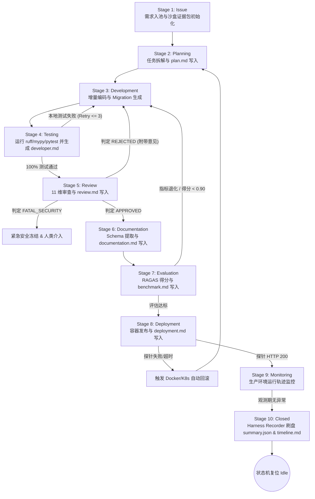
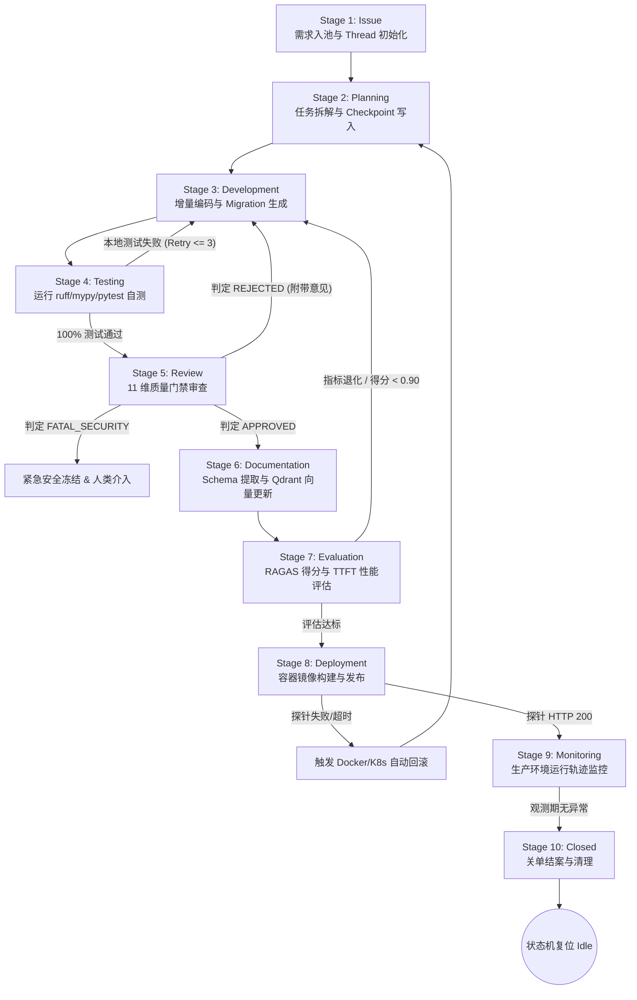

# Enterprise AI Harness - Issue Lifecycle Specification
> 企业级 AI 数字员工平台——Issue 全生命周期流转规范说明书 (V1.0)

---

## 1. 概述与生命周期模型 (Lifecycle Overview)

在 Harness Engineering 体系中，一个 Issue（需求单、Bug 单或重构单）从创建到最终归档关单，必须精准穿过 **10 个连续且具备物理约束的阶段（Stages）**。每个阶段拥有明确的**输入、输出、负责 Agent、产出物（Artifact）与退出条件（Exit Condition）**。

整个生命周期由 Harness Orchestrator 进行监控，确保任何未满足退出条件的需求严禁进入下一阶段。

---

## 2. 10 阶段履历规范 (10-Stage Lifecycle Breakdown)

```text
┌──────────────┐     ┌──────────────┐     ┌──────────────┐     ┌──────────────┐     ┌──────────────┐
│  1. Issue    │ ──> │ 2. Planning  │ ──> │3. Development│ ──> │  4. Testing  │ ──> │  ### Stage 1: Issue (需求/故障接收与入池)
*   **阶段定位**：需求的初始化与合法性校验，以及运行证据沙盒初始化。
*   **负责 Agent**：`Harness Orchestrator` / `Bootstrap Orchestrator`
*   **输入 (Input)**：来自开发者或用户的自然语言需求描述（GitHub Issue / JIRA Ticket）。
*   **输出 (Output)**：标准化且分配了唯一 `thread_id` 的任务消息项。
*   **产出物 (Artifact)**：初始化证据包 `.harness/runs/Issue-XXXX/issue.md` 与 `summary.json`。
*   **记录行为 (Recorder)**：`Harness Recorder` 引擎启动，绑定沙盒目录，开始监听事件总线。
*   **退出条件 (Exit Condition)**：Issue 结构格式校验无误，证据包初始化完毕，推送至准备队列。

---

### Stage 2: Planning (任务拆解与计划规划)
*   **阶段定位**：将大需求拆解为原子、增量、可测试的任务步骤。
*   **负责 Agent**：`Planner Agent`
*   **输入 (Input)**：Issue 消息项 + [AGENTS.md](file:///g:/LLM_Learning/product/AGENTS.md) + `docs/memory/system-context.md`。
*   **输出 (Output)**：`sprint-active.md` 中的 Checkpoint 任务清单与 `plan.md` 物理设计文件。
*   **产出物 (Artifact)**：[docs/plans/sprint-active.md](file:///g:/LLM_Learning/product/docs/plans/sprint-active.md) 与 `.harness/runs/Issue-XXXX/plan.md`。
*   **记录行为 (Recorder)**：`Harness Recorder` 捕获 `TASK` 消息与 `plan.md` 生成事件，更新 `timeline.md`。
*   **退出条件 (Exit Condition)**：受影响文件预测明确，`plan.md` 写入且已被锁定为只读。

---

### Stage 3: Development (增量编码与迁移生成)
*   **阶段定位**：增量代码编写、ORM 建模与数据库迁移脚本生成。
*   **负责 Agent**：`Developer Agent`
*   **输入 (Input)**：特定 Checkpoint 任务 + `plan.md` + `docs/guidelines/coding-standards.md`。
*   **输出 (Output)**：改动的应用源码、SQLAlchemy 模型与 Alembic 迁移文件。
*   **产出物 (Artifact)**：Git Diff 补丁、`backend/migrations/versions/*.py`。
*   **记录行为 (Recorder)**：`Harness Recorder` 跟踪 Tool 执行轨迹与 Thought 思考链。
*   **退出条件 (Exit Condition)**：源码编辑完毕；若物理表有改动，Alembic 迁移脚本成功生成。

---

### Stage 4: Testing (本地测试与自我验证)
*   **阶段定位**：开发者节点的本地代码质量与单元测试验证。
*   **负责 Agent**：`Developer Agent`
*   **输入 (Input)**：改动后的物理代码 + `backend/tests/`。
*   **输出 (Output)**：自动化测试运行日志与静态检查报告。
*   **产出物 (Artifact)**：新增/修改的测试文件、`.harness/runs/Issue-XXXX/developer.md`。
*   **记录行为 (Recorder)**：`Harness Recorder` 捕获 `pytest` / `ruff` stdout 输出，生成 `developer.md`。
*   **退出条件 (Exit Condition)**：`ruff check`、`mypy` 与 `pytest` 100% 零报错通过，`developer.md` 已锁定。

---

### Stage 5: Review (11 维质量门禁审查)
*   **阶段定位**：独立第三方质量与安全门禁审核。
*   **负责 Agent**：`Reviewer Agent`
*   **输入 (Input)**：Git Diff + `developer.md` + 11 维审查清单（Architecture, Security, Performance 等）。
*   **输出 (Output)**：评审决策 (`APPROVED` / `REJECTED_WITH_CHANGES` / `FATAL_SECURITY_BLOCK`)。
*   **产出物 (Artifact)**：`.harness/runs/Issue-XXXX/review.md` 代码审查报告。
*   **记录行为 (Recorder)**：`Harness Recorder` 捕获 `DECISION` 或 `REVIEW` 消息，写出 `review.md` 并只读锁定。
*   **退出条件 (Exit Condition)**：输出 `APPROVED` 状态并写入证据链（若被驳回则退回 Stage 3）。

---

### Stage 6: Documentation (知识提取与 Schema 同步)
*   **阶段定位**：代码合并后的自动契约提取与知识库更新。
*   **负责 Agent**：`Documentation Agent`
*   **输入 (Input)**：合并至主分支的代码库 + `backend/api/` + `backend/models/`。
*   **输出 (Output)**：最新的 OpenAPI JSON、更新后的 API/DB 说明文档。
*   **产出物 (Artifact)**：`docs/generated/openapi-spec.json`、`.harness/runs/Issue-XXXX/documentation.md`。
*   **记录行为 (Recorder)**：`Harness Recorder` 捕获 Schema 变更与 Qdrant Point 写入日志。
*   **退出条件 (Exit Condition)**：Schema 导出完成，向量重建完毕，`documentation.md` 写入证据包。

---

### Stage 7: Evaluation (RAGAS 准确率与性能回归评估)
*   **阶段定位**：针对 RAG 知识检索与系统吞吐的回归评测。
*   **负责 Agent**：`Evaluator Agent`
*   **输入 (Input)**：测试环境 Endpoint + `benchmark/test-dataset.json`。
*   **输出 (Output)**：RAGAS 指标评分（Faithfulness, Recall）及首字延迟（TTFT）报告。
*   **产出物 (Artifact)**：`.harness/runs/Issue-XXXX/benchmark.md`。
*   **记录行为 (Recorder)**：`Harness Recorder` 记录 RAGAS 得分、TTFT 与 Token 成本元数据。
*   **退出条件 (Exit Condition)**：RAGAS Faithfulness > 0.90，首字延迟耗时无退化，证据落盘。

---

### Stage 8: Deployment (容器构建与环境发布)
*   **阶段定位**：物理容器编译与环境部署更新。
*   **负责 Agent**：`Deployment Agent`
*   **输入 (Input)**：通过评估的发布镜像标签 + Docker Compose / K8s Manifests。
*   **输出 (Output)**：更新后的容器服务实例。
*   **产出物 (Artifact)**：构建的 Docker Image、`.harness/runs/Issue-XXXX/deployment.md`。
*   **记录行为 (Recorder)**：`Harness Recorder` 记录容器编译命令、金丝雀比例与健康探针。
*   **退出条件 (Exit Condition)**：`/api/v1/health` 返回 HTTP 200 OK，`deployment.md` 只读锁定。

---

### Stage 9: Monitoring (在线轨迹收集与运行审计)
*   **阶段定位**：新上线服务的线上健康与性能监控。
*   **负责 Agent**：`Harness Orchestrator` / `Monitoring Subsystem`
*   **输入 (Input)**：生产环境 WebSocket 运行日志、Prometheus 监控指标。
*   **输出 (Output)**：系统实时健康度指标。
*   **产出物 (Artifact)**：Prometheus Metric 采样数据、日志追踪记录。
*   **记录行为 (Recorder)**：`Harness Recorder` 保持无盲区采集，准备最终刷盘。
*   **退出条件 (Exit Condition)**：在观测窗口内无 5xx 崩溃，准备结案。

---

### Stage 10: Closed (证据落盘与归档闭环)
*   **阶段定位**：需求的物理关单与 Harness Recorder 最终刷盘。
*   **负责 Agent**：`Harness Orchestrator` & `Harness Recorder`
*   **输入 (Input)**：监控日志 + 全阶段产生的 8 大只读证据文件。
*   **输出 (Output)**：最终刷盘落盘的只读证据链条包及 Closed 状态。
*   **产出物 (Artifact)**：`.harness/runs/Issue-XXXX/summary.json`、`timeline.md` 与 `runtime.log`。
*   **记录行为 (Recorder)**：**Harness Recorder 刷盘写出 `summary.json`, `timeline.md`, `runtime.log`，关闭监听。**
*   **退出条件 (Exit Condition)**：`summary.json`、`timeline.md` 刷盘完成且大小 > 0，临时资源释放，状态机归位 `Idle`。

---

## 3. 完整生命周期流转图 (Master Lifecycle Flowchart)



---

## 4. 各阶段元素汇总表 (Master Summary Matrix)

| 阶段 (Stage) | 负责 Agent | 核心输入 (Input) | 核心产出物 (Artifact) | Recorder 行为与关单硬性依赖 |
| :--- | :--- | :--- | :--- | :--- |
| **1. Issue** | Orchestrator | 自然语言需求单 | `Issue-XXXX/issue.md` | 启动 Recorder，监听消息总线 |
| **2. Planning** | Planner Agent | Issue + AGENTS.md | `Issue-XXXX/plan.md` | 捕获 `plan.md` 并锁定只读 |
| **3. Development** | Developer Agent | Task Checkpoint + 源码 | Git Diff / Migration | 记录思考链与编辑文件轨迹 |
| **4. Testing** | Developer Agent | 改动代码 + `tests/` | `Issue-XXXX/developer.md` | 捕获 pytest stdout 并生成 `developer.md` |
| **5. Review** | Reviewer Agent | Git Diff + developer.md | `Issue-XXXX/review.md` | 捕获 Decision 并锁定 `review.md` |
| **6. Documentation**| Doc Agent | 合并代码 + API/Models | `Issue-XXXX/documentation.md`| 记录 Schema 变动与 Qdrant Point |
| **7. Evaluation** | Evaluator Agent | Test Endpoint + Dataset | `Issue-XXXX/benchmark.md` | 记录 RAGAS 分数、TTFT 与 Token 开销 |
| **8. Deployment** | Deployment Agent| 镜像标签 + Manifests | `Issue-XXXX/deployment.md` | 记录容器 Tag 与 HTTP 200 健康探针 |
| **9. Monitoring** | Orchestrator | 在线 WebSocket 日志 | Prometheus Metric | 无盲区指标采集中 |
| **10. Closed** | Orchestrator & Rec | 监控日志 + 8 大证据包 | `summary.json`, `timeline.md`, `runtime.log` | **硬性依赖：刷盘生成 summary.json & timeline.md 成功** | (Exit Condition)**：在观测窗口（如 10 分钟）内无 5xx 崩溃或丢包报错。

---

### Stage 10: Closed (归档闭环)
*   **阶段定位**：需求的最终完成结案。
*   **负责 Agent**：`Harness Orchestrator`
*   **输入 (Input)**：健康的监控指标 + 完整的构建与测试日志。
*   **输出 (Output)**：已关闭的 Issue 状态与结案通知。
*   **产出物 (Artifact)**：关闭状态的 Issue、标记为 `[x]` 的 `sprint-active.md` 记录。
*   **退出条件 (Exit Condition)**：所有临时资源释放，全局状态机归位至 `Idle`。

---

## 3. 完整生命周期流转图 (Master Lifecycle Flowchart)



---

## 4. 各阶段元素汇总表 (Master Summary Matrix)

| 阶段 (Stage) | 负责 Agent | 核心输入 (Input) | 核心产出物 (Artifact) | 退出条件 (Exit Condition) |
| :--- | :--- | :--- | :--- | :--- |
| **1. Issue** | Orchestrator | 自然语言需求单 | `logs/trajectories/issue.json` | 成功分配唯一 `thread_id` |
| **2. Planning** | Planner Agent | Issue + AGENTS.md + Context | `docs/plans/sprint-active.md` | Checkpoint 清单写入完成 |
| **3. Development** | Developer Agent | Task Checkpoint + 源码 | Git Diff / Migration 文件 | 编码完成，物理表变动生成 Migration |
| **4. Testing** | Developer Agent | 改动代码 + `tests/` | `logs/pytest.log` | `ruff`/`mypy`/`pytest` 零报错 |
| **5. Review** | Reviewer Agent | Git Diff + 测试日志 | PR Review Markdown 报告 | 输出 `APPROVED` 判定 |
| **6. Documentation**| Doc Agent | 合并代码 + API/Models | `openapi-spec.json` / Qdrant 点位 | Schema 导出且向量重建完毕 |
| **7. Evaluation** | Evaluator Agent | Test Endpoint + Dataset | `eval_report.json` | RAGAS 得分 > 0.90，TTFT 无退化 |
| **8. Deployment** | Deployment Agent| 镜像标签 + Manifests | Docker Image / 探针日志 | `/api/v1/health` 返回 HTTP 200 |
| **9. Monitoring** | Orchestrator | 在线 WebSocket 运行日志 | Prometheus Metric 数据 | 观测期内无 5xx 报错 |
| **10. Closed** | Orchestrator | 监控日志 + 部署结果 | 标记结案的 `sprint-active.md` | 临时资源释放，复位至 `Idle` |
