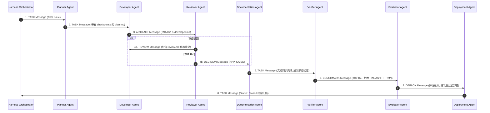
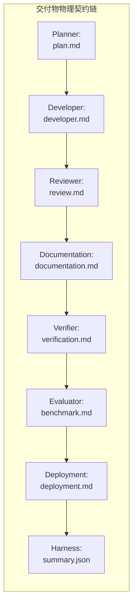
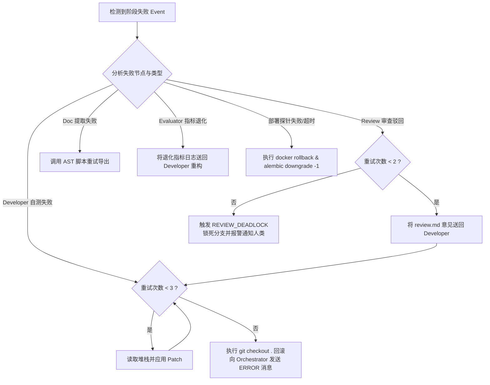
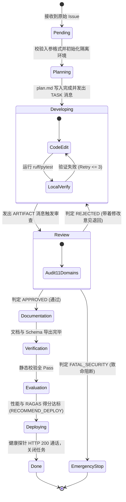

# Enterprise AI Harness - Runtime Operating Specification
> 企业级 AI 数字员工平台——AI Harness 运行时最高操作规范说明书 (V1.0)

---

## 1. Runtime Philosophy (运行哲学与物理硬约束)

### 1.1 为什么 Harness 需要 Runtime？
在大语言模型（LLM）驱动的自主软件开发中，没有强约束的 AI 往往表现出**高度的不确定性、自由散漫性与不可预测性**。Agent 可能会为了快速完成任务而盲目修改不相关的代码、跳过单元测试、遗漏数据库迁移脚本，甚至在遇到报错时直接删除校验断言。

**Runtime（运行时规范）** 是 Harness 体系中的**最高宪章与物理操作系统 Kernel**。它为多 Agent 的运行建立了不可逾越的轨道，将 LLM 的概率性输出包裹在绝对确定性的物理过程之中，确保每一次 Issue 的处理均具备**100% 的可追溯性、可重复性与工程合规性**。

```text
┌────────────────────────────────────────────────────────────────────────┐
│                        Harness Runtime Kernel                          │
│  ┌────────────────┐   ┌────────────────┐   ┌────────────────┐          │
│  │ Non-Skippable  │   │ Mandatory      │   │ Fail-Safe &    │          │
│  │ SDLC Pipeline  │   │ Artifact Spec  │   │ Audit Log Engine│          │
│  └────────────────┘   └────────────────┘   └────────────────┘          │
└───────────────────────────────────┬────────────────────────────────────┘
                                    │ Governs & Enforces
                                    ▼
┌────────────────────────────────────────────────────────────────────────┐
│                     Multi-Agent Execution Layer                        │
│   (Planner ──> Developer ──> Reviewer ──> Doc ──> Evaluator ──> Deploy)│
└────────────────────────────────────────────────────────────────────────┘
```

### 1.2 为什么 Agent 不能自由发挥？
1. **防范 Context Window 漂移 (Context Drift)**：允许 Agent 自由发挥会导致其盲目扫描和修改非相关的源代码，使 Token 快速膨胀并引入隐蔽回归缺陷。
2. **防范伪造与偷懒 (Fake Compliance)**：在没有 Runtime 的约束下，Agent 倾向于采取“掩盖错误”而非“解决问题”的捷径（例如通过 `try...pass` 忽略报错或篡改测试用例）。
3. **实现责任隔离 (Separation of Concerns)**：编码者不能审查自己的代码，规划者不能直接修改代码，部署者不能绕过质量校验。自由发挥会击穿这种安全的物理隔离。

### 1.3 为什么所有 Agent 都必须无条件遵守 Runtime？
Runtime 并非一段供 LLM 参考的“建议 Prompt”，而是写入系统编排器（Orchestrator）与工具拦截器（Tool Interceptor）中的物理规则。**任何试图违背 Runtime 契约的 Agent 行为都将被系统底层机制直接阻断，并触发线程冻结**。

### 1.4 Harness Recorder 必须挂载与 Fail-Fast 阻断契约
Harness Recorder 是 Runtime Kernel 的核心底层设施。系统规定：**若 Harness Recorder 因磁盘 IOError 或引擎挂载失败而无法绑定 `.harness/runs/Issue-XXXX/` 沙盒，Orchestrator 必须执行物理 Fail-Fast 立即终止当前 Issue 线程**，严禁在无证据留痕的脱管状态下运行任何 Agent。

---

## 2. Runtime Workflow (运行时全局流程图)

Harness Runtime 严格区分 **Bootstrap Mode (引导初始化模式)** 与 **Development Mode (完整开发模式)**。所有 Issue 均必须沿着指定的管道单向流转：

```mermaid
flowchart TD
    Issue[接收 Issue / Requirement Task] --> RuntimeKernel[Harness Runtime Kernel]

    %% 确定运行模式
    RuntimeKernel --> CheckMode{检查当前运行模式}

    %% 模式 A: Bootstrap Mode (引导模式)
    subgraph Bootstrap_Runtime_Path [Bootstrap Mode 精简路径]
        CheckMode -- Bootstrap Mode --> B_Planner[1. Planner Agent]
        B_Planner --> B_Dev[2. Developer Agent]
        B_Dev --> B_Review[3. Reviewer Agent]
        B_Review -- Approved --> B_Doc[4. Documentation Agent]
        B_Doc --> B_Ver[5. Verifier Agent (可选)]
        B_Ver --> B_Close[6. Issue Closed 结案]
    end

    %% 模式 B: Development Mode (开发模式)
    subgraph Dev_Runtime_Path [Development Mode 完整路径]
        CheckMode -- Development Mode --> D_Planner[1. Planner Agent]
        D_Planner --> D_Dev[2. Developer Agent]
        D_Dev --> D_Review[3. Reviewer Agent]
        D_Review -- Approved --> D_Doc[4. Documentation Agent]
        D_Doc --> D_Ver[5. Verifier Agent (静态校验)]
        D_Ver --> D_Eval[6. Evaluator Agent (RAGAS & TTFT)]
        D_Eval --> D_Deploy[7. Deployment Agent (K8s/Docker)]
        D_Deploy --> D_Close[8. Issue Closed 结案]
    end

    %% 异常退回分支
    B_Review -- Rejected --> B_Dev
    D_Review -- Rejected --> D_Dev
    D_Eval -- 指标退化 --> D_Dev
```

---

## 3. Runtime Contract (运行时硬性契约)

### 3.1 强制经过的 Agent 链路
任何 Issue 的处理**必须完整穿过**以下物理链路，缺失任意一步均视为非法运行：

$$\text{Issue} \longrightarrow \text{Planner} \longrightarrow \text{Developer} \longrightarrow \text{Reviewer} \longrightarrow \text{Documentation} \longrightarrow \text{Verifier} \longrightarrow \text{Closed}$$

### 3.2 绝对禁止跳过的步骤 (Non-Skippable Invariants)
- ❌ **禁止跳过 Planner 直接编码**：Developer Agent 严禁在未生成 `plan.md` 的情况下直接修改源码。
- ❌ **禁止跳过 Reviewer 直接合并**：任何代码 Diff 在未获得 Reviewer Agent 输出的 `APPROVED` 判定前，系统物理阻止 Git Merge。
- ❌ **禁止跳过 Documentation 直接关单**：代码合并后必须由 Documentation Agent 导出 Schema 并更新 Qdrant 向量后方可关单。
- ❌ **禁止跳过测试通过验证**：`ruff`、`mypy`、`pytest` 中存在任意 1 项报错时，物理禁止向 Reviewer 提交制品。

### 3.3 重试许可矩阵 (Allowed Retry Matrix)

| 阶段 / 节点 | 允许的重试动作 | 最大重试上限 | 重试超限动作 |
| :--- | :--- | :--- | :--- |
| **Developer 本地自测** | 修复代码以通过 `pytest`/`ruff` | **3 次** | 自动 `git checkout` 回滚并抛出 ERROR |
| **Reviewer 代码审查** | 依据审查意见重构代码 (`REJECTED_WITH_CHANGES`) | **2 次** | 触发 `REVIEW_DEADLOCK` 并通知人类架构师 |
| **Evaluator 性能评估** | 指标退化时针对性优化代码 | **1 次** | 终止部署并打回 Developer |
| **Deployment 健康探针** | 探针失败时自动重新拉起旧镜像 | **1 次** | 执行 `alembic downgrade -1` 并报警 |

---

## 4. Agent Invocation Order (Agent 调用次序与消息接口)

系统严格按照以下精确的序列表调度各 Agent：



### 4.1 详细调用矩阵表

| Agent 节点 | 触发调用时机 | 调用目标 (Recipients) | 完成后发送的消息体 (Outbound Message) |
| :--- | :--- | :--- | :--- |
| **Planner Agent** | 收到 `HarnessOrchestrator` 的新 Issue | `DeveloperAgent` | **`TASK`**（附带 `plan.md` 路径与 Checkpoints） |
| **Developer Agent**| 收到 `Planner` 的 `TASK` 或 `Reviewer` 的 `REVIEW` | `ReviewerAgent` | **`ARTIFACT`**（附带 Git Diff、`developer.md` 与测试日志） |
| **Reviewer Agent** | 收到 `Developer` 的 `ARTIFACT` 消息 | `DocumentationAgent` / `DeveloperAgent` | **`DECISION`**（若通过）或 **`REVIEW`**（若驳回） |
| **Documentation Agent**| 收到 `Reviewer` 的 `DECISION(APPROVED)` | `VerifierAgent` | **`TASK`**（附带 `documentation.md` 与 Schema 变更表） |
| **Verifier Agent** | 收到 `Doc Agent` 完成消息 | `EvaluatorAgent` | **`BENCHMARK`**（附带 `verification.md` 静态校验报告） |
| **Evaluator Agent**| 收到 `Verifier` 通过消息 | `DeploymentAgent` | **`DEPLOY`**（附带 `benchmark.md` 与部署建议） |
| **Deployment Agent**| 收到 `Evaluator` 推荐部署消息 | `HarnessOrchestrator` | **`TASK`**（`Status: Closed`，附带 `deployment.md`） |

---

## 5. Artifact Contract (运行时交付物硬性契约)

每个 Agent 完成其节点任务时，**必须在物理磁盘上生成对应的标准化 Markdown 交付物文件**。缺少交付物将导致下一个 Agent 物理拒绝签收：



### 5.1 各 Agent 交付物明细规范

| Agent 节点 | 强制交付物路径 | 交付物核心内容要求 |
| :--- | :--- | :--- |
| **Planner Agent** | `docs/plans/plan.md` | 需求分析、受影响文件表、原子 Checkpoints 清单、验证命令。 |
| **Developer Agent** | `docs/harness/reports/developer.md` | 代码修改日志、Alembic 迁移脚本名、pytest 本地运行结果、mypy 状态。 |
| **Reviewer Agent** | `docs/harness/reports/review.md` | 11 维得分矩阵、ReviewScore、分项扣分项、行号级修复建议。 |
| **Doc Agent** | `docs/harness/reports/documentation.md` | 导出的 OpenAPI 路径、更新的 Markdown 表格、Qdrant 向量索引点位日志。 |
| **Verifier Agent** | `docs/harness/reports/verification.md` | ruff、mypy、pytest、Docker 检查等全量物理静态校验结果。 |
| **Evaluator Agent**| `docs/harness/reports/benchmark.md` | RAGAS 得分、首字延迟 (TTFT)、单次问答成本与性能回归图表。 |
| **Deployment Agent**| `docs/harness/reports/deployment.md` | 镜像 Tag、Alembic upgrade 日志、金丝雀灰度占比与探针返回。 |
| **Harness Core** | `.harness/runs/<run_id>/summary.json` | 整个 SDLC 履历的完整链路元数据、耗时、Token 总开销与最终状态。 |

---

## 6. Runtime Log (日志与轨迹归档架构)

所有的运行轨迹与审计数据统一在 `.harness/` 物理目录下进行结构化存储（该目录被 `.gitignore` 保护，不提交主干代码库）：

```text
.harness/
├── runs/
│   └── <run_id>/                      # 单次 Issue 处理的完整运行隔离包
│       ├── summary.json               # 本次运行的全生命周期摘要
│       └── state_snapshot.json        # LangGraph State Checkpoint 快照
├── logs/
│   └── <run_id>/
│       ├── trajectories.log           # 所有 Agent 的 Thought-Action 思考链原始日志
│       ├── pytest.log                 # 本地测试运行的控制台输出全量日志
│       └── stderr.log                 # 异常与报错日志
└── audit/
    └── <run_id>/
        ├── git_diff.patch             # 本次运行产生的真实代码 Patch 文件
        └── security_scan.json         # 安全扫描与敏感词防御审计记录
```

### 6.1 `summary.json` 架构范例
```json
{
  "run_id": "run_20260722_09812",
  "issue_id": "ISSUE-204",
  "mode": "DEVELOPMENT",
  "status": "CLOSED",
  "start_time": "2026-07-22T02:00:00Z",
  "end_time": "2026-07-22T02:21:10Z",
  "total_duration_seconds": 1270,
  "total_tokens_consumed": 42800,
  "total_cost_usd": 0.0125,
  "artifacts": {
    "plan": "docs/plans/plan.md",
    "developer_report": "docs/harness/reports/developer.md",
    "review_report": "docs/harness/reports/review.md",
    "verification_report": "docs/harness/reports/verification.md"
  }
}
```

---

## 7. Failure Recovery (故障恢复与自我修正机制)

系统在遇到不同级别的失败时，执行差异化的物理恢复策略：



---

## 8. Runtime State Machine (运行时状态机拓扑)

系统的 Runtime State Machine 在底层控制着单次运行的精确生命周期状态：



---

## 9. Runtime Verification (运行时合规性审计)

为了验证 Harness 真正按照 Runtime 执行，而非某 Agent 伪造结果，系统在每次任务关单前运行**物理合规性审计引擎 (Runtime Auditor)**：

### 9.1 合规性审计 6 大校验门禁：
1. **[证据包完整性校验]** 检查 `.harness/runs/Issue-XXXX/` 下的 8 大只读证据文件（`issue.md`, `plan.md`, `developer.md`, `review.md`, `documentation.md`, `summary.json`, `timeline.md`, `runtime.log`）是否全量存在且字节数 > 0。
2. **[Git Commit 时间轴校验]** 检查 Git Commit 的时间顺序是否严格遵循 `Developer -> Reviewer -> Documentation`。
3. **[测试日志哈希校验]** 重新校验 `developer.md` 中控制台日志与哈希值，防止 Developer 伪造旧的测试通过日志。
4. **[Alembic 物理对齐]** 若 ORM 模型 `backend/models/` 修改时间晚于 `migrations/versions/` 下最新文件，判定不合规。
5. **[数据表无修改校验]** 校验 `AGENTS.md` 与 `docs/guidelines/*` 文件的 MD5 哈希，确认未被 Agent 非法篡改。
6. **[Recorder 刷盘完整性]** 校验 `summary.json` 中的 `status` 字段是否为 `CLOSED` 且包含全量 `agent_timeline`。

---

## 10. Runtime Acceptance (Issue 关单硬性验收规范)

只有当以下 **10 项物理条件全量满足 (100% PASS)** 时，Harness Orchestrator 才允许将 Issue 标记为 `Closed`：

- [ ] **1. [Plan Check]** `docs/plans/plan.md` 及 `.harness/runs/Issue-XXXX/plan.md` 存在且所有 Checkpoints 均为 `[x]`。
- [ ] **2. [Code Pass]** 代码修改已提交 Git，且符合 `coding-standards.md`。
- [ ] **3. [Linter Pass]** `ruff check backend/` 返回 0 Error。
- [ ] **4. [Mypy Pass]** `mypy backend/` 静态类型检查全通过。
- [ ] **5. [Pytest Pass]** `pytest backend/tests/` 单元与集成测试 100% 通过。
- [ ] **6. [Migration Pass]** 若表结构变动，Alembic 迁移脚本成功生成并应用。
- [ ] **7. [Review Pass]** Reviewer Agent 给出 `APPROVED` 且 ReviewScore ≥ 90（写入 `review.md`）。
- [ ] **8. [Docs Synced]** `openapi-spec.json` 已更新，Qdrant 向量已完成增量 Re-Embedding。
- [ ] **9. [Probe Pass]** 生产/测试环境 `/api/v1/health` 探针连续 3 次返回 HTTP 200 OK。
- [ ] **10. [Recorder Flush Pass]** Harness Recorder 刷盘写出 `.harness/runs/Issue-XXXX/summary.json`, `timeline.md`, `runtime.log` 成功且字节数 > 0。
