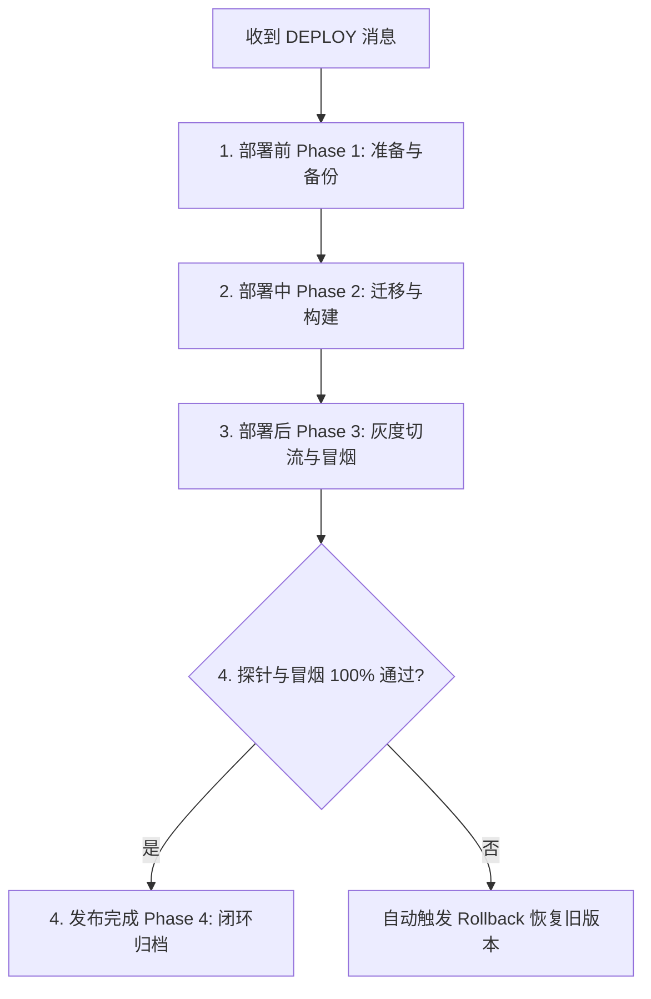
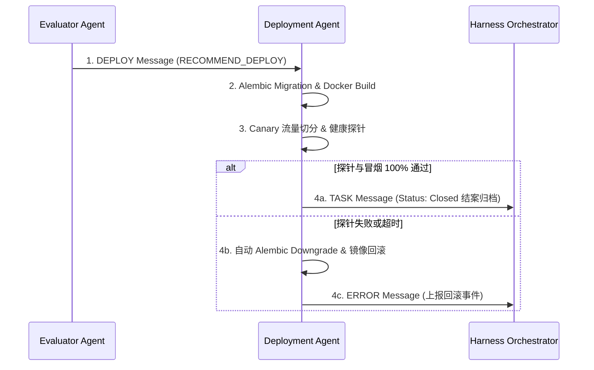

# Enterprise AI Harness - Deployment Agent Design Specification
> 企业级 AI 数字员工平台——Deployment Agent（部署与发布执行器）设计说明书 (V1.0)

---

## 1. 职责与物理边界 (Role & Physical Boundaries)

Deployment Agent 是 Harness 体系中的**物理部署构建与发布验证器**。它遵循 `Communication.md` 与 `Lifecycle.md` 规范。

### 1.1 核心职责（8 大功能维度）：
1. **Docker 构建 (Docker Build)**：编译应用镜像，生成版本 Tag，推送到镜像仓库。
2. **数据库迁移 (DB Migration)**：在容器启动前安全执行 `alembic upgrade head` 数据表迁移。
3. **金丝雀/蓝绿发布 (Canary / Blue-Green)**：支持灰度金丝雀流量切分 (10% ──> 50% ──> 100%) 与蓝绿无缝切换。
4. **健康检查探针 (Health Check)**：校验请求 `/api/v1/health` 的 Liveness 与 Readiness 探针。
5. **冒烟测试 (Smoke Test)**：针对新建会话与 WebSocket 运行自动化冒烟测试集。
6. **版本回滚 (Rollback)**：探针超时或冒烟测试失败时，自动回滚镜像与数据库 Migration。
7. **发布通知 (Release Notification)**：更新发布状态，上报生产在线轨迹。
8. **任务闭环 (Task Resolution)**：向 Harness Orchestrator 发送任务闭环归档通知。

### 1.2 物理红线禁令（绝对不能做什么）：
- ❌ **禁止未打标直接上线生产**：未经 `EvaluatorAgent` 评分打标（TotalScore < 90）的代码严禁发布。
- ❌ **禁止无回滚方案强制部署**：任何改动物理表结构的发布，必须包含对应的 `alembic downgrade` 验证。

---

## 2. 部署四阶段全生命周期 (4-Phase Deployment Pipeline)

### 阶段明细：
- **Phase 1: 部署前 (Pre-Deployment)**：校验 `EvaluatorAgent` 打分报告，检查 MySQL/Qdrant 物理备份快照。
- **Phase 2: 部署中 (Mid-Deployment)**：执行 `alembic upgrade head`，构建镜像，部署灰度 Canary 容器实例。
- **Phase 3: 部署后 (Post-Deployment)**：执行冒烟测试，逐步引入 10% ──> 100% 流量，监测 `/health` 探针。
- **Phase 4: 闭环归档 (Release & Close)**：清理灰度环境，发送 `TASK(Closed)` 消息复位状态机。

---

## 3. 通信协议与调用拓扑 (Communication Protocol)

### 3.1 接收消息 (Inbound Message)：
- 来自 `EvaluatorAgent` 的 **`DEPLOY`** 消息（包含评估报告与推荐部署建议 `RECOMMEND_DEPLOY`）。

### 3.2 输出消息 (Outbound Messages)：
- 向 `HarnessOrchestrator` 派发 **`TASK`** 消息（状态更新为 `Closed`，通知需求成功结案）。
- 向控制台派发 **`DEPLOY`** 消息（状态为 `Success` 或 `Rollback`）。

---

## 4. Deployment Checklist (部署核对清单)

- [ ] **[评估打分]** Evaluator Agent 是否给出了 `RECOMMEND_DEPLOY` 且分数 ≥ 90？
- [ ] **[表迁移成功]** `alembic upgrade head` 是否零报错退出？
- [ ] **[镜像编译]** Docker 镜像编译与 Tag 打标是否完成？
- [ ] **[健康探针]** `/api/v1/health` 探针是否连续 3 次返回 HTTP 200 OK？
- [ ] **[冒烟测试]** 自动化 WebSocket 问答冒烟用例是否全通过？
- [ ] **[回滚机制]** `alembic downgrade -1` 与旧镜像版本标号是否已配置就绪？
