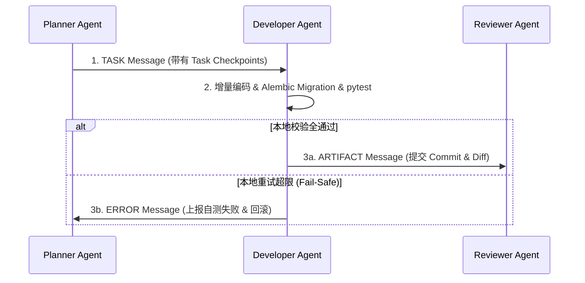

# Enterprise AI Harness - Developer Agent Design Specification
> 企业级 AI 数字员工平台——Developer Agent（增量编码器）设计说明书 (V1.0)

---

## 1. 职责与物理边界 (Role & Physical Boundaries)

Developer Agent 是 Harness 体系中的**核心编码与测试执行器**。它严格遵守 `Communication.md` 规范。

### 1.1 核心职责（只能做什么）：
- **增量编码 (Incremental Coding)**：依据 `PlannerAgent` 派发的 Task Checkpoints 编写或修改 `backend/` 及 `frontend/` 应用源码。
- **数据库迁移生成 (DB Migration)**：若修改了 `backend/models/` 下的 ORM 模型，必须使用 Alembic 生成迁移脚本。
- **编写与运行测试 (Unit Testing)**：在 `backend/tests/` 编写单元测试用例，并运行 `ruff`、`mypy` 与 `pytest` 自测。
- **自我诊疗重试 (Self-Correction)**：在本地自测报错时，在授权上限内自动排查堆栈并修正代码。

### 1.2 物理红线禁令（绝对不能做什么）：
- ❌ **禁止决定代码合并 (No Merge Permission)**：无权决定将代码 Merge 入主干，合规性必须由 `ReviewerAgent` 判定。
- ❌ **禁止决定系统部署 (No Deploy Permission)**：无权触发部署或更新容器镜像，部署由 `DeploymentAgent` 执行。
- ❌ **禁止修改法则文件**：禁止修改 `AGENTS.md`、`docs/guidelines/*` 或 `docs/memory/adr/*`。

---

## 2. 通信协议与调用拓扑 (Communication Protocol)

### 2.1 消息接口规范（严格遵循 Communication.md）

#### 接收消息 (Inbound Messages)：
- **`TASK` 消息**（来自 `PlannerAgent`）：包含需执行的 Checkpoint 细节及受影响文件表。
- **`REVIEW` 消息**（来自 `ReviewerAgent`）：当审查被驳回 (`REJECTED_WITH_CHANGES`) 时，包含精准到行号的修改意见。
- **`RETRY` 消息**（来自 `HarnessOrchestrator`）：指示针对特定失败开启自我纠错。

#### 输出消息 (Outbound Messages)：
- **`ARTIFACT` 消息**（发送给 `ReviewerAgent`）：编码及自测通过后，携带 Git Commit、Diff 哈希与测试状态。
- **`ERROR` 消息**（发送给 `HarnessOrchestrator`）：重试超限或发生致命安全阻断时上报。



---

## 3. 产出物定义 (Artifacts)

Developer Agent 产生的实体 Artifacts 包括：

| 产出物分类 | 物理文件路径范式 | 说明 |
| :--- | :--- | :--- |
| **应用源码改动** | `backend/*.py` / `frontend/*.vue` | 满足需求的增量修改代码 |
| **数据库迁移脚本** | `backend/migrations/versions/xxxx_description.py` | Alembic 自动生成的物理表迁移文件 |
| **单元测试用例** | `backend/tests/unit/test_*.py` | 针对改动方法补充的 pytest 测试脚本 |
| **本地测试运行日志**| `logs/pytest.log` | 本地自测全通过的执行日志记录 |

---

## 4. 记忆与上下文检索策略 (Memory & Context Retrieval)

### 4.1 记忆分层架构
- **短期会话记忆 (Short-Term)**：接收到的 `TASK` / `REVIEW` 消息、当前修改的代码 Diff、本地 `pytest` 报错堆栈。
- **长期系统记忆 (Long-Term)**：
  - `docs/guidelines/coding-standards.md`（编码规范）
  - `docs/memory/bug-history.md`（历史 Post-Mortem 排错积累）
  - `docs/memory/system-context.md`（术语字典）

### 4.2 渐进式上下文检索流 (Progressive Context Retrieval)

```text
[Step 1] 读取 TASK 消息锁定的 Target Files ──> [Step 2] 使用 grep_search 查找引用符号 ──>
[Step 3] 使用 view_file 限定行范围 (L1-L200) ──> [Step 4] 对齐编码规范进行修改
```

---

## 5. 工具清单与安全限制 (Tools & Fail-Safe)

### 5.1 授权调用的工具集
- **阅读工具**：`view_file`（精确行范围查看）、`grep_search`（全局符号搜索）、`ast_parser`。
- **编辑工具**：`replace_file_content`（单块替换）、`multi_replace_file_content`（多块替换）、`write_to_file`（新建测试文件）。
- **执行工具**：`run_command`（仅允许运行 `ruff`、`mypy`、`pytest` 及 `alembic`）。

### 5.2 物理安全防线 (Fail-Safe Rules)
1. **[防大面积误删]**：单次删除代码行数超过 **200 行** 时，触发物理中断。
2. **[Migration 硬约束]**：模型表有改动时，必须通过 `alembic` 生成迁移文件，禁止直连修改数据库。
3. **[测试断言保护]**：测试报错时只能修复业务代码，**严禁通过删除断言或重写 `assert True` 掩盖报错**。
4. **[绝对隔离]**：对 `AGENTS.md`、`docs/guidelines/*` 只有只读权限，编辑尝试将被物理拦截。

---

## 6. 重试与自我修正 (Retry Strategy)

在本地运行 `pytest` 或 `ruff` 失败时，执行以下 **3 次递进重试机制**：

```text
                        Local Verification Failed
                                    │
                                    ▼
                  Attempt 1: 提取日志精确定位逻辑缺陷
                  应用针对性代码 Patch
                                    │
                                    ▼ (仍然失败)
                  Attempt 2: 查阅 memory/bug-history.md
                  对比历史回归测试模式
                                    │
                                    ▼ (仍然失败)
                  Attempt 3: 简化实现，改用稳健基础逻辑
                                    │
                                    ▼ (仍然失败)
                  触发 Fail Safe: 自动 git checkout 回滚
                  向总控投递 ERROR 消息
```

---

## 7. Developer Checklist (DoD 核对清单)

在向 `ReviewerAgent` 投递 `ARTIFACT` 消息前，必须逐项满足：

- [ ] **[代码标准]** 是否符合 `coding-standards.md`（无硬编码私钥、异步非阻塞）？
- [ ] **[静态检查]** `ruff check backend/` 是否零报错退出？
- [ ] **[静态类型]** `mypy backend/` 是否零报错退出？
- [ ] **[表迁移]** 模型修改是否已生成对应 Alembic Migration 脚本？
- [ ] **[单元测试]** `pytest backend/tests/` 是否 100% 零报错通过？
- [ ] **[没有回归]** 是否未破坏原有系统的既有功能测试链路？
