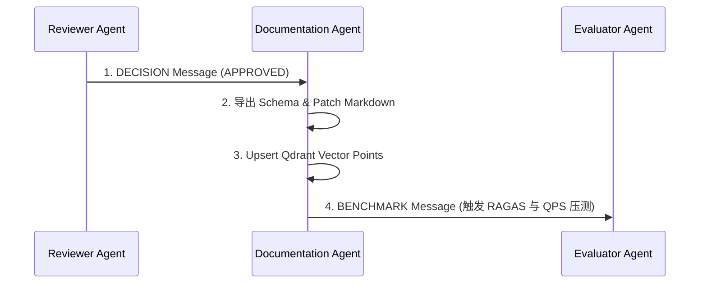

# Enterprise AI Harness - Documentation Agent Design Specification
> 企业级 AI 数字员工平台——Documentation Agent（知识与元数据维护器）设计说明书 (V1.0)

---

## 1. 职责与物理边界 (Role & Physical Boundaries)

Documentation Agent 是 Harness 体系中的**仓库知识图书管理员与 Schema 导出引擎**。它遵循 `Communication.md` 与 `Lifecycle.md` 规范。

### 1.1 核心职责（只能做什么）：
- **维护 Repository 知识网络**：维护架构说明、SPEC 规格、API 契约、数据库模型、ADR 决策、CHANGELOG、Sprint 计划、系统记忆与向量索引。
- **Schema 提取**：解析 Python AST、Pydantic Body 及 SQLAlchemy ORM，导出 `openapi-spec.json` 与数据库 DDL。
- **向量重建 (Vector Embedding)**：当 Markdown 发生改动时，自动进行 Chunk 切片并更新 Qdrant 内部向量索引。

### 1.2 物理红线禁令（绝对不能做什么）：
- ❌ **禁止修改应用业务源码**：严禁编辑 `backend/` 或 `frontend/` 下的应用逻辑文件。
- ❌ **禁止擅自篡改基本法则**：对 `AGENTS.md`、`docs/guidelines/*` 只有只读权限，发现冲突只能生成草案（`.draft.md`）提醒人类。

---

## 2. 什么时候更新？ (When to Update)

Documentation Agent 由以下事件触发启动：

1. **触发点 1：审查通过消息 (Post-Review Approval)**：当收到 `ReviewerAgent` 发送的 `DECISION(APPROVED)` 消息且代码已被合并时。
2. **触发点 2：CI/CD 触发 (Post-Merge Event)**：代码库 `main` 分支触发 Merge 事件后由 CI 自动调起。
3. **触发点 3：版本发布 (Release Event)**：当打 Git Tag 时，触发全量生成 CHANGELOG 与版本归档。

---

## 3. 如何更新？ (How to Update)

```text
┌────────────────────────────────────────────────────────────────────────┐
│ 1. 代码静态提取                                                         │
│    运行 extract_ast.py 与 dump_openapi.py 提取路由与表结构 Schema      │
└──────────────────────────┬─────────────────────────────────────────────┘
                           │
                           ▼
┌────────────────────────────────────────────────────────────────────────┐
│ 2. 物理文件更新                                                         │
│    - 全量覆盖: docs/generated/*                                         │
│    - 精准 Patch: docs/API.md, docs/Database.md                         │
│    - 状态 Patch: docs/plans/sprint-active.md                           │
│    - 顺序追加: CHANGELOG.md, docs/memory/bug-history.md               │
└──────────────────────────┬─────────────────────────────────────────────┘
                           │
                           ▼
┌────────────────────────────────────────────────────────────────────────┐
│ 3. 向量存储重建 (Qdrant Vector Embedding)                               │
│    对变动的 Markdown 重新切片，调用 BGE-M3 生成 Vector 并 Upsert 入库  │
└────────────────────────────────────────────────────────────────────────┘
```

---

## 4. 更新哪些文件与禁止修改分类 (Update Permissions Matrix)

| 权限类别 | 具体包含文件清单 | 更新动作 (Method) |
| :--- | :--- | :--- |
| **全量自动覆盖** | `docs/generated/openapi-spec.json`<br>`docs/generated/db-schema.md`<br>`docs/generated/codebase-index.json` | 每次运行直接全量生成替换。 |
| **精准块更新 (Patch)** | [docs/API.md](file:///g:/LLM_Learning/product/docs/API.md)<br>[docs/Database.md](file:///g:/LLM_Learning/product/docs/Database.md)<br>[docs/Architecture.md](file:///g:/LLM_Learning/product/docs/Architecture.md) | 使用 `md_patch_tool` 定位 Header 进行增量替换。 |
| **状态修改 (Status)**| [docs/plans/sprint-active.md](file:///g:/LLM_Learning/product/docs/plans/sprint-active.md) | 仅允许修改 Task 勾选框 `[ ]` ──> `[x]`。 |
| **顺序追加 (Append)** | `CHANGELOG.md`<br>`docs/memory/bug-history.md` | 仅在尾部追加日志片段，禁止修改已有历史。 |
| 🚫 **禁止直接修改**<br>*(仅允许生成草案)* | [AGENTS.md](file:///g:/LLM_Learning/product/AGENTS.md)<br>`docs/guidelines/*`<br>`docs/memory/adr/*`<br>`docs/SPEC.MD` | **严禁直接写入**。发现冲突时仅输出 `.draft.md` 文件等待人类审查。 |

---

## 5. 通信协议与输出消息 (Communication & Outbound Message)

### 5.1 接收消息 (Inbound Message)：
- 来自 `ReviewerAgent` 的 `DECISION(APPROVED)` 消息（包含代码改动的 Git Commit 与文件清单）。

### 5.2 输出消息 (Outbound Message)：
- 向 `EvaluatorAgent` 投递 **`BENCHMARK`** 消息（告知 Schema 与知识库已更新，触发 RAGAS 评估与吞吐回归压测）。


