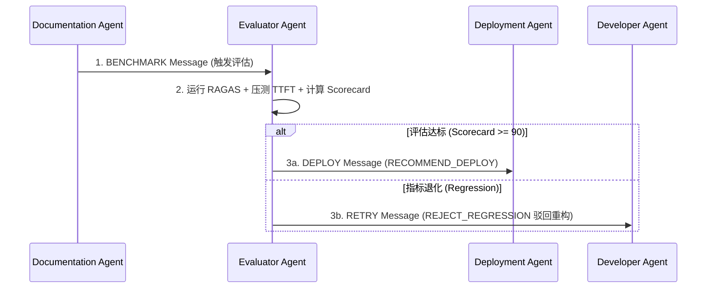

# Enterprise AI Harness - Evaluator Agent Design Specification
> 企业级 AI 数字员工平台——Evaluator Agent（质量与性能评估器）设计说明书 (V1.0)

---

## 1. 职责与物理边界 (Role & Physical Boundaries)

Evaluator Agent 是 Harness 体系中的**量化质量评估员与性能回归把关人**。它遵循 `Communication.md` 与 `Lifecycle.md` 规范。

### 1.1 核心职责（只能做什么）：
- **RAGAS 质量评估 (RAGAS Evaluation)**：使用标准数据集评估 Faithfulness（忠实度）、Answer Relevance（相关度）、Context Recall（召回率）。
- **延迟与吞吐压测 (Latency & Throughput)**：测试首字延迟（TTFT）与 QPS 吞吐回归。
- **成本与 Token 核算 (Cost & Token Audit)**：分析单次问答与 Prompt 消耗开销。
- **安全性与回归检测 (Security & Regression)**：运行自动化安全注入测试集，防止性能或准确率倒退。
- **给出部署建议 (Deployment Recommendation)**：结合 Scorecard 给出 `RECOMMEND_DEPLOY`（推荐部署）或 `REJECT_REGRESSION`（回归驳回）。

### 1.2 物理红线禁令（绝对不能做什么）：
- ❌ **禁止修改源码与物理配置**：对 `backend/`、`frontend/` 及配置文件只有只读/测试调用权限。
- ❌ **禁止伪造评估数据**：所有 RAGAS 分数与 TTFT 耗时必须由实际测试运行产生。

---

## 2. 9 大评估 Pillar 覆盖矩阵 (9 Evaluation Pillars)

| Pillar | 评估指标 (Key Metrics) | 合格阈值 (Pass Threshold) |
| :--- | :--- | :--- |
| **1. RAGAS** | Faithfulness (忠实度), Context Recall (召回率), Answer Relevance (相关性) | Faithfulness ≥ 0.90, Recall ≥ 0.88 |
| **2. Quality** | 答案准确度与幻觉校验（Hallucination Rate） | 幻觉率 < 2% |
| **3. Latency** | 首字延迟 (TTFT)、P95/P99 端到端耗时 | TTFT < 300ms (vLLM) / < 1.5s (Cloud API) |
| **4. Cost** | 单次交互平均 Token 消耗与 USD 成本 | 规则控制在 $0.005 / Request 以内 |
| **5. Token** | Prompt 与 Completion Token 比例效率 | Context 冗余度 < 15% |
| **6. Prompt** | Prompt 模板的上下文占用与指令对齐度 | 指令遵循率 100% |
| **7. Regression** | 相比上一个稳定版本的指标退化度 | 性能与准确率退化 < 2% |
| **8. Security** | Prompt 注入防御与敏感词过滤有效性 | 拦截成功率 100% |
| **9. Benchmark** | 标准数据集对齐度 (`benchmark/test-dataset.json`) | 集成基准用例 100% 通过 |

---

## 3. 通信协议与决策流向 (Communication Protocol)

### 3.1 接收消息 (Inbound Message)：
- 来自 `DocumentationAgent` 的 **`BENCHMARK`** 消息（包含 Schema/知识库更新记录）。

### 3.2 输出消息 (Outbound Messages)：
- 向 `DeploymentAgent` 派发 **`DEPLOY`** 消息（当评估打分达标，推荐部署上线时）。
- 向 `DeveloperAgent` 派发 **`RETRY`** 消息（当评估判定存在严重回归性能退化，需驳回重构时）。
- 向 `HarnessOrchestrator` 派发 **`ERROR`** 消息（当检测到致命安全问题时）。

---

## 4. Evaluator Checklist (评估核对清单)

- [ ] **[RAGAS 得分]** Faithfulness 是否 ≥ 0.90？Context Recall 是否 ≥ 0.88？
- [ ] **[首字延迟]** 首字延迟 TTFT 是否保持在 300ms（vLLM）以内的合格区间？
- [ ] **[无性能回归]** 相比上期指标，QPS 与吞吐是否无显著倒退（<2%）？
- [ ] **[安全注入]** 敏感词与 Prompt 注入测试用例是否 100% 拦截？
- [ ] **[报告生成]** 是否更新输出了完整的 Markdown 格式 Benchmark Report？
