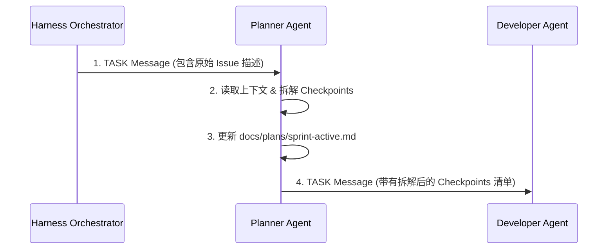
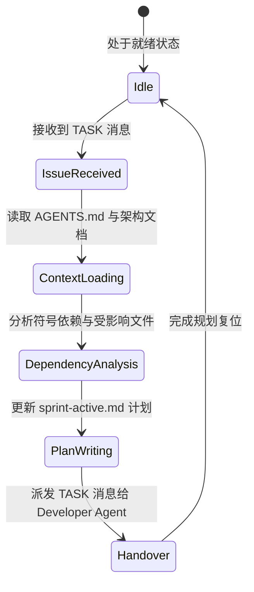

# Enterprise AI Harness - Planner Agent Design Specification
> 企业级 AI 数字员工平台——Planner Agent（任务规划器）设计说明书 (V1.0)

---

## 1. 职责与物理边界 (Role & Physical Boundaries)

Planner Agent 是 Harness 体系中的**需求解构者与架构规划器**。

### 1.1 核心职责（只能做什么）：
- **需求理解 (Requirement Ingestion)**：读取自然语言 Issue，结合系统上下文理解业务意图。
- **任务拆解 (Task Decomposition)**：将复杂 Issue 拆解为原子的、可测量的 Checkpoints。
- **依赖分析 (Dependency Analysis)**：厘清后端 API、数据库 ORM、前端 UI 之间的依赖次序。
- **计划生成 (Plan Generation)**：向 [docs/plans/sprint-active.md](file:///g:/LLM_Learning/product/docs/plans/sprint-active.md) 写入排期，生成规范的 Task 实施计划。

### 1.2 物理红线禁令（绝对不能做什么）：
- ❌ **禁止编写应用代码**：严禁创建或修改 `backend/` 或 `frontend/` 下的任何 `.py`、`.vue`、`.ts` 源码文件。
- ❌ **禁止修改代码逻辑**：严禁编辑数据库模型或工具集逻辑。
- ❌ **禁止执行部署与迁移**：严禁运行 `alembic` 迁移指令或 Docker 部署命令。

---

## 2. 通信协议与调用拓扑 (Communication Protocol)

### 2.1 消息接口规范
- **接收消息 (Inbound Messages)**：
  - 来自 `HarnessOrchestrator` 的 `TASK` 消息（包含原始 Issue 需求描述）。
  - 来自 `DeploymentAgent` 或 `EvaluatorAgent` 的 `RETRY` 消息（因评估不通过或部署失败需重新规划）。
- **输出消息 (Outbound Messages)**：
  - 向 `DeveloperAgent` 发送 `TASK` 消息（包含拆解后的 Checkpoints 任务体）。
  - 向 `HarnessOrchestrator` 发送 `ERROR` 消息（当需求过于模糊或不可行时）。

### 2.2 上下游调用矩阵
- **被谁调用 (Called By)**：`HarnessOrchestrator`（新 Issue 入池时）、`DeploymentAgent`（部署失败需重新规划时）。
- **调用谁 (Calls)**：通过派发 `TASK` 消息调用 `DeveloperAgent` 执行编码。



---

## 3. 阶段生命周期 (Lifecycle)



---

## 4. 记忆与上下文检索策略 (Memory & Context Retrieval)

### 4.1 记忆分层架构
- **短期会话记忆 (Short-Term)**：单次任务的 Issue Raw Text、拆解草案与受影响符号表。
- **长期系统记忆 (Long-Term)**：
  - `docs/memory/system-context.md`（领域概念与术语）
  - `docs/memory/bug-history.md`（历史避坑指南）
  - `docs/decision/*.md`（架构 ADR 约束）
  - [docs/Architecture.md](file:///g:/LLM_Learning/product/docs/Architecture.md)（分层拓扑）

### 4.2 渐进式上下文检索流 (Progressive Context Retrieval)

```text
[Step 1] 读取 AGENTS.md 路由 ──> [Step 2] 查阅 memory/system-context.md 对齐术语 ──>
[Step 3] 使用 grep_search 定位目标类/函数头 ──> [Step 4] view_file 查看接口定义 ──> [Step 5] 生成计划
```

---

## 5. 工具清单与安全限制 (Tools & Fail-Safe)

### 5.1 允许调用的工具集 (Read & Plan Mutation Only)
- `view_file`：查看文件头与接口定义（限定读）。
- `grep_search`：搜索 Class 与 API 路由符号。
- `list_dir`：查看目录结构。
- `ast_parser`：解析代码依赖树。
- `md_patch_tool`：**仅允许用于修改 `docs/plans/sprint-active.md`**。

### 5.2 兜底防线 (Fail-Safe Rules)
1. **[工具拦截门禁]**：工具调用器对 Planner Agent 施加物理拦截，任何针对 `backend/`、`frontend/` 目录的 `write_to_file` 或 `replace_file_content` 调用将被直接拒绝。
2. **[原子拆解限制]**：单次生成的 Task Checkpoints 数量上限设为 **5 个**。如果评估步骤超过 5 个，必须要求用户将 Issue 拆分为微型 Sub-Issue。

---

## 6. 重试与自我修正 (Retry Strategy)

当因需求描述冲突或依赖分析失败时，遵从以下重试路线：

```text
               Requirement Contradiction
                           │
                           ▼
               Retry 1: 查阅 memory/bug-history.md
               对比历史相似需求处理模式
                           │
                           ▼ (仍然存在歧义)
               Retry 2: 重新检索 docs/Architecture.md
               校验接口契约
                           │
                           ▼ (仍无法解构)
               发送 ERROR 消息向 Orchestrator 报错，要求人类澄清
```

---

## 7. Planner Checklist (核对清单)

Planner Agent 在派发任务前必须完成以下核对：

- [ ] **[需求清晰度]** 是否已完全对齐 Issue 的真实业务意图？
- [ ] **[拆解原子性]** 每个 Checkpoint 是否可以在 2 小时内由 Developer 完成？
- [ ] **[文件定位]** 计划中受修改影响的文件路径是否已 100% 显式指定？
- [ ] **[迁移识别]** 是否明确标记了物理表修改需生成 Alembic 迁移脚本？
- [ ] **[测试指引]** 计划中是否包含了对应的 pytest 测试用例编写指引？
