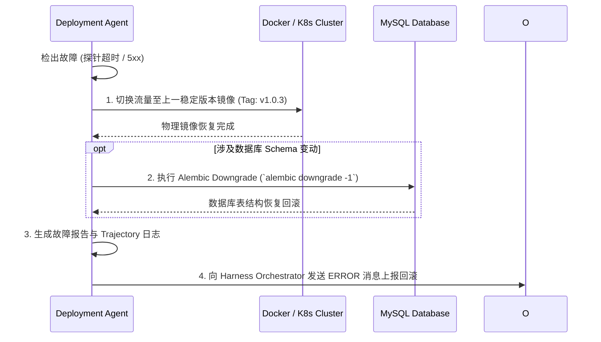

# Enterprise AI Harness - Automated & Manual Rollback Specification
> 企业级 AI 数字员工平台——版本回滚与故障恢复规范说明书 (V1.0)

---

## 1. 触发回滚的判定矩阵 (Rollback Trigger Matrix)

当部署阶段发生以下任意一种故障时，系统强制触发自动回滚流程：

| 故障现象 (Failure Event) | 检出阶段 (Phase) | 阈值标准 (Threshold) | 动作类型 (Action) |
| :--- | :--- | :--- | :--- |
| **探针响应超时或 5xx 错误** | 部署后 (Post-Deploy) | `/api/v1/health` 连续 3 次失败或耗时 > 5s | **自动回滚 (Auto)** |
| **冒烟测试用例失败** | 部署后 (Post-Deploy) | 自动化 WebSocket 对话冒烟用例 1 项失败 | **自动回滚 (Auto)** |
| **Alembic 迁移执行报错** | 部署中 (Mid-Deploy) | `alembic upgrade head` 命令抛出 Exception | **自动回滚 (Auto)** |
| **生产环境发生 Fatal Regression**| 在线监控 (Monitoring)| 线上 5xx 报错率突增 > 1% | **自动/人工回滚** |

---

## 2. 自动化回滚双轨算法 (Dual-Track Rollback Flow)

回滚必须同时涵盖**物理镜像切回**与**数据库 DDL 逆向恢复**：



---

## 3. 人工强制回滚 CLI 指令集 (Manual Rollback CLI)

当自动回滚失效或人类架构师需要紧急介入时，可使用控制台指令强制覆盖：

```bash
# 1. 镜像与服务强行回滚至上一版本
harness rollback --target-tag v1.0.3

# 2. 数据库撤销最近一次 Alembic 迁移
cd backend && alembic downgrade -1

# 3. 强制重置线程状态机
harness reset --thread-id thread_9a7d3bf0_15bd
```
